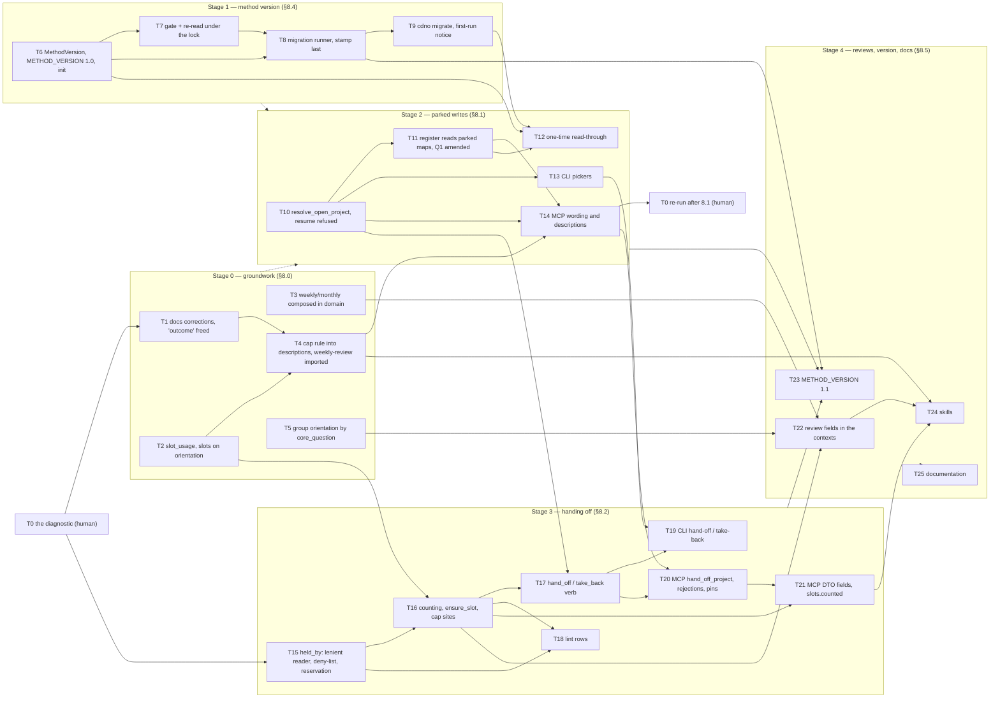

# RFC 0006 — Implementation plan

Companion to [RFC 0006 — Attention and structure](0006-attention-and-structure.md) (reviewed on
PR #779); RLM 1.1 only. T0 is a human step recorded on its own issue; T1–T25 are each meant to be
one issue and one pull request: small enough to review in one sitting, independent where the
dependency graph allows, and **done only when its probe passes**. Two rules carried over from the
RFC 0002, 0004 and 0005 plans: a green suite is not a probe (a probe asserts the specific new
behaviour, and where it guards a regression the breaking mutation is shown to fail), and
no-regression probes are differential against artefacts captured from `main`, never against a
hand-written expectation.

Conventions used here: `cdno` means the CLI built from the branch; `just ci` is the local gate
(fmt + clippy + test); every new Rust test file is registered in its crate's `tests/unit.rs` or it
never runs (CLI and MCP test targets are separate files under `tests/` and are discovered by
Cargo); **every task adds its line to `CHANGELOG.md` under `[Unreleased]`**, and each task below
names that line. A documentation sentence that a PR makes false is corrected in that PR; new pages
and the method text land in T25. The RFC's section numbers (§7.1, §8.2, …) refer to the accepted
RFC. Log lines are quoted with the em dash spelled `\u{2014}` in Rust and `—` in markdown.

**Scope.** §8.0 (groundwork, including the `core_question` grouping rehearsal), §8.4 (method
version and the migration framework), §8.1 (parked writes, the register, the one-time
read-through), §8.2 (handing off) and §8.5 (review fields), in the RFC's order: 8.0 and 8.4 → 8.1
→ 8.2 → 8.5. §8.3 (outcomes) is RFC 0007 and RLM 1.2, and is out of this plan.

**Verified against the code** (tree at `cbb8b3c`, which is `main` at v0.42.0 plus the RFC). Every
file and line the RFC cites was checked. Four corrections fall out, and the tasks below use the
corrected form:

- There are sixteen `resolve_active_project` call sites, not "about ten": thirteen switch to the
  new resolver (T10), three stay (the two start helpers `resolve_start_target` and
  `plan_unplanned_start` in `projects/actions.rs:204, 217`, which cover all four start and switch
  verbs, and `park_project` at `lifecycle.rs:207`). `resume_action` (`actions.rs:438`) calls no
  resolver at all today, so its refusal is a new check, not a kept one.
- §11 names `handlers_lifecycle.rs` for the cap rejection. No such target exists; the lifecycle
  handlers are tested in `crates/cdno-mcp/tests/handlers_operations.rs` (e.g.
  `activate_project_at_the_cap_errors`), and the probes below use it.
- §11 places the version-gate probes in `cdno-core`'s `config` and `transaction` tests. The gate
  lives in `Vault::transaction()` (`cdno-domain/src/vault/mod.rs:202`), and core's
  `VaultTransaction::new` is also what reconciliation uses (`cdno-core/src/reconcile.rs:210,
  301, 385, 410, 550`), which must not be gated. So the version type and the on-disk read are
  pinned in `cdno-core`'s `config_tests.rs`, and the gate itself in `cdno-domain`'s
  `vault_tests.rs` (T6, T7).
- §8.4 says `cdno init` writes `method_version = "1.1"`, and that the runner logs `method version
  on [[vault]]`. The first would let a binary that lacks practice 8 stamp 1.1; both review seats
  that designed §8.4 settled on `init` writing the binary's own `METHOD_VERSION`, held at 1.0
  until 8.1 and 8.2 are complete (T6, T23). The second is a body wikilink to a note that does not
  exist, which `cdno lint` reports as a dangling link on every daily note that carries it
  (`vault/lint.rs:220–232`). Decision D1 below.

## Complexity tiers

Every task carries a tier so that the work can be matched to a model of the right capability
without spending high-reasoning effort on mechanical edits. The tier is assessed from what the
task requires, not from how many lines it touches.

| Tier | Meaning | Match to |
|---|---|---|
| **M — mechanical** | The pattern exists next door and is copied; the probe is a compile plus an existing test shape; no new invariant, no ordering or concurrency question. | A small, fast model. |
| **S — standard** | Several files or one judgement call; an existing invariant must be kept; the design is fully specified in the RFC and the task follows it. | A mid-tier model. |
| **R — reasoning** | A new invariant, a transaction with ordering or locking hazards, a reader that must never fail, or a correctness argument that spans files. | A frontier reasoning model, with a second-model review of the diff. |

A task tiered M or S that turns out to need a decision the RFC does not make is stopped and the
decision raised on its issue, not improvised.

Tally: 4 M, 16 S, 5 R (T7, T8, T11, T15, T16), 25 tasks; T0 is a human step with no tier and no
PR. The five R tasks are the ones where a wrong answer is silent: a write that lands in a vault
migrated past the binary, a stamp that claims a migration the files never received, a promise
that quietly leaves (or a closed project's date that quietly enters) the register, a hand edit
that silently frees a slot or takes down every view, and a cap that counts the wrong maps. Each
has a mutation probe for exactly that.

## Decisions this plan takes, and the ones it raises

Taken here, from the review thread on PR #779 where the RFC compresses it:

- **The deny-list** (§10, open). Sentinels, which name the person: `me`, `I`, `myself`, and
  `(mine)` (the log's own stand-in, which someone copying from a `holder on` entry will write;
  this plan's addition). Placeholders, which name nobody: `someone`, `somebody`, `nobody`,
  `unknown`, `tbd`, `n/a`, `none`, `-`, `?`, and the blank string. Trimmed, any case. One
  function serves the reader, the verb's refusal and lint (T15). The limit is stated, not solved:
  cdno cannot know the person's own name, so the list approximates §7.2's "a map that names you is
  yours", and no config key is added for it.
- **`list_actions` on a parked map** (§10, open): switched with the other verbs, as all seats
  said (T10).
- **The sentinel refusal's code.** A new domain variant `HolderNotAName { value }`, classified
  under the existing `empty_field` code with `details: { field: "held_by", value, remedy:
  "take_back" }`, so the wire carries only the three rejections §8.2 names (T17, T20).
- **The version-gate errors over MCP** are mechanical failures, not rejection codes: no different
  argument changes the outcome (`rejection.rs`'s own test), so `classify` returns `None` for them
  and the message names both versions and the remedy (T7).
- **A malformed `method_version`** (`"1"`, `"1.1.0"`, `"v1.1"`) is a config error at load naming
  the key, the same treatment a `[focus]` typo gets (T6). The **re-read under the lock** extracts
  only `[vault].method_version`, so an unrelated config problem introduced while a server runs
  does not block its writes; a file that is no longer TOML, or a malformed version, refuses the
  write rather than falling back to the open-time value (T7).
- **The built-in project template gains no `held_by:` key.** Absent means yours, and adding the
  key would put a `templates sync` warning on every customised override (#699).

Raised, to be confirmed by the maintainer on the named task's issue before it starts:

- **D1 — the migration log line (before T8).** §8.4 prints `method version on [[vault]]` with
  `was:`/`now:`. `[[vault]]` dangles. Recommended: the shape both §8.4 seats agreed in their
  final round, `vault migrated` followed by indented `was: 1.0` / `now: 1.1`, with no wikilink; if
  the RFC's words are preferred, the same line without brackets (`method version on the vault`).
  Either way it is one constant, in the `was:`/`now:` family, and not a focus marker.
- **D2 — "changed since last week" (before T22; §10, open).** Recommended: the map file's
  modification time falls within the current ISO week, read from the index's `mtime_ns`, the same
  source the stuck scan uses (`context.rs:412–440`). It over-reports (any write counts) and never
  under-reports, which is the safe direction for a question that is asked, never concluded.
- **D3 — the review questions' wording (T24; §10, open).** The skill text in T24 is the draft;
  the maintainer's other skills follow it.

## Dependency graph

T1, T2, T3, T5 and T6 have no code prerequisites and can start in parallel once T0 is recorded.
The dotted edges are the RFC's order, not a code dependency: stage 2 changes what users see, and
the version gate and runner (stage 1) should ship in a release no later than the first stage-2
change, because binaries up to v0.42 check nothing and the gate protects only from the release
that carries it. T10 and T11 belong in the same release (RFC 0004 paired its T4 and T5 the same
way): parked writes without live dates would let a person pre-stage a deadline the register
hides.

---

## T0 — The diagnostic, by hand

**RFC.** §10 ("The diagnostic"), §11 (O4).

**What.** Not a `cdno` command and not code. Before T1 is merged, the maintainer takes the
current active set and, for each active map, applies the settled sentence, *a map counts unless I
have written down who else is moving it*, writing down the name where there is one. Optionally,
the zero-code trial: declare `[schemas.project.fields.held_by]` with `type = "string"`, `settable
= true` and `log_on_change = true`, and **no `default`** (the domain seat withdrew `default =
"me"`, which `load_schema_defaults` in `vault/templating.rs` would write into every new map), then
set the names with `cdno frontmatter set`. Today's binary counts nothing differently for it; the
trial only records the names in the maps and leaves `held_by: … → …` lines in the log, which stay
(the journal is append-only, and nothing needs to read them). Record on T0's issue how many maps
would stop counting. Repeat after T14 is merged (8.1 shipped) and record again.

**Gate.** If one map stops counting, the practice earns its place and the plan proceeds. If three
or more would, the cap is too low and no practice would hide it: stop before stage 3 and take the
result to the maintainer.

**Depends on.** Nothing. T15 depends on it: the trial's schema block must still open once
`held_by` is reserved, and T15's probe pins that.

**Deliverable.** Two comments on T0's issue. No PR, no CHANGELOG line.

**Correct means.** The practice is tried on real maps under the exact sentence the tool will
check, before any code depends on the answer.

---

## Stage 0 — groundwork (no behaviour change)

### T1 — Documentation corrections, and the word "outcome" freed

**RFC.** §8.0 bullets 1 and 2; §4 ("The cap").

**What.** `docs/design.md:347` (§5.3, "5-project cap"): the sentence "creating a 6th active
project prompts parking one first" is wrong against the code (`lifecycle.rs:124–130`); it becomes
"creating a project at the cap creates it parked; the cap is checked on activation".
`docs-site/src/concepts/business-rules.md:21–28` says the same and is corrected the same way.
`docs/design.md:349` uses "outcome" twice for closures ("both closed outcomes", "the other
outcome"): reworded to "both closed states" and "closed again the other way". The agent-facing
sentence that teaches the opposite of practice 9: the PORTFOLIO bullet of the server instructions
(`crates/cdno-mcp/src/server.rs:283–285`) and `create_portfolio`'s description
(`crates/cdno-mcp/src/creation.rs:52`) say "delivering an outcome … that is a project"; both
become "delivering a result". The module doc of `crates/cdno-domain/src/vault/closure.rs:1`
("the one outcome type") becomes "the one closure type". The doc comment on
`ClosedProjectDto.outcome` (`crates/cdno-mcp/src/dto.rs:571`) and
`docs-site/src/reference/json-output.md:117` say that this `outcome` is `completed` or `dropped`,
the closure, and never a parent (the user seat's ask; the wire field stays, §8.3).

**Deliverable.** The edits and one test.

**Depends on.** T0.

**Complexity.** M. Text in known places; the one test copies an existing pin.

**Probes.**
- `cargo test -p cdno-mcp --test server` passes with
  `no_agent_text_uses_outcome_for_a_deliverable`: the instructions and `create_portfolio`'s
  description contain neither "delivering an outcome" nor "an outcome rather". Mutation: restore
  the server.rs sentence; the test fails.
- `grep -rn "delivering an outcome\|6th active" crates docs/design.md docs-site/src` returns
  nothing.
- `mdbook build docs-site` reports no broken link.

**CHANGELOG.** "Docs: creating a project at the cap creates it parked, and the cap is checked on
activation (design §5.3 and the business-rules page corrected); the agent-facing text no longer
calls a deliverable an 'outcome' (RFC 0006 §8.0)."

**Correct means.** No page says the cap refuses creation, and no text an agent reads uses the
word the method is about to define for something else.

### T2 — `slot_usage()`, and `slots` on `get_orientation`

**RFC.** §8.0 bullets 3 and 4.

**What.** New file `crates/cdno-domain/src/vault/projects/slots.rs`: `pub struct SlotUsage {
active: usize, counted: usize, cap: u8, counted_slugs: Vec<String> }` and `Vault::slot_usage()`.
In this task `counted` uses the predicate the code has today (`status == Active` at `projects/`),
so `counted == active`; T16 swaps in `counts_toward_cap`. The five sites that compute the cap
today switch to it: `lifecycle.rs:124` (creation routing), `lifecycle.rs:262–272` (the
activation refusal, still before the locator in this task), `crates/cdno-cli/src/commands/project.rs:652`
(the "N of M slots in use" closure message), `crates/cdno-mcp/src/context.rs:143–144` (monthly)
and `:188–200` (`list_projects`). `OrientationContext` (`vault/orient.rs`) gains `slots:
SlotUsage`, and `OrientationContextDto` (`dto.rs:171`) gains `slots: ProjectSlotsDto`.

**Deliverable.** The module, the five switched sites, the orientation field, tests. A new domain
test file `slots_tests.rs`, registered.

**Depends on.** Nothing.

**Complexity.** S. One factoring over five sites in three crates, with a differential to prove
nothing moved.

**Probes.**
- `cargo test -p cdno-domain --test unit -- unit::slots_tests` passes with
  `slot_usage_counts_active_maps_only` (one active, one parked, one closed: active 1, counted 1,
  cap 5). Mutation: count parked maps; the test fails.
- `cargo test -p cdno-mcp --test handlers_context` passes with
  `orientation_carries_slots_matching_list_projects`.
- `grep -rn "max_active_projects" crates/*/src` names only `cdno-core/src/config.rs` and
  `slots.rs`.
- Differential: `list_projects` and `get_monthly_context` `slots`, and `cdno project complete
  --json`'s message, captured on `main` against a fixture vault with five active maps, are
  identical on the branch.

**CHANGELOG.** "`get_orientation` carries `slots` (active projects against the cap), matching
`list_projects`; the cap count has one home in the domain (RFC 0006 §8.0)."

**Correct means.** The cap is computed in exactly one place, and the morning read shows it.

### T3 — The weekly and monthly contexts composed in the domain

**RFC.** §8.0 bullet 3 ("hoist the weekly and monthly context composition").

**What.** New files `crates/cdno-domain/src/vault/weekly_context.rs` (`Vault::weekly_context(today)
-> WeeklyContext { week_of, logs, completed_actions, closed_projects, state_changes, commitments
}`) and `crates/cdno-domain/src/vault/monthly_context.rs` (`Vault::monthly_context(today) ->
MonthlyContext { since, completed_actions, closed_projects, parked_projects, active_questions,
portfolios, stuck_projects, stewardships, commitments, slots }`), each an `impl Vault` block, one
operation per file as CLAUDE.md asks (distinct from `weekly.rs` and `monthly.rs`, which are the
review *notes*). The handlers `get_weekly_context` and `get_monthly_context`
(`crates/cdno-mcp/src/context.rs:76–176`) become one `with_vault` call plus the DTO mapping. The
token-safety bounds (the 100-line log cap and the ~200-character state gist) stay in `cdno-mcp`:
they are interface concerns.

**Deliverable.** Two domain operations, two thinned handlers, two new test files
(`weekly_context_tests.rs`, `monthly_context_tests.rs`) registered in `tests/unit.rs`.

**Depends on.** Nothing.

**Complexity.** S. A move with a differential; the trap is moving the interface-side caps into the
domain by accident.

**Probes.**
- Differential: the JSON of `get_weekly_context` and `get_monthly_context` captured on `main`
  against the `handlers_context.rs` fixture vault (checked in under
  `crates/cdno-mcp/tests/fixtures/`, dates normalised) is identical on the branch.
- `cargo test -p cdno-domain --test unit -- unit::weekly_context_tests unit::monthly_context_tests`
  pass with one composition test each, asserting every field is filled from its source.
- `grep -n "weekly_logs\|completed_actions_between\|stuck_projects\|parked_projects" crates/cdno-mcp/src/context.rs`
  finds none of them inside the two handlers.

**CHANGELOG.** "Internal: the weekly and monthly review contexts are composed in the domain
(`Vault::weekly_context`, `Vault::monthly_context`); MCP output is unchanged (RFC 0006 §8.0)."

**Correct means.** The fields T22 adds have one home, and no client sees a byte of difference.

### T4 — The cap rule into the tool descriptions; `weekly-review` imported

**RFC.** §8.0 bullets 4, 5 and 6; §2 O7.

**What.** The server instructions are cut at 2,048 characters before the cap sentence
(`server.rs:272–276`), so an agent's whole briefing on projects is the tool descriptions. Remove
the cap mechanics from the instructions (keep "projects end, stewardships do not") and put the
rule, **as it is true today**, into the descriptions of `create_project`
(`crates/cdno-mcp/src/creation.rs:24`), `park_project` and `activate_project`
(`crates/cdno-mcp/src/lifecycle.rs:31, 92`) and `add_action` (`crates/cdno-mcp/src/operations.rs`):
creation is never refused at the cap and creates the map parked; the cap is checked on
activation; `project_cap_reached` lists the maps to choose from. The surfaces seat's drafts on
PR #779 are the starting text, minus every sentence that becomes true only with T10 (parked maps
take writes) or T17 (handing off); T14 and T20 add those. Bring `weekly-review` into
`examples/skills/weekly-review/SKILL.md` from the maintainer's current copy, edited so that every
tool it names exists and it carries no personal detail; list it in `examples/skills/README.md`.
The `create-project` skill lives outside this repository and hard-codes "5": recorded on the
issue as a hand step for the maintainer (read `slots.cap` from `get_orientation` or
`list_projects`).

**Deliverable.** Instruction and four description edits, a pin, one imported skill.

**Depends on.** T1 (the same instruction text), T2 (`slots` on orientation, which the descriptions
cite).

**Complexity.** S. Prose an agent executes, inside two existing length constraints.

**Probes.**
- `cargo test -p cdno-mcp --test server` passes with
  `cap_clause_is_pinned_on_the_four_project_descriptions`, modelled on
  `concept_method_clauses_are_pinned_on_the_tool_descriptions`: `create_project` says it is never
  refused at the cap and creates the map parked, `activate_project` names `project_cap_reached`,
  and none of the four offers handing off. The existing one-paragraph and 2,048-character tests
  and `instructions_carry_the_focus_protocol` still pass.
- A script in the PR checks every backticked tool name in `examples/skills/weekly-review/SKILL.md`
  against the advertised catalogue.

**CHANGELOG.** "The cap rule moves from the MCP server instructions, where clients cut it off,
into the `create_project`, `park_project`, `activate_project` and `add_action` descriptions;
`weekly-review` joins `examples/skills/` (RFC 0006 §8.0)."

**Correct means.** An agent that reads nothing but the tool it is about to call knows that
creation at the cap parks and that activation is where the cap bites.

### T5 — Orientation grouped by `core_question`

**RFC.** §8.0 bullet 7; §5.8; §7.3 ("or under its question"), the rehearsal for RFC 0007.

**What.** `ProjectSummary` (`crates/cdno-domain/src/vault/projects/summary.rs:27–45`) gains
`core_question: Option<String>`, filled from the frontmatter `project_summary` already parses.
`OrientationContext` gains `groups: Vec<ProjectGroup>`, `ProjectGroup { parent:
Option<GroupParent>, projects: Vec<String> }`, `GroupParent::Question(String)` (the link target,
brackets stripped), built from the summaries in hand: grouped **by the field**, never by
`question_backlinks` (`context.rs:617–650`), which buckets any link to the question, a passing
mention in Current State included, because `LinkEntry` records no source field. The flat
`projects` list is unchanged in content and order, so existing readers see nothing new; groups
follow the order of their first member. RFC 0007 adds `GroupParent::Outcome` with outcome-first
precedence. `OrientationContextDto` gains `groups`; `get_orientation`'s description says the
projects are grouped under their core question where one is set; `cdno orient`
(`crates/cdno-cli/src/commands/orient.rs`, the "Active projects" block) renders a group of two or
more as one line with its fronts.

**Deliverable.** The field, the grouping, the DTO, the renderer, tests.

**Depends on.** Nothing.

**Complexity.** S. The judgement (field, not backlinks) is the RFC's; the care is keeping
`projects` byte-identical.

**Probes.**
- `cargo test -p cdno-domain --test unit -- unit::orient_tests` passes with
  `two_projects_sharing_a_core_question_form_one_group`,
  `a_project_mentioning_a_question_in_its_state_is_not_grouped_under_it` and
  `projects_without_a_core_question_stay_ungrouped`. Mutation: build the groups from
  `question_backlinks`; the mention test fails.
- `cargo test -p cdno-cli --test orient` passes with
  `orient_renders_a_shared_question_as_one_line_with_its_fronts`.
- `cargo test -p cdno-mcp --test handlers_context` passes with `orientation_carries_groups`.
- Differential: `cdno orient --json`'s `projects` array on a fixture vault is identical to `main`.

**CHANGELOG.** "Orientation groups the projects that share a core question: `get_orientation`
carries `groups`, and `cdno orient` shows a shared question as one line with its fronts (RFC 0006
§8.0)."

**Correct means.** Three maps of one inquiry read as one undertaking in the morning, by the
stated link alone.

---

## Stage 1 — method version and the migration framework (§8.4)

### T6 — `MethodVersion`, the binary's `METHOD_VERSION`, and `cdno init`

**RFC.** §8.4 bullet 1; §7.4.

**What.** In `crates/cdno-core/src/config.rs`: `pub struct MethodVersion { major: u16, minor: u16
}` with `FromStr`/`Display` (`"1.1"`), `Ord`, and `VaultMeta.method_version:
Option<MethodVersion>` (serde through the string form; `None` reads as 1.0, unstamped). It stays in
`[vault]`, whose structs deny no unknown fields (`config.rs:52–54, 101–103`), so every released
binary ignores the key; never in a table that denies them, as `[focus]` does (`config.rs:23`). A
pure `method_version_from_str(toml: &str) -> Result<Option<MethodVersion>, ConfigError>` that
reads only that key, for T7's re-read. A malformed value is a config error naming the key. In
`cdno-domain`, new file `crates/cdno-domain/src/method_version.rs`: `pub const METHOD_VERSION:
MethodVersion` = **1.0**, exported; it moves to 1.1 only in T23, so `cdno init` never stamps 1.1
from a binary that lacks practice 8. `crates/cdno-cli/templates/default_config.toml` gains
`method_version = "1.0"` under `[vault]`, with a comment saying it is the version of the method
the vault follows, not of cdno, written by `init` and changed only by `cdno migrate`. The repo's
tracked dev vault `.cuaderno/config.toml` gains the same line by hand.

**Deliverable.** The type, the key, the constant, the template line, tests.

**Depends on.** Nothing.

**Complexity.** S. Small, but two judgements are fixed here (absent means 1.0; malformed is an
error) and the constant's home is policy.

**Probes.**
- `cargo test -p cdno-core --test unit -- unit::config_tests` passes with
  `method_version_absent_reads_as_unstamped`, `method_version_parses_major_minor`,
  `method_version_rejects_a_malformed_string_naming_the_key` (`"1"`, `"1.1.0"`, `"v1.1"`) and
  `an_unknown_vault_key_still_loads` (the `[vault]` table still accepts keys it does not know).
- `cargo test -p cdno-cli --test init` passes with `init_writes_the_binarys_method_version`: the
  written line equals `cdno_domain::METHOD_VERSION`.
- Differential: the whole suite and `cdno lint` on the dev vault are unchanged.

**CHANGELOG.** "A vault records the version of the Research Logbook Method it follows: `cdno
init` writes `[vault] method_version`; a vault without it reads as RLM 1.0. The method version is
separate from cdno's own version (RFC 0006 §8.4)."

**Correct means.** The version has one spelling, absent is a defined value, and no binary stamps
more than it implements.

### T7 — The gate in `Vault::transaction()`, re-reading the version under the lock

**RFC.** §8.4 bullet 2.

**What.** `Vault::transaction()` (`crates/cdno-domain/src/vault/mod.rs:202`) acquires the lock
(`VaultTransaction::new`, `cdno-core/src/transaction.rs:114`) and **then** reads
`.cuaderno/config.toml` through the store and extracts the version with T6's
`method_version_from_str`, never from the `VaultConfig` loaded at open (`cdno-cli/src/bootstrap.rs:80`,
`cdno-domain/src/bootstrap.rs:81`): that is what lets the remote server, which reads config once,
see a migration without a restart. A pure `method_gate(binary, vault) -> Gate` decides: vault
major ahead → `DomainError::MethodVersionAhead { vault, binary }` (remedy: upgrade cdno; reads
keep working); vault major behind → `DomainError::VaultNeedsMigration { vault, binary }` (remedy:
`cdno migrate --dry-run`); newer minor → allowed, and a once-per-process notice is set
(`Vault::take_method_notice()` yields it once); older minor → nothing. A config that is no longer
TOML, or a malformed version, refuses the write with a config error naming the file. `Vault::new`
records the same notice from the loaded config, so the warning appears once per start even
without a write. `pub(in crate::vault) fn transaction_ungated()` exists for T8's runner only, with
a doc comment saying so. Reconciliation is not gated (it builds its own `VaultTransaction`), so a
vault on a newer major still opens and reads. The known raw writes (`write_note_raw`, template
eject, save and sync, `save_config_raw`) bypass the gate as they bypass the lock: listed in
`transaction()`'s doc comment, not widened. In `cdno-mcp`, `classify` gains `MethodVersionAhead |
VaultNeedsMigration => return None` (mechanical); the stdio and HTTP binaries log the notice
through `tracing` (stdout is JSON-RPC). In `cdno-cli/src/bootstrap.rs`, the notice goes to
stderr. Lint: a vault on a newer minor is a Warning on `.cuaderno/config.toml`, a newer major an
Error.

**Deliverable.** The gate, two error variants with their `thiserror` messages, the notice, the
ungated constructor, the lint rows, the MCP arms, tests.

**Depends on.** T6.

**Complexity.** R. The read must happen under the lock and after it, from disk, on every write,
without blocking reconciliation, and without letting a half-edited config either block every
write or silently fall back to the stale value.

**Probes.**
- `cargo test -p cdno-domain --test unit -- unit::vault_tests` passes with:
  `a_write_after_an_external_major_stamp_is_refused_and_writes_nothing` (open at 1.0, write
  `method_version = "2.0"` through the store, `add_action` → `MethodVersionAhead`; the map and
  the daily note are byte-identical); `reads_keep_working_on_a_newer_major` (`Vault::new` and
  `orientation_context` succeed); `a_newer_minor_writes_and_notices_once` (two writes,
  `take_method_notice` is `Some` then `None`); `an_unrelated_config_edit_does_not_block_writes`;
  `a_config_that_is_not_toml_on_reread_refuses_the_write`;
  `the_version_is_read_after_the_lock_is_taken` (a recording store wrapper: `acquire_write_lock`
  precedes the `read_file` of the config). A table test of `method_gate` covers the older-major
  case with a synthetic binary 2.0.
- Mutation: compare against `self.config`; the external-stamp test fails. Mutation: read before
  locking; the ordering test fails.
- `cargo test -p cdno-core --test unit -- unit::config_tests` passes with
  `method_version_from_str_reads_only_the_vault_key`.
- `cargo test -p cdno-domain --test unit -- unit::lint_tests` passes with
  `a_newer_minor_vault_is_a_warning_on_the_config` and `a_newer_major_vault_is_an_error`.
- `cargo test -p cdno-mcp --test e2e_http` passes with
  `a_write_after_the_vault_is_stamped_past_the_server_is_refused`: the spawned server, then the
  config rewritten to 2.0 on disk, then `add_action` fails naming both versions.

**CHANGELOG.** "Writes re-read the vault's method version under the write lock: a vault on a newer
major version refuses writes (reads keep working), a newer minor warns once per start and in
`cdno lint`, and a long-running server learns of a migration without a restart (RFC 0006 §8.4)."

**Correct means.** No write lands in a vault that has moved past the binary, whoever moved it and
whenever.

### T8 — The migration runner, stamping last

**RFC.** §8.4 bullet 3; §7.4 (minor and major).

**What.** New file `crates/cdno-domain/src/vault/migrate.rs`, mirroring the index `MIGRATIONS`
(`cdno-core/src/index.rs:26–37`): `pub struct FileMigration { to_major: u16, description:
&'static str, plan: fn(&Vault, &mut MigrationPlan) -> Result<(), DomainError> }` and `pub const
FILE_MIGRATIONS: &[FileMigration] = &[]`, append-only, a shipped entry never edited, keyed by
target major only (under §7.4's page test a minor version has no file step, so a non-empty step
means a major). `MigrationPlan` records `(path, new content)` writes, separate from the
transaction, because `VaultTransaction` exposes nothing it has buffered. `Vault::plan_migration(binary,
steps) -> MigrationReport { from, to, steps, read_through }` (`read_through` is filled by T12) and
`Vault::migrate(at, binary, steps) -> MigrationReport`, both taking the list and the binary
version as parameters so tests inject a synthetic step. Rules: a planned write to an append-only
type (`NoteType::is_append_only`: daily, weekly, evidence, tracking) is refused before anything is
staged, and readers keep accepting every historical line shape for ever; a vault already at the
binary's version is a no-op with no stamp and no line; a newer vault is `MethodVersionAhead`. One
`transaction_ungated()` (T7), staged in this order: each step's file writes and index upserts;
then the log line (D1) through `stage_daily_log`; then **last** the stamp, built by a new
comment-preserving `toml_edit` setter `set_method_version` in `crates/cdno-core/src/config_edit.rs`
and checked by `validate_config_str` (`vault/config.rs:223`) before it is staged. Never through
`save_config_raw` or `save_config_to`. The doc comment calling `save_config_to` "the ONLY path
that writes `.cuaderno/config.toml`" (`vault/config.rs:144`) names the second writer, which holds
the lock.

**Why stamp last.** A failed commit rolls back what it applied, so the order matters little when
nothing crashes. But the transaction is not crash-safe by design. With the stamp last, a crash
or a failed rollback leaves the stamp old: a rerun re-plans (the plan is a pure function of the
current files, so a migrated file plans nothing) and completes. With the stamp first, the vault
would claim a version its files never reached, and the rerun would find nothing to do: silent and
permanent.

**Deliverable.** The module, the setter, tests. New domain test file `migrate_tests.rs`,
registered.

**Depends on.** T6, T7, and D1 confirmed.

**Complexity.** R. Stamp ordering, idempotency, the journal fence and the gate bypass each fail
silently if wrong.

**Probes.**
- `cargo test -p cdno-domain --test unit -- unit::migrate_tests` passes with:
  `an_unstamped_vault_is_stamped_with_an_empty_list_and_logs_one_line` (the config's comments and
  other keys byte-identical); `a_second_run_writes_nothing` (the store byte-identical);
  `a_synthetic_major_step_and_the_stamp_commit_together`; `the_stamp_is_the_last_write` (a
  recording store: the config is the last path written); `a_failing_step_write_leaves_the_stamp_unchanged`
  (the existing `FailingStore`); `a_rerun_after_a_partial_migration_completes_it` (the step's
  change applied by hand, no stamp: the run stamps and plans nothing for that file);
  `a_step_that_plans_a_journal_note_is_refused_before_anything_is_written`;
  `the_runner_is_not_blocked_by_the_gate_on_an_older_major`; `a_newer_vault_is_refused`.
- Mutation: stage the stamp first; `the_stamp_is_the_last_write` fails. Mutation: run through the
  gated `transaction()`; the older-major test fails.
- `cargo test -p cdno-core --test unit -- unit::config_edit_tests` passes with
  `set_method_version_inserts_under_vault_and_preserves_comments` (absent key inserted, present
  key replaced).

**CHANGELOG.** "A method-migration runner: an ordered, append-only list of file migrations keyed
by major version (empty for RLM 1.1), run in one transaction under the write lock, never touching
journal notes, and stamping the version last (RFC 0006 §8.4)."

**Correct means.** The stamp never claims more than the files are, and running twice is running
once.

### T9 — `cdno migrate`, and the first-run notice

**RFC.** §8.4 bullet 3 ("CLI-only, never run at open; `--dry-run`"); §8.1 ("no count in the
first-run notice").

**What.** New `crates/cdno-cli/src/commands/migrate.rs`: `cdno migrate [--dry-run] [--json]`. It
has no promptable argument, so it prompts and confirms nothing. The dry run prints the vault's
version (or "no method_version: 1.0"), the binary's, the file migrations ("none: additive"), the
config line it would write, the log line it would write, and a read-through section (empty until
T12); the real run prints what it did. Up to date: "vault is at RLM X; nothing to do", exit 0. A
newer vault: refused, non-zero. `--json` carries the same content. In
`crates/cdno-cli/src/bootstrap.rs`, after the vault opens: when the key is absent, or below the
binary's version, one stderr line, **with no count** (counting the register on every invocation
is the wrong cost): the vault records RLM X, this cdno implements Y, `cdno migrate --dry-run` shows
what changes. Suppressed for `cdno migrate` and `cdno init`. The T7 newer-minor notice is printed
here too. No MCP tool, never from `Vault::new`, never relayed by the MCP agent.

**Deliverable.** The verb, the notice, tests.

**Depends on.** T8.

**Complexity.** S.

**Probes.**
- `cargo test -p cdno-cli --test migrate` (new target) passes with:
  `dry_run_prints_the_plan_and_writes_nothing` (the temp vault's tree byte-identical);
  `migrate_stamps_and_logs_once`; `migrate_twice_is_a_no_op_the_second_time`;
  `migrate_json_carries_the_same_content`; `migrate_on_a_newer_vault_exits_non_zero`.
- `cargo test -p cdno-cli --test bootstrap` passes with
  `an_unstamped_vault_prints_one_notice_on_stderr_only` (`cdno orient --json`'s stdout still
  parses as JSON; stderr has one line and no digit) and
  `a_vault_at_the_binarys_version_prints_no_notice`.

**CHANGELOG.** "`cdno migrate [--dry-run]` records the method version this cdno implements in
the vault and runs any file migrations; a vault that records no method version gets a one-line
notice on stderr (RFC 0006 §8.4)."

**Correct means.** The person chooses when the vault moves, sees exactly what will change first,
and is told once per run until they do.

---

## Stage 2 — parked maps accept writes (§8.1)

### T10 — `resolve_open_project`, the thirteen callers, and `resume` refused on a parked map

**RFC.** §8.1 bullets 1 and 3; §7.1; §10 (`list_actions`).

**What.** In `crates/cdno-domain/src/vault/projects/mod.rs`, `resolve_open_project(slug)`:
`resolve_closable_project` (`:242–266`) minus the closed arm, so an active map at `projects/` or a
parked one at `projects/_parked/`, folder and status agreeing; anything else is
`ProjectNotActive`. The module doc states the rule: every project-body verb picks
`resolve_open_project` or `resolve_active_project`, and only starting, switching or resuming work,
and parking, need an active map. Switched (thirteen): `update_project_state` (`state.rs:60`),
`add_milestone`, `complete_milestone`, `drop_milestone` (`milestones.rs:112, 166, 238`),
`add_waiting_on`, `resolve_waiting_on` (`waiting.rs:39, 81`), `set_core_question`
(`core_question.rs:94`), `add_action`, `complete_action`, `drop_action`,
`promote_action_with_vars`, `list_actions` (`projects/actions.rs:684, 740, 806, 875, 947`), and
`add_action_with_note_and_vars` (`vault/actions.rs:142`), which the RFC's first draft missed:
without it `add_action` works on a parked map while `add_action --note` refuses. Kept:
`resolve_start_target` and `plan_unplanned_start` (`actions.rs:204, 217`) and `park_project`
(`lifecycle.rs:207`). `resume_action` (`actions.rs:438`): after the target `(slug, action)` is
chosen and before anything is staged, `self.resolve_active_project(&slug)?`, so a carried focus or
a pause on a since-parked map is refused as `ProjectNotActive` (status parked); `NoFocus` and
`FocusOpen` keep winning, since they are about the slot; `pause_action` stays free. The
`ProjectNotActive` message (`crates/cdno-domain/src/error.rs:90–102` and
`describe_project_status` at `:385`) keeps its variant and fields; for a parked map it says that
starting, switching or resuming work needs an active map, and so does parking.

**Tests that flip.** The `ProjectNotActive`-on-parked assertions for the switched verbs become
positive tests: `add_action_with_note_on_parked_project_errors_and_writes_nothing`
(`actions_tests.rs:130`), `update_project_state_errors_when_project_parked`,
`add_action_errors_when_project_parked`, `complete_action_errors_when_project_parked`,
`add_milestone_errors_when_project_parked`, `set_core_question_errors_when_project_parked`
(`projects_tests.rs:636, 1222, 1438, 1654, 3086`) and the rest of the parked set the PR lists one
by one. The folder-mismatch tests (`projects_tests.rs:677, 1489`: `status: parked` at
`projects/`) and every closed-map assertion stay refused.

**Deliverable.** The resolver, thirteen switched sites, the resume check, the message, one positive
test per switched verb, the flipped tests.

**Depends on.** Nothing in code; lands after stages 0 and 1 by the RFC's order, and in the same
release as T11.

**Complexity.** S. The caller list is fixed above; the one placement (resume's check after the
slot checks) is stated.

**Probes.**
- `cargo test -p cdno-domain --test unit -- unit::projects_tests unit::actions_tests` passes with
  a positive test per switched verb on a parked map (thirteen), plus
  `resume_of_a_pause_on_a_since_parked_map_is_project_not_active` and
  `resume_of_a_carried_focus_on_a_since_parked_map_is_refused`, and with
  `start_action_rejects_parked_project_and_blank_action`,
  `unplanned_start_rejects_parked_project_and_blank_action` and
  `a_parked_project_is_reported_even_with_a_focus_open` unchanged.
- Mutation: switch `resolve_start_target` to the open resolver; the start test fails. Mutation:
  drop the resume check; both resume tests fail.

**CHANGELOG.** "A parked project map is a complete map: next actions, state, milestones,
waiting-on, the core question and promotion all work on a parked project; only starting,
switching or resuming work, and parking, need it active, and resuming work on a since-parked
project is now refused (RFC 0006 §7.1, §8.1)."

**Correct means.** Parking changes what counts and when it is read, and nothing else a map does,
except that work cannot be picked up on it without activating it.

### T11 — The register reads parked maps; RFC 0004 §9 Q1 amended

**RFC.** §8.1 bullets 2 and 5; §7.1 ("is still a promise and stays in the commitments register").

**What.** In `Vault::commitments` (`crates/cdno-domain/src/vault/commitments.rs`), sources 1 and 4
at `:708` and `:822` change from `status != Active` to `!matches!(status, Active | Parked)`;
closed maps stay out, and source 3 is untouched. The doc comment at `:653–658` follows. The
"date is live" flag from the first draft is not added (it would restate `is_hard`). The
documentation that this PR makes false is corrected in it: `docs/design.md:351` and `:728`,
`docs-site/src/concepts/business-rules.md:55`, `docs-site/src/tutorials/commitments.md:20–23`,
and `get_commitments`'s description (`crates/cdno-mcp/src/context.rs:233`). **RFC 0004 §9 Q1**
(`docs/rfcs/0004-closing-projects.md:717–720`) is amended in place with one sentence: *Amended by
RFC 0006 §7.1: a parked map now takes plan writes and keeps its hard dates in the register, and
the stale-nag problem this answer solved with the freeze is solved by live dates plus
`drop_milestone` on the parked map (#611).* The restatement in its §5.1 (`:290–291`) gains a
pointer to the amendment.

**Deliverable.** Two filters, the docs, the RFC 0004 sentence, tests.

**Depends on.** T10 (same release).

**Complexity.** R. Two lines, but wrong silently in both directions (a promise that stays hidden;
a closed project's date that comes back), and `cached_project_context` (`:891–911`) swallows
parse failures with `.ok()`, so any map whose frontmatter stops parsing drops its dates without a
word: the reason T15's reader must never fail, pinned there.

**Probes.**
- `cargo test -p cdno-domain --test unit -- unit::commitments_tests` passes with
  `commitments_skips_milestones_of_parked_projects` (`:699`) flipped to
  `commitments_includes_hard_milestones_of_parked_projects`,
  `commitments_skips_action_dues_of_non_active_projects` (`:743`) flipped to
  `commitments_includes_action_dues_of_parked_projects`, and new
  `completed_and_dropped_projects_dates_stay_out` and
  `park_keeps_the_milestone_in_the_register_without_a_reindex` (on RFC 0004 T4's restaging).
- Mutation: `status != Completed` (forgetting `Dropped`); the closed test fails on its dropped
  map. Mutation: accept every status; the same test fails.
- Differential: `commitments()` on a fixture vault with no parked maps is identical to `main`.

**CHANGELOG.** "The commitments register keeps a parked project's hard milestones and action-note
due dates; closed projects' dates stay out. Parked deadlines that had dropped out come back, some
overdue: `cdno migrate --dry-run` lists them. After a downgrade to an earlier cdno they leave the
register again, with no warning (RFC 0006 §7.1, §8.1)."

**Correct means.** A date is in the register while its project is open, whatever its relationship
to the cap.

### T12 — The one-time read-through

**RFC.** §8.1 bullet 4; §7.1 ("read the parked maps once"); §7.4 ("one pass").

**What.** `Vault::parked_live_dates(today) -> Vec<CommitmentEntry>`: sources 1 and 4 restricted to
parked maps, every date rather than a window, overdue first and then by date, reusing the
register's cache. It fills `MigrationReport.read_through` (T8), so `cdno migrate --dry-run` and the
real run list the dates with their maps (T9's section). Lint: one **Warning** per overdue hard
date on a parked map, emitted only while the vault's method version is below 1.1 (a named
constant, `READ_THROUGH_BELOW = 1.1`, **not** the binary's version: the behaviour ships with T11
whatever the binary stamps), saying the date is in the register again and to drop it with `cdno
project milestone drop` or re-date it, and that `cdno migrate` records the read-through as done.
Once the vault records 1.1 the row is gone for good: a permanent lint row on parked deadlines would
be the guilt engine §6 P1's bound forbids. Over MCP the row arrives only when the agent runs
`lint`; no orientation field, no new tool, nothing relayed every session.

**Deliverable.** The query, the report field, the lint row, tests.

**Depends on.** T6, T9, T11.

**Complexity.** S.

**Probes.**
- `cargo test -p cdno-domain --test unit -- unit::commitments_tests` passes with
  `parked_live_dates_lists_overdue_first_and_omits_active_and_closed_maps`.
- `cargo test -p cdno-domain --test unit -- unit::lint_tests` passes with
  `an_overdue_parked_date_warns_while_the_vault_is_below_1_1` and
  `the_read_through_row_is_gone_once_the_vault_records_1_1`. Mutation: compare against the
  binary's version; with the binary at 1.0 the first test fails.
- `cargo test -p cdno-cli --test migrate` passes with
  `dry_run_lists_the_parked_hard_dates_overdue_first`.

**CHANGELOG.** "A one-time read-through of parked deadlines: `cdno migrate --dry-run` lists the
hard dates on parked maps that are back in the register, overdue first, and `cdno lint` warns on
the overdue ones until the vault records RLM 1.1 (RFC 0006 §7.1, §8.1)."

**Correct means.** Each stale date is shown once, with the way to drop it, and then never nags
again.

### T13 — CLI pickers and completions offer parked maps

**RFC.** §8.1 bullet 3 ("The CLI project pickers list parked maps for the switched verbs").

**What.** `crates/cdno-cli/src/prompt.rs`: `prompt_open_project` (active and parked, parked
labelled `(parked)`), modelled on `prompt_closable_project` (`:326`). It replaces
`prompt_project` at every switched verb's site: in `commands/project.rs` the state, core-question,
milestone add/done/drop and waiting add/resolve handlers (`:408, :458, :836, :904, :947, :984,
:1027`), in `commands/action.rs` the add, done, drop, promote and list handlers, and
`commands/triage.rs:77` (triage routes an item to a project's actions); the PR lists each site and
its picker. `prompt_project` stays for `action start`, `action switch` and `project park`.
`crates/cdno-cli/src/completions.rs` gains `complete_open_project` for the same verbs' `--slug`
and `--project`. Help text says "(active or parked)".

**Deliverable.** One picker, one completer, the switched sites, tests.

**Depends on.** T10.

**Complexity.** M. `prompt_closable_project` is the template.

**Probes.**
- `cargo test -p cdno-cli --test project` passes with
  `milestone_add_on_a_parked_project_by_flag_succeeds` and
  `state_on_a_parked_project_by_flag_succeeds`.
- `cargo test -p cdno-cli --test action` passes with `add_on_a_parked_project_succeeds` and
  `start_on_a_parked_project_is_still_refused`.
- `cargo test -p cdno-cli --test prompt` passes with `open_picker_offers_parked_maps_labelled`
  and `start_picker_offers_active_maps_only`.

**CHANGELOG.** "The CLI's project pickers and completions offer parked projects for every verb
that now accepts them; `action start`, `action switch` and `project park` still offer active
projects only (RFC 0006 §8.1)."

**Correct means.** A person at a terminal can reach a parked map from every verb that accepts one.

### T14 — MCP: the rejection, the descriptions, and the O7 chain

**RFC.** §8.1 bullet 3; §2 O7.

**What.** `project_not_active` (`crates/cdno-mcp/src/rejection.rs:196–209`) keeps its code and
details; its doc comment and the docs-site rejection table
(`docs-site/src/reference/mcp/overview.md:95`, which today says a `parked` status "means
`activate_project` first", the advice O7 loops on) say that on a parked map it now means a focus
verb or `park_project` was refused. Descriptions rewritten for parked writes: `add_action`
(an open project, active or parked; refused only on a closed one), `complete_action`,
`drop_action`, `promote_action`, `update_project_state`, `set_core_question` (`operations.rs:231`),
the milestone and waiting-on tools (`operations.rs:93, 118, 135, 154, 171`, "an active project" →
"an open (active or parked) project"), `create_project` (a parked map takes its first actions
straight away), `park_project` (the surfaces seat's draft, naming `start_action`, `resume_action`,
`switch_action` and their unplanned forms as the only verbs that need an active map: "a map you
start work on is a map that counts"), and `resume_action` (refused on a parked project).

**Deliverable.** Message and description edits, the overview row, tests.

**Depends on.** T4, T10, T11.

**Complexity.** S.

**Probes.**
- `cargo test -p cdno-mcp --test handlers_operations` passes with
  `o7_chain_create_at_cap_then_add_action_on_the_parked_map_succeeds`,
  `start_action_on_a_parked_project_is_project_not_active` and
  `resume_action_on_a_since_parked_project_is_project_not_active`.
- `cargo test -p cdno-mcp --test server` passes with
  `park_project_names_the_verbs_that_need_an_active_map` and
  `no_switched_tool_description_says_an_active_project`.

**CHANGELOG.** "MCP: `add_action` and the milestone, waiting-on, state and core-question tools
accept a parked project; `project_not_active` on a parked project now means a focus verb or
`park_project` was refused, and the descriptions say so (RFC 0006 §8.1)."

**Correct means.** The path an agent actually takes at the cap, create then add an action, works,
and no text sends it round the activate-first loop.

---

## Stage 3 — handing off (§8.2)

### T15 — `held_by`: the lenient reader, the deny-list, the reservation

**RFC.** §8.2 "Field" and "Compatibility"; §7.2 ("a map that names you is yours"); §10 (the
zero-code trial must still open).

**What.** `ProjectFrontmatter` (`crates/cdno-domain/src/frontmatter/project.rs:96–121`) gains
`held_by: Option<String>`, read **leniently** and never through `optional_field::<String>`, which
errors on a non-string value (`cdno-core/src/frontmatter.rs:105–114`); `active_projects()`
propagates parse errors by design (`lifecycle.rs:36–50`), as do `stuck_projects` and
`stuck_project_days` (`context.rs:428–430, 469–471`), so one hand-written `held_by:
[[people/ana]]` (a nested YAML sequence) would take down create, activate, orientation,
`list_projects` and the monthly context, and would silently drop the map's dates from the register
through `cached_project_context`. The rule: the verb refuses; the parser never does. New
`crates/cdno-domain/src/frontmatter/holder.rs`: `pub enum HolderReading { Absent, Named(String),
NotAString, Yours(String), Placeholder(String) }`, one `classify_holder_text(&str)` holding the
deny-list (above), and two adapters, from `serde_yaml::Value` (the parser) and from
`serde_json::Value` (lint reads the index's frontmatter). `held_by` is `Some` only for `Named`.
`ProjectFrontmatter::counts_toward_cap(&self) -> bool { self.status == Active &&
self.held_by.is_none() }`, on the frontmatter because every cap site already holds `(path,
ProjectFrontmatter)`. Reservation: `is_reserved_key`
(`crates/cdno-domain/src/vault/set_frontmatter.rs:240`) gains project `held_by`, as `closed` is
reserved, with a doc comment saying **never** through `hard_reserved_fields`
(`type_registry.rs:397`), because `validate_reserved_schema_fields` (`type_registry.rs:253–264`)
refuses to open a vault whose config declares a hard-reserved key, and T0's trial declares this
one. No template change.

**Deliverable.** The field, the reader, the deny-list, the predicate, the reservation, tests.

**Depends on.** T0.

**Complexity.** R. A reader that must never fail and must never let a mistyped or self-naming value
free a slot, shared verbatim by three consumers; and a reservation whose obvious implementation
bricks vaults.

**Probes.**
- `cargo test -p cdno-domain --test unit -- unit::frontmatter_tests` passes with
  `held_by_that_is_not_a_string_reads_as_absent` (unquoted `[[people/ana]]`, `2`, `true`, a
  mapping), `held_by_naming_you_or_nobody_reads_as_absent_in_any_case` (a table: `" Me "`,
  `"MYSELF"`, `"(mine)"`, `"TBD"`, `"?"`, `""`) and `held_by_with_a_name_reads_as_named`
  (`"the harbour office"`, a quoted `"[[people/ana]]"`).
- `cargo test -p cdno-domain --test unit -- unit::projects_tests` passes with
  `active_projects_does_not_fail_on_an_unquoted_wikilink_holder`, `counts_toward_cap_table`
  (active/none counts; active/named does not; parked/none does not; active/`me` counts),
  `a_map_with_an_unknown_optional_key_parses_and_counts` (version skew) and
  `project_status_has_exactly_four_variants` (an exhaustive match: §6 P7's tripwire).
- `cargo test -p cdno-domain --test unit -- unit::commitments_tests` passes with
  `a_map_with_an_unreadable_holder_keeps_its_dates_in_the_register`.
- `cargo test -p cdno-domain --test unit -- unit::set_frontmatter_tests` passes with
  `held_by_is_reserved_even_when_declared_settable` (`ReservedSchemaField`), and
  `unit::vault_tests` with `a_vault_declaring_a_project_held_by_schema_field_opens`.
- Mutation: read with `optional_field::<String>`; the `active_projects` test fails. Mutation: add
  `held_by` to `hard_reserved_fields`; the vault-opens test fails. Mutation: drop the sentinel
  arm; the `counts_toward_cap_table` row for `me` fails.

**CHANGELOG.** "Project maps may carry `held_by:`, the name of whoever else is moving the map. It
is read leniently: a value that is not a plain name, or that names you (`me`, `I`, `myself`) or
nobody (`tbd`, `someone`, …), reads as absent, so the map counts and nothing fails; the key is
reserved from `set_frontmatter` (RFC 0006 §8.2)."

**Correct means.** Whatever is written in the field, every view still opens, and a map is not
counted out unless it names someone else.

### T16 — Counting: `slot_usage`, `ensure_slot`, and the cap sites

**RFC.** §8.2 "Count"; §7.2 ("The count", "The cap").

**What.** In `slots.rs` (T2): `counted` and `counted_slugs` use `counts_toward_cap`;
`pub(in crate::vault) fn ensure_slot(&self, counts_before: bool, counts_after: bool)` refuses
with `ProjectCapReached { current: counted, max: cap, active_projects: counted_slugs }` exactly
when the map did not count before, counts after, and counted maps are at the cap: §7.2's one rule
("checked whenever a map that did not count begins to count"). Sites: creation routing
(`lifecycle.rs:124`) compares counted maps (creation takes no holder, so the new map counts iff it
is created active); activation (`lifecycle.rs:260–274`) moves the check **after** `locate_project`
and calls `ensure_slot(false, held_by.is_none())`, so a parked map that names a holder activates
without a slot; take-back calls it in T17. `active_projects()` keeps its meaning (open and shown):
the pickers, completions and orientation stay on it. The stuck scan (`context.rs:412–487`) stays
over `status: active`, held maps included, so a handed-off map unchanged for a fortnight still
surfaces ("chase, or take back?"). `ProjectSummary` gains `held_by: Option<String>`, `counts:
bool` and `waiting_on_empty: bool` (no `## Waiting On`, an empty one, or only `(nothing yet)`),
computed in the pass `project_summary` already makes over the body (`summary.rs:67–90`). Starting
a focus never changes `held_by` (§6 P6). Visible precedence change: activating a missing slug at
the cap is now `NotFound`, not `ProjectCapReached`.

**Deliverable.** The predicate at every cap site, `ensure_slot`, the summary fields, tests.

**Depends on.** T2, T15.

**Complexity.** R. One rule over four cases at sites in three crates, an ordering change in
`activate`, and a scan that must deliberately not use the new predicate.

**Probes.**
- `cargo test -p cdno-domain --test unit -- unit::slots_tests` passes with
  `ensure_slot_follows_the_one_rule` (a table: not→counts at the cap refused; counts→counts,
  counts→not and not→not allowed).
- `cargo test -p cdno-domain --test unit -- unit::projects_tests` passes with
  `create_at_the_cap_counts_only_counted_maps` (five active, one held: the new map is active),
  `activating_a_held_parked_map_at_the_cap_needs_no_slot`,
  `activating_an_unheld_parked_map_at_the_cap_is_refused`,
  `cap_reached_lists_counted_maps_only` and `activating_a_missing_slug_at_the_cap_is_not_found`.
- `cargo test -p cdno-domain --test unit -- unit::context_tests` passes with
  `a_held_active_map_stays_in_the_stuck_scan_carrying_its_holder`.
- Mutation: count `status == Active` in `slot_usage`; the creation test fails. Mutation: keep the
  check before the locator; the held-parked test fails. Mutation: filter the stuck scan by
  `counts`; the stuck test fails.

**CHANGELOG.** "The cap counts the maps that are yours: an active project that names who else is
moving it does not count. `activate` checks the cap only when the map will count, and
`project_cap_reached` lists the counted maps; activating a missing project at the cap now reports
it missing (RFC 0006 §7.2, §8.2)."

**Correct means.** Every surface agrees on one count, and the cap bites exactly when a map starts
to count.

### T17 — The verb: hand off and take back

**RFC.** §8.2 "Verb"; §7.2 ("The log", "Three guards", "The asymmetry").

**What.** New `crates/cdno-domain/src/vault/projects/holder.rs`: `Vault::hand_off(at, slug,
change: HolderChange) -> Result<WriteOutcome, DomainError>`, `enum HolderChange { HandTo(String),
TakeBack }`: one operation, explicit take-back, never "holder omitted". Order: validate the input
before the lock (blank → `EmptyField { field: "held_by" }`; a sentinel or placeholder →
`HolderNotAName { value }`, whose message says that if you cannot name who has it, it is yours,
and to take it back instead; a line break → refused); open the transaction;
`resolve_open_project` (active and parked alike; closed is `ProjectNotActive`); for a hand-off,
one `current_focus(at.date())` call, as the start verbs make (`actions.rs:189–199`), and an action
on this map in focus → new `DomainError::ProjectInFocus { slug, action }` ("pause first"); for a
take-back on an active held map, `ensure_slot(false, true)`; a take-back on a parked map clears
the name only, needs no slot and does not activate. Write: the value as a double-quoted YAML
scalar with `\` and `"` escaped, always, so the tool never writes a shape the reader has to
forgive; replaced with `rewrite_field_in_frontmatter` when the key exists, inserted when absent
(`merge_fields_into_frontmatter`, `frontmatter_edit.rs:43`, does not guarantee the quotes, so
insert then rewrite, or a dedicated insert); take-back writes `held_by: null`. The same value again
is `WriteOutcome::noop` with no log. Log, in the existing mutable-field family modelled on
`format_core_question_log_entry` (`core_question.rs:137–165`): `holder on [[slug]]` with indented
`was:` / `now:`, the absent side rendered by a named constant `(mine)`; `LOG_HOLDER_PREFIX` is a
constant; not a focus marker, so `FOCUS_MARKER_PREFIXES` (`vault/lint.rs:619`) is untouched. The
index entry is upserted, so a quoted wikilink holder becomes a link row
(`cdno-core/src/extractors.rs:280–300`). `park` and the closing verbs keep `held_by` (they rewrite
one field).

**Deliverable.** The verb, two error variants, tests. New domain test file `holder_tests.rs`,
registered.

**Depends on.** T10, T16.

**Complexity.** S. Every check and its order are specified; the escaping is the one place to be
careful, and a probe holds it.

**Probes.**
- `cargo test -p cdno-domain --test unit -- unit::holder_tests` passes with:
  `hand_off_writes_a_quoted_holder_and_one_log_entry`;
  `a_holder_with_quotes_colons_and_a_wikilink_round_trips` (`Ana "the boat" O'Neil: hull` and
  `[[people/ana]]` read back as `Named`, exactly);
  `a_wikilink_holder_appears_in_the_person_notes_backlinks`;
  `sentinels_and_placeholders_are_refused_with_take_back_advice`;
  `hand_off_while_an_action_on_the_map_is_in_focus_is_project_in_focus` and
  `a_focus_on_another_project_does_not_block_a_hand_off`;
  `take_back_on_a_parked_map_at_the_cap_clears_the_name_and_leaves_it_parked`;
  `take_back_on_an_active_held_map_at_the_cap_is_refused`;
  `hand_off_on_a_closed_map_is_project_not_active`;
  `hand_off_changes_nothing_in_commitments`;
  `starting_a_focus_on_a_held_map_never_changes_its_holder` (the map byte-identical);
  `park_keeps_the_holder`; `the_same_holder_again_is_a_noop`.
- Mutation: write the value unquoted; the punctuation test fails (it reads back absent).
  Mutation: skip the focus check; the focus test fails.

**CHANGELOG.** "`Vault::hand_off` records whose move a project is, logging `holder on [[slug]]`
with `was:`/`now:` lines; taking back clears the name, is cap-checked only on an active map and
never activates a parked one; a hand-off is refused while an action on that project is in focus
(RFC 0006 §7.2, §8.2)."

**Correct means.** A holder changes only by one logged act, on the person's word, and never while
they are in the middle of the map's work.

### T18 — Lint: over the cap, and the `held_by` rows

**RFC.** §8.2 "Field" (severities) and "Surfaces" (lint); §11 (O5).

**What.** In `crates/cdno-domain/src/vault/lint.rs`, beside `project_status_issues` (`:1140`), a
`project_holder_issues(path, frontmatter)` using T15's JSON adapter, with the severities set by
`crates/cdno-domain/src/lint.rs:36–43` (Error: downstream code trips over it; Warning: it parses,
worth flagging): `NotAString` → **Error**, naming the fix (quote it: `held_by: "[[people/ana]]"`),
because the person named a holder and it is not honoured; `Yours` → **Warning** ("delete the
line; no holder means yours"); `Placeholder` → **Warning** ("name the holder or delete the line;
if you cannot name who has it, it is yours"). A vault-level **Warning** on
`.cuaderno/config.toml` when counted maps exceed the cap, naming them. The `lint_all_notes` doc
comment and the MCP `lint` description list the rows.

**Deliverable.** The rows and their tests.

**Depends on.** T15, T16.

**Complexity.** S. The split must follow the documented rule, and the message wording is part of
the contract.

**Probes.**
- `cargo test -p cdno-domain --test unit -- unit::lint_tests` passes with
  `an_unquoted_wikilink_holder_is_an_error_naming_the_fix`, `a_holder_naming_you_is_a_warning`,
  `a_placeholder_holder_is_a_warning`, `a_named_holder_is_clean` and
  `counted_maps_over_the_cap_warn` (six active at cap 5 warns; six active with one held is clean).
- `cargo test -p cdno-cli --test lint` passes with `lint_reports_the_over_cap_warning`.
- `grep -rn '"tbd"' crates/cdno-domain/src` names one site: the deny-list is not copied into lint.
- `cdno lint` from the repo root reports no new row.

**CHANGELOG.** "`cdno lint` warns when the projects that count exceed the cap, reports a
`held_by` that is not a plain name as an error, and warns on one that names you or nobody (RFC
0006 §8.2)."

**Correct means.** Every way the field can fail to mean what the person wrote is named, with its
fix.

### T19 — CLI: `project hand-off` and `project take-back`

**RFC.** §8.2 "Surfaces" (CLI).

**What.** In `crates/cdno-cli/src/commands/project.rs`: `HandOff { slug: Option<String>, to:
Option<String> }` and `TakeBack { slug: Option<String> }`, flags-and-prompts through
`gather_or_error`, `--slug` completing with `complete_open_project` (T13) and `--to` prompted
("Who has it?"), confirming only when something was prompted; both call the one domain operation.
`project list` and `project show` print the holder (`held by: …`) and whether the map counts; the
`--json` rows gain `held_by` and `counts`. The closure message's "N of M slots in use" uses the
counted figure. `cdno orient` (`commands/orient.rs:228`) draws its suggestion from maps that count
before any held one, and shows a held map's holder. Refusals render gently: `ProjectInFocus` names
`cdno action pause`; `HolderNotAName` names `cdno project take-back`; `ProjectCapReached` lists the
counted maps.

**Deliverable.** Two subcommands, the list/show/orient changes, tests.

**Depends on.** T13, T17.

**Complexity.** S. The subcommand shape is next door (`core-question`'s `--question | --clear`).

**Probes.**
- `cargo test -p cdno-cli --test project` passes with
  `hand_off_by_flags_writes_the_holder_and_logs`, `take_back_by_flags_clears_it`,
  `hand_off_without_to_non_interactive_is_missing_flag`,
  `hand_off_to_me_is_refused_with_the_take_back_advice` and
  `list_and_show_print_the_holder_and_counts`.
- `cargo test -p cdno-cli --test orient` passes with
  `the_suggestion_prefers_a_map_that_counts_over_a_held_one`.

**CHANGELOG.** "`cdno project hand-off --slug … --to …` and `cdno project take-back --slug …`;
`project list` and `show` print the holder, and `cdno orient` suggests from projects that count
(RFC 0006 §8.2)."

**Correct means.** The method's two acts have their own words in the terminal.

### T20 — MCP: `hand_off_project`, the rejections, the pins

**RFC.** §8.2 "Surfaces" (MCP); §11 (agent surface).

**What.** `hand_off_project { project, holder?, take_back? }`, exactly one of the two (refused
otherwise, as `set_core_question`'s `clear` is), through `with_vault` and `verified_write_focused`
so its payload carries `focus` like every write in `FOCUSED_WRITES`. Rejections in
`crates/cdno-mcp/src/rejection.rs`: new code `project_in_focus` with `details: { slug, action }`;
`HolderNotAName` → `empty_field` with `details: { field: "held_by", value, remedy: "take_back" }`;
`project_cap_reached` (`:184–190`) now carries counted maps in `current` and `active_projects`,
and neither its message nor its details names handing off. Descriptions: `hand_off_project` (the
surfaces seat's draft, opening "Record whose move a project is", with the holder test, "someone you
could list in Waiting On and ask what came back", "only on the person's word, with the name they
give", "never the way to make room at the cap", refused while an action on the project is in
focus); `create_project` (takes no holder; never offer to hand one off to make room);
`activate_project` (a project that will count needs a free slot; the counted list);
`park_project` (work someone else is moving stays active and is handed off). Pins: the catalogue
64 → 65 at `crates/cdno-mcp/tests/server.rs:146` (and the expected list in
`advertised_catalogue_matches_expected_surface`), `tests/e2e_stdio.rs:227` and
`tests/e2e_http.rs:178`; the read-only count stays 18 (`server.rs:196, 222`); `FOCUSED_WRITES`
17 → 18 (`tests/handlers_operations.rs:3527`).

**Deliverable.** One tool, one new code, two reclassified errors, four descriptions, the pins.

**Depends on.** T14, T17.

**Complexity.** S. `set_core_question`'s handler is the shape.

**Probes.**
- `cargo test -p cdno-mcp --test handlers_operations` passes with
  `hand_off_project_round_trips_a_quoted_wikilink_and_the_map_stops_counting`,
  `hand_off_project_takes_exactly_one_of_holder_and_take_back`,
  `hand_off_project_in_focus_is_project_in_focus`,
  `take_back_at_the_cap_is_project_cap_reached` and
  `cap_rejection_lists_counted_maps_only_and_never_names_handing_off` (no "hand" in message or
  details), and with the table test over `FOCUSED_WRITES` covering the new tool.
- `cargo test -p cdno-mcp` unit tests in `rejection.rs` pass with `project_in_focus_classifies`
  and `holder_not_a_name_classifies_as_empty_field`.
- `cargo test -p cdno-mcp --test server --test e2e_stdio --test e2e_http` pass with the new
  catalogue pins, and `server.rs` with `no_cap_text_offers_handing_off_as_a_remedy`.

**CHANGELOG.** "MCP `hand_off_project` (a holder, or `take_back: true`) with the
`project_in_focus` rejection; `project_cap_reached` lists only the projects that count. The server
advertises 65 tools (RFC 0006 §8.2)."

**Correct means.** An agent can record a hand-off only as the person said it, and nothing it reads
at the cap suggests one.

### T21 — MCP: the open-project fields and `slots.counted`

**RFC.** §8.2 "Surfaces" (DTO fields, `slots`); §11 (`slots.counted`).

**What.** `crates/cdno-mcp/src/dto.rs`: `ProjectSummaryDto` (`:46`) gains `held_by` (null when the
map is the person's own, or the value is unreadable), `counts`, `waiting_on_empty` and
`core_question`; `ProjectFrontmatterDto` (`:837`) gains `held_by`; `ProjectListEntryDto` (`:866`)
and `ProjectContextDto` (`:1044`) gain `counts`. `ProjectSlotsDto` (`:791`) gains `counted` beside
`active`, which keeps its meaning (open and shown, held or not; its doc comment is corrected; the
out-of-repo create-project skill reads it); on `list_projects`, `get_monthly_context` and
`get_orientation`. Descriptions of `list_projects` ("branch on `counts`, never on the holder's
name") and `get_orientation` (suggest today's work from projects that count; parked projects are
not listed), from the surfaces seat's drafts with the handed-off question moved to the weekly
context (T22).

**Deliverable.** The fields, two descriptions, tests.

**Depends on.** T16, T20.

**Complexity.** M. Field plumbing over `From` impls; the values are computed in T16.

**Probes.**
- `cargo test -p cdno-mcp --test handlers_context` passes with
  `slots_carry_active_counted_and_cap` (on `list_projects` and `get_orientation`, `counted <
  active` when one active map is held), `orientation_project_carries_held_by_counts_and_waiting_on_empty`,
  `list_projects_entries_carry_counts` and
  `a_map_with_an_unreadable_holder_reports_null_and_counts`.
- `cargo test -p cdno-mcp --test server` passes with
  `list_projects_says_to_branch_on_counts`.

**CHANGELOG.** "MCP: open-project summaries carry `held_by`, `counts` and `waiting_on_empty`, and
`slots` gains `counted` beside `active`, which keeps its meaning (RFC 0006 §8.2)."

**Correct means.** An agent branches on one boolean the server computed, and no existing field
changes meaning.

---

## Stage 4 — reviews, the version bump, and documentation (§8.5)

### T22 — The review fields in the weekly and monthly contexts

**RFC.** §8.5; §8.2 ("the weekly context exposes the number of days this week with a focus
started on a handed-off map"); §7.2 ("The review", the two-days guard); D2.

**What.** `WeeklyContext` (T3) gains `projects: Vec<ReviewProject>`, one per active map (held maps
included; parked maps are read monthly), each carrying the summary fields (`held_by`, `counts`,
`waiting_on_empty`, `core_question`), `changed_this_week` (D2) and `focus_days_while_held`: the
number of distinct days from the ISO Monday to today with a `started` or `resumed` head naming the
map, read with `focus_heads(date)` (`context.rs:1056`), reported for a map that names a holder and
zero otherwise. It is evidence, never a verdict: no log line has an author, and an agent moving the
map through cdno writes the same lines. `MonthlyContext` carries `held_by` on its parked and stuck
entries, so the monthly review reads parked maps by title and tells "someday" from "someone has it".
`WeeklyContextDto` and `MonthlyContextDto` map the fields. `get_weekly_context`'s description: for
a handed-off project that changed this week, ask what came back and what awaits the person's
decision, never whether it moved; the day count is evidence for the person to weigh.

**Deliverable.** The fields in both contexts and DTOs, the description, tests.

**Depends on.** T3, T5, T16; D2 confirmed.

**Complexity.** S. Fields over existing scans; the one rule (days, not lines) is stated.

**Probes.**
- `cargo test -p cdno-domain --test unit -- unit::weekly_context_tests` passes with
  `a_held_map_reports_the_days_with_work_started` (starts on Monday and Wednesday, a resume on
  Wednesday: 2), `a_map_not_held_reports_zero_days`, `changed_this_week_follows_the_map_mtime` and
  `review_projects_carry_held_by_counts_and_waiting_on_empty`. Mutation: count lines instead of
  days; the first test reads 3 and fails.
- `cargo test -p cdno-domain --test unit -- unit::monthly_context_tests` passes with
  `parked_entries_carry_their_holder`.
- `cargo test -p cdno-mcp --test handlers_context` passes with
  `weekly_context_carries_the_review_fields`.

**CHANGELOG.** "The weekly context lists each active project with `held_by`, `counts`,
`waiting_on_empty`, `changed_this_week` and, for a handed-off one, the days this week with work
started on it, as evidence for the review (RFC 0006 §8.5)."

**Correct means.** The weekly review has what it needs to ask each map the question its
relationship implies, and no field pretends to know who did the work.

### T23 — `METHOD_VERSION` 1.1

**RFC.** §7.4 ("RFC 0006 is 1.1"); §8.4; §10 ("Versioning").

**What.** `METHOD_VERSION` (`crates/cdno-domain/src/method_version.rs`) 1.0 → 1.1;
`crates/cdno-cli/templates/default_config.toml`'s literal follows (T6's test pins the two
together); the repo's dev vault `.cuaderno/config.toml` line is edited by hand to `"1.1"` (its
journal is not tracked, so the runner's log line would land in an untracked file). Lands only after
every task in stages 2 and 3, so no binary that implements 1.1 lacks practice 8.

**Deliverable.** The constant, the template line, the dev vault line, tests.

**Depends on.** T8 and all of stages 2 and 3.

**Complexity.** M.

**Probes.**
- `cargo test -p cdno-cli --test init` passes with the literal at 1.1.
- `cargo test -p cdno-cli --test bootstrap` passes with
  `an_unstamped_vault_prints_the_notice_naming_1_1` and `a_1_0_vault_prints_the_notice`.
- `cargo test -p cdno-cli --test migrate` passes with
  `migrate_stamps_1_1_lists_the_read_through_and_clears_the_lint_row`.

**CHANGELOG.** "This cdno implements RLM 1.1 (parking clarified, practice 8 handing off, the
monthly loop): `cdno init` writes `method_version = \"1.1\"`, and `cdno migrate` stamps an
existing vault after showing the parked deadlines to read through (RFC 0006 §7.4)."

**Correct means.** The version a vault is stamped with is a promise the binary keeps.

### T24 — Skills

**RFC.** §8.5; §8.0 (the create-project "5"); §11 (O6); D3.

**What.** `examples/skills/daily-orientation/SKILL.md`: suggest from projects with `counts: true`;
read the cap from `slots`, never a literal 5; show grouped projects as one line with their fronts
(`groups`); mention a handed-off map only when something has come back (the person says so, or
its Waiting On changed), never "did it move". `examples/skills/weekly-review/SKILL.md` (imported in
T4): per project, mine (`counts`): "did it move?"; handed off and `changed_this_week`: "what came
back, and what is waiting on your decision?"; handed off with `waiting_on_empty`: "a name over an
empty Waiting On is a parked map wearing a name: park it or take it back?"; `focus_days_while_held`
of two or more: offered as evidence, and the person decides whether the map is theirs again; a
held map in the stuck list: "chase, or take back?". The skill asks and never concludes.
`examples/skills/references/ADHD-PRINCIPLES.md`: a "Handing off" section, including that handing
off is never offered to make room at the cap. There is no monthly-review skill in this repository
(only `get_monthly_context`); the parked-by-title and "is it time?" questions are written into the
weekly-review skill's monthly note for the maintainer's own monthly skill to follow, with the
other out-of-repo skills (`create-project`, `weekly-planning`).

**Deliverable.** Three edited files.

**Depends on.** T4, T21, T22; D3 confirmed.

**Complexity.** S. Skill text is what the agent does; it must match the tool contracts exactly.

**Probes.**
- A script in the PR checks every backticked tool and DTO field in the three files against the
  catalogue and the output schemas.
- `grep -rniE "\b5 (active )?projects\b|five active" examples/skills/` returns nothing.
- Human (§11, O6): the weekly review run against the dev vault, with one map held and one not,
  asks at least two different questions of at least two maps; recorded on the issue.

**CHANGELOG.** "Skills: `daily-orientation` suggests from projects that count and reads the cap
from `slots`; `weekly-review` asks each project the question its relationship implies (RFC 0006
§8.5)."

**Correct means.** The shipped skills ask what the method says to ask, of the right maps.

### T25 — Documentation

**RFC.** §7.1, §7.2 and §7.4 as method text; §8 throughout.

**What.** **`docs/design.md`:** §1 gains "The method and its version": §7.4's versioning rule
(minor and major by the page test, the first-page record, the changelog of practices) and the
rhythm's monthly loop; §4's structural conventions (`:174`) describe `_parked/` as complete maps
that do not count, read at the monthly review; §5.3 gains §7.1 (parking, clarified) and §7.2
(practice 8) as method text, the optional `held_by:` in the frontmatter example, the count
("neither parked nor handed off") in the cap paragraph (`:347`), the holder in the lifecycle
paragraph (`:349`) with the `holder on [[slug]]` line; §7 (history preservation) gains the
`holder on` entry and the migration line (D1) beside `state on`; §9 documents `[vault]
method_version`; the CLI and MCP surface lists (around `:1131–1133`, `:1251`, `:1397–1414`) gain
`hand-off`, `take-back`, `migrate` and `hand_off_project`; the skills table (`:1445`) names the
weekly review's per-relationship questions. **`docs-site/src`:** `concepts/rlm.md` (practice 8
under Track 2, parking clarified under practice 4, "Monthly" in "The rhythm", a "Method version"
section carrying the changelog of practices (1.0: the seven; 1.1: parking clarified, practice 8,
the monthly loop), and a row in the mapping table); `concepts/business-rules.md` (the count,
parked writes, `held_by` and the deny-list with its stated limit); `concepts/vault-structure.md`
(`_parked/`); `concepts/configuration.md` and `reference/configuration.md` (`method_version`);
`reference/frontmatter.md` (`held_by`); `reference/cli/project.md` (`hand-off`, `take-back`, the
holder in `list` and `show`, pickers offering parked maps); new `reference/cli/migrate.md`, listed
in `SUMMARY.md` and `reference/cli/overview.md`; `reference/cli/lint.md` (the new rows);
`reference/cli/orient.md` (groups, the suggestion from counted maps); `reference/mcp/overview.md`
(65 tools; `project_in_focus`, `empty_field` for `held_by`, `project_cap_reached` listing counted
maps); `reference/mcp/reads.md` (`slots.counted`, `groups`, the summary and weekly fields);
`reference/mcp/writes.md` (parked maps take writes); `reference/mcp/creation-and-lifecycle.md`
(`hand_off_project`); `reference/mcp/with-claude-skills.md` (`weekly-review` in the examples);
`getting-started/connect-to-claude.md` (65 tools); `reference/json-output.md` (the new orient and
project-list fields); `tutorials/projects.md` (a parked map is complete; a hand-off walkthrough);
`tutorials/weekly-review.md` (the questions per relationship); `reference/troubleshooting.md` ("my
handed-off map still counts": a sentinel, a placeholder or an unquoted wikilink; "writes are
refused with a method version error"). **`CLAUDE.md`:** the history-preservation paragraph gains
`holder on [[slug]]` and the migration line, saying neither is a focus marker so neither joins
`FOCUS_MARKER_PREFIXES`; "Invariants" gains the method-migration rules (append-only list,
idempotent, one transaction under the lock, stamp last, never `save_config_raw`, never at open or
over MCP, steps never touch append-only notes, readers accept every historical line shape), the
version gate in `Vault::transaction()` with the raw writes it does not cover, and `held_by`
reserved through `is_reserved_key` only; the architecture notes state the resolver rule; the
release paragraph says the method version is not the crate version. **`STATUS.md`:** an RFC 0006
row and the tool count. **`README.md`:** the tool count. **RFC 0006**'s status line moves to
"Accepted — shipped" once the maintainer confirms. (RFC 0004 §9 Q1 is amended in place by T11, in
the PR that makes it false.)

**Deliverable.** The edits; `mdbook build docs-site` clean.

**Depends on.** Everything above.

**Complexity.** S. Everything to say is in the RFC; the work is placing it, and the method text
must stay free of tool words where §7 is free of them.

**Probes.**
- `mdbook build docs-site` reports no broken intra-book link.
- `grep -rn "64 tools" docs-site/src STATUS.md README.md` returns nothing; `grep -rn "65 tools"`
  finds the overview, the getting-started page, STATUS and README.
- `grep -n "migrate" docs-site/src/SUMMARY.md` finds the new page.
- Every CLI flag and MCP field named in the pages exists (`cdno project hand-off --help`, `cdno
  migrate --help`, the DTO schemas), checked by hand in the PR description.

**CHANGELOG.** "Documentation for RLM 1.1: parking clarified, practice 8 (handing off), the
monthly loop and the method's versioning rule in the design document and the user guide, with
`cdno migrate`, `hand-off`, `take-back` and `hand_off_project` documented (RFC 0006)."

**Correct means.** A paper user can follow the method from the guide without the tool, and a
cdno user can use every verb and field this plan added.

---

## Out of scope, by the RFC

- **§8.3 outcomes** (RFC 0007, RLM 1.2): the bundled `outcome` type, the `outcome:` link and its
  verb, typed children, outcome grouping (T5's `GroupParent` leaves room for it), the domain-only
  `closed_as` rename of `ClosedProjectEntry.outcome`, and the catalogue +2.
- **A `rhythm:` field** (§5.4, §6 P4): six months on, only if a cadence residue shows (§11).
- **Per-context ceilings** (§5.2) and any change to the cap's default.
- **An MCP tool for `cdno migrate`, or migrations run at open**: never (§8.4).
- **Proposed in review, not adopted by §8, so not here:** `method: { vault, binary }` and
  `config_stale` on `get_orientation`; a committed `rlm-1.1` fixture vault with a release-checklist
  step running the previous tag's server against it. Either can be filed as a follow-up issue.
- **The skills that live outside this repository** (`create-project`, `weekly-planning`, the
  maintainer's monthly review): they follow T24's text, outside this plan.

## Suggested order of work

T0 first, by hand. Then three tracks in parallel: **A** the groundwork, T1 and T2 → T4, with T3
and T5 alongside; **B** the method version, T6 → T7 (R) → T8 (R) → T9; **C** nothing else until A
and B have landed in a release, because the gate protects only from the release that carries it.
Stage 2 is T10 with T11 (R) in the same release, then T12, T13 and T14 in any order, then T0's
re-run. Stage 3 starts with T15 (R) and T16 (R), the last pieces of real risk; T17 follows, and
T18–T21 can then run in parallel. T22 is independent of stage 3's interface tasks once T16 is in.
T23 is the gate on calling the work 1.1, after every task in stages 2 and 3. T24 and T25 are the
tail.

## Done when

T1 to T25 are merged, T0 is recorded twice, a parked map takes every plan write and keeps its hard
dates in the register while `start` and `resume` still refuse it, a handed-off map does not count
on any surface and every hand edit of `held_by` either counts or is honoured but never breaks a
view, `cdno migrate` stamps an existing vault with RLM 1.1 after showing its parked deadlines, a
write into a vault migrated past the binary is refused, and the weekly review asks a handed-off map
what came back rather than whether it moved.
