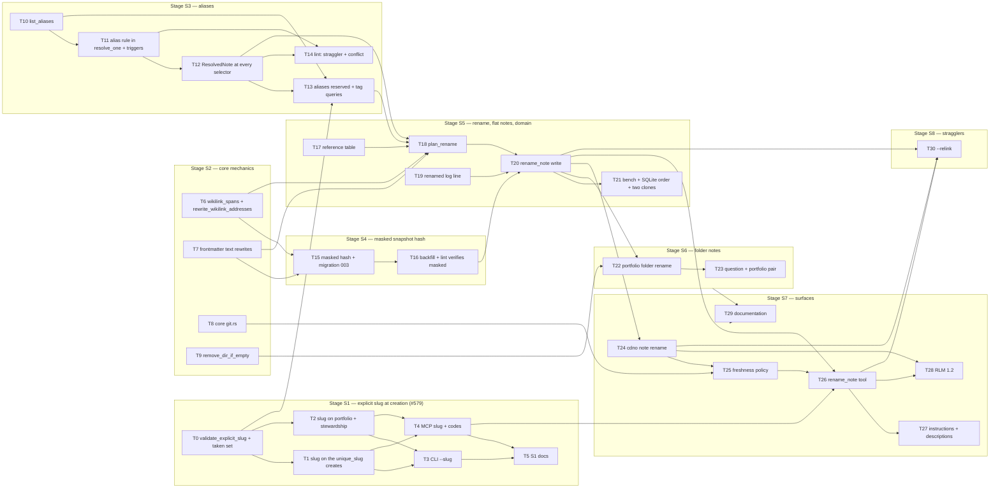

# RFC 0007 — Implementation plan

Companion to [RFC 0007 — Renaming a note](0007-renaming-notes.md) (merged as #846); tracked by
#848, with T0–T30 filed as #849–#879 in order. Each task below is meant to be one issue and one
pull request: small enough to review in one sitting,
independent where the dependency graph allows, and **done only when its probe passes**. Two rules
carried over from the RFC 0002, 0004 and 0005 plans: a green suite is not a probe (a probe asserts
the specific new behaviour, and where it guards a regression the breaking mutation is shown to
fail), and no-regression probes are differential against artefacts captured from `main`, never
against a hand-written expectation.

Conventions used here: `cdno` means the CLI built from the branch; `just ci` is the local gate
(fmt + clippy + test); every new Rust test is registered in its crate's `tests/unit.rs` or it
never runs; **every task adds its line to `CHANGELOG.md` under `[Unreleased]`**. The RFC's section
numbers (§5.4, §6.2, …) refer to the accepted RFC. `old` and `new` in a probe name stand for the
slug before and after a rename; the fixtures use the stock `surrogate-model` example. Line
numbers cited as `file:line` are as of #846's merge (`9f99ea2`) and are a place to start reading,
not a contract.

A third rule, specific to this RFC: **every probe that writes compares bytes.** The exception the
RFC makes to the append-only rule is "references only, every other byte untouched" (§5.1), and
the only way to show that is to diff the referrer before and after the operation and assert that
every differing span is inside a rewritten reference. The `differs_only_by`
function (T6) is what every later write probe calls.

## Complexity tiers

Every task carries a tier so that the work can be matched to a model of the right capability
without spending high-reasoning effort on mechanical edits. The tier is assessed from what the
task requires, not from how many lines it touches.

| Tier | Meaning | Match to |
|---|---|---|
| **M — mechanical** | The pattern exists next door and is copied; the probe is a compile plus an existing test shape; no new invariant, no ordering or concurrency question. | A small, fast model. |
| **S — standard** | Several files or one judgement call; an existing invariant must be kept; the design is fully specified in the RFC and the task follows it. | A mid-tier model. |
| **R — reasoning** | A new invariant, a transaction with ordering or rollback hazards, error-path design, or a correctness argument that spans files (the plan hash, the masked hash on a second clone, re-resolution on an alias change). | A frontier reasoning model, with a second-model review of the diff. |

A task tiered M or S that turns out to need a decision the RFC does not make is stopped and the
decision raised on its issue, not improvised.

Tally: 5 M, 18 S, 8 R (T11, T12, T16, T18, T20, T22, T25, T30). The R tasks are the ones where a
wrong answer is silent: a link that resolves to the wrong note, a snapshot that passes on one
clone and fails on the other, a write that lands on a plan the person did not see.

## Decisions this plan makes

The RFC leaves three small things unsaid that the code forces a choice on. Each is recorded here
so the task that meets it does not improvise; any of them can be overturned on the plan's issue.

- **P1 — `slugify` is idempotent on an explicit slug.** Two lookups slugify their input today:
  `resolve_paths` for stewardships (`stewardships.rs:458`) and `slug_link` for a commitment's
  `project:` / `stewardship:` value (`commitments.rs:1017`). `slugify` keeps six words, so an
  explicit seven-word slug typed into either would be cut and not found. T0 makes `slugify`
  return any string `validate_explicit_slug` accepts unchanged. The only behaviour this changes
  is a title that is already slug-shaped and longer than six words, which today is truncated.
- **P2 — `--question` on `portfolio create` is one flag, not two.** It already exists and takes
  the question's *text* (`portfolio.rs:34`), slugified to make the portfolio's slug. The RFC's
  `--question <ref>` (§5.7) is met by resolving the value first as a question reference (exact
  slug through `resolve_question_by_slug`); if a question resolves, its slug is the portfolio's;
  otherwise the value is text as today. The MCP `question` field does the same. A question whose
  text happens to be slug-shaped resolves as a reference first; the description says so.
- **P3 — `proptest` joins the workspace as a dev-dependency** of `cdno-core`, for T6's and T7's
  property tests. Nothing in the workspace has one today; a hand-rolled generator would be a
  worse version of the same thing.

## Dependency graph

Eight tasks have no prerequisites and can start on day one: T0, T6, T7, T8, T9, T10, T17 and
T19. S1 (T0–T5) ships first and on its own, as the RFC asks; S2, S3 and S4 each ship
without changing what a person sees except where stated (S3: an existing Obsidian alias starts
resolving; S4: a column). The rename itself (T20) needs S2, S3 and S4 complete.

---

## Stage S1 — explicit slug at creation (#579)

### T0 — `validate_explicit_slug` and the taken set

**What.** In `crates/cdno-domain/src/vault/slug.rs`:
`pub(in crate::vault) fn validate_explicit_slug(slug: &str) -> Result<(), SlugRejection>` with
`pub enum SlugRejection { Empty, UpperCase, BadChar(char), LeadingOrTrailingDash, DoubleDash,
TooLong { max: usize }, YamlTyped }` (§5.7: lowercase ASCII alphanumerics joined by single `-`,
no leading or trailing `-`, at most `SLUG_MAX_CHARS`, and not a value YAML 1.1 reads as a
non-string: `true`, `false`, `yes`, `no`, `on`, `off`, `null`, `~`, an integer, a float, a date
such as `2026-11-05`). `DomainError::InvalidSlug { slug, why: SlugRejection }` and
`DomainError::SlugTaken { slug, holder: VaultPath, kind: TakenBy }` with
`pub enum TakenBy { Stem, Folder, Alias }` (`Alias` is wired in T13). A new
`pub(in crate::vault) fn taken_names(&self) -> Result<HashMap<String, (VaultPath, TakenBy)>, DomainError>`
built from `index.list_all_paths()` through `note_ref::candidate_slug` (`note_ref.rs:215`), so a
folder note contributes its **folder name** as well as `_index` — `unique_slug` (`slug.rs:138`)
uses only stems today and would let a derived `surrogate-model` collide with
`portfolios/surrogate-model/_index.md`. `unique_slug` and `disambiguate_slug` take the keys of
`taken_names`. Per **P1**, `slugify` returns its input unchanged when `validate_explicit_slug`
accepts it.

**Deliverable.** The validator, the two error variants, `taken_names`, the `slugify` early return,
tests.

**Depends on.** Nothing.

**Complexity.** S. The rule is listed; the judgement (folder names are taken) is the RFC's §6.2.

**Probes.**
- `cargo test -p cdno-domain --test unit -- unit::slug_tests` passes with a table-driven
  `explicit_slug_rejections_name_their_reason` (one row per `SlugRejection`, including `2026`,
  `true`, `no`, `1e3`, `2026-11-05`, `Surrogate`, `a--b`, `-a`, `a-`, `a b`, `ä`, a 51-character
  slug), `an_explicit_slug_is_a_fixed_point_of_slugify` (`a-b-c-d-e-f-g` through `slugify` is
  itself; `A B` is still `a-b`), and `a_folder_note_takes_its_folder_name` (a vault with
  `portfolios/surrogate-model/_index.md`: `unique_slug("surrogate-model")` is
  `surrogate-model-2`). The last two need a vault; use the `vault_with_notes` shape from
  `projects_tests.rs:29`, since `slug.rs` is `pub(in crate::vault)` and the test goes through a
  create.
- Mutation: build `taken_names` from file stems only; the folder test fails.
- Differential: `slugify` over every title in `docs-site/src` and in the test fixtures gives
  the same output on `main` and the branch (a script in the PR; the only permitted difference is
  a slug-shaped title longer than six words, and the PR lists any it finds).

**Correct means.** A slug the person types is accepted or refused for a stated reason, and a
name that would shadow a folder note is never derived.

### T1 — `slug` on the creates that use `unique_slug`

**What.** `slug: Option<&str>` on `create_project_with_vars` (`projects/lifecycle.rs:115`),
`create_question_with_vars` (`questions.rs:76`), `create_action_note` (`actions.rs:52`, and so
`add_action_with_note_and_vars` and `promote_action_with_vars`), `create_custom_note_with_vars`
(`custom_notes.rs:193`) and `create_commitment_with_vars` (`commitments.rs:157`). With `Some`,
the slug is validated (`InvalidSlug`) and checked against `taken_names` (`SlugTaken`, never
suffixed). Tests seed one holder per name, since with several the reported holder follows index order. With `None`, behaviour is unchanged. The no-vars wrappers pass `None`. The custom-note
`{{slug}}` placeholder (`ENGINE_SUPPLIED_FIELDS`, `custom_notes.rs:39`) carries the explicit one.

**Deliverable.** Five signatures, their checks, tests.

**Depends on.** T0.

**Complexity.** S. One pattern applied five times; the care is that `SlugTaken` is raised before
anything is staged.

**Probes.**
- `cargo test -p cdno-domain --test unit -- unit::projects_tests` passes with
  `an_explicit_slug_names_the_file` (`--slug surrogate-calibration` with a long title gives
  `projects/surrogate-calibration.md`, and the map's `title:` is the full title) and
  `an_explicit_slug_that_is_taken_is_refused_not_suffixed` (a second create with the same slug
  is `SlugTaken { kind: Stem }` and the vault is byte-identical before and after).
- The same pair in `questions_tests`, `actions_tests` (through `add_action_with_note_and_vars`
  and `promote_action_with_vars`), `custom_notes_tests` (and the `{{slug}}` placeholder renders
  the explicit slug) and `commitments_tests`.
- Mutation: route the explicit slug through `unique_slug`; the refusal tests fail with a
  `-2` file present.

**Correct means.** An explicit slug is used exactly or not at all.

### T2 — `slug` on portfolio and stewardship creates, and `--question` as a reference

**What.** `create_portfolio_with_vars` (`portfolios.rs:119`) takes `slug: Option<&str>`; per
**P2**, its `question` argument is first tried as a question reference through
`resolve_question_by_slug` (`questions.rs:228`), and on a hit the portfolio's slug defaults to the
question's slug and the two are linked as today (`portfolios.rs:154`); otherwise `question` is
text. The reference is tried only for slug-shaped text; a hit takes the question's text as the
portfolio's title; an explicit slug beside a reference must equal the question's stem or is
refused with `PortfolioSlugMismatch`. `create_stewardship_flat_with_vars` and `create_stewardship_expanded_with_vars`
(`stewardships.rs:118`, `:166`) take `slug: Option<&str>`; `resolve_paths` (`:458`) takes the
slug when one is given. Both keep their deliberate raw-`slugify` behaviour when no slug is given
(`portfolios.rs:131`, `stewardships.rs:124`), and both check both candidate paths for `SlugTaken`
(`Folder` for a portfolio or an expanded stewardship).

**Deliverable.** Three signatures, the reference-first rule, tests.

**Depends on.** T0.

**Complexity.** S.

**Probes.**
- `cargo test -p cdno-domain --test unit -- unit::portfolios_tests` passes with
  `a_question_reference_gives_the_portfolio_its_slug` (a question created with
  `--slug surrogate-calibration` and a long text; `create_portfolio(question =
  "surrogate-calibration")` makes `portfolios/surrogate-calibration/_index.md` linked both ways),
  `question_text_still_slugifies_when_no_question_resolves`, and
  `an_explicit_portfolio_slug_that_is_a_folder_is_refused` (`SlugTaken { kind: Folder }`).
- `cargo test -p cdno-domain --test unit -- unit::stewardships_tests` passes with
  `an_explicit_stewardship_slug_is_found_by_its_slug` (create with a seven-word slug, then
  `resolve_stewardship_with_variant(slug)` finds it — this is **P1** at work) and the flat/expanded
  `SlugTaken` pair.
- Mutation: drop the **P1** early return in `slugify`; the seven-word stewardship test fails.

**Correct means.** A question created with a chosen slug keeps its portfolio correlation, and a
stewardship can be given a name its lookup still finds.

### T3 — `--slug` on the CLI create verbs

**What.** `slug: Option<String>` as `--slug`, **never prompted** and never part of the
confirmation preview, on `project create` (`project.rs:29`), `question create`
(`question.rs:30`), `portfolio create` (`portfolio.rs:34`), `action add` (`action.rs:35`; only
meaningful with `--note`, so clap `requires = "note"`), `action promote` (`action.rs:58`),
`note create` (`note.rs:25`), `stewardship create` (`stewardship.rs:32`) and `commit create`
(`commit.rs:28`). `InvalidSlug` and `SlugTaken` render as the other refusals do, and under
`--json` as a `{code, message, details}` object in the shape of `reject_json`
(`action.rs:1451`), `details` carrying `slug`, `why` or `holder` / `kind`. The `--question`
help on `portfolio create` says a question's slug is accepted (**P2**).

**Deliverable.** Eight flags, the two renderings, tests.

**Depends on.** T1, T2.

**Complexity.** M. Flag plumbing; the help text comes from the RFC.

**Probes.**
- One test per verb in its CLI target (`tests/project.rs`, `question.rs`, `portfolio.rs`,
  `action.rs`, `note.rs`, `stewardship.rs`, `commit.rs`): `create_with_slug_names_the_file`, each
  asserting the path printed and the file's existence; `action add --slug` without `--note` is a
  clap error naming `--note`.
- `cargo test -p cdno-cli --test project` passes with `a_taken_slug_is_refused_as_json`
  (`--json`: `code` is `slug_taken`, `details.kind` is `stem`) and
  `slug_is_never_prompted` (pty-driven `project create` with only `--slug` prompts for the
  title and the context, never for the slug).
- Differential: `cdno project create --help` on `main` plus one `--slug` line equals the branch.

**Correct means.** The flag exists everywhere the RFC lists it and nowhere else, and it is
never asked for.

### T4 — `slug` on the MCP create tools, and the two codes

**What.** `slug: Option<String>` on `CreateProjectInput` (`input.rs:522`), `CreateQuestionInput`
(`:705`), `CreatePortfolioInput` (`:539`), `CreateCustomNoteInput` (`:115`),
`CreateStewardshipInput` (`:720`), `AddActionInput` (`:156`; ignored unless `with_note`, and the
description says so), `PromoteActionInput` (`:277`) and `CreateCommitmentInput` (`:292`). Each
field's doc comment carries the §5.7 hint: *the slug is the name every later reference types;
propose a short one for a long title.* `RejectionCode::{InvalidSlug, SlugTaken}` in
`rejection.rs:95` with `classify` arms: `invalid_slug { slug, why }` and
`slug_taken { slug, holder, kind }`, and `PortfolioSlugMismatch` → `portfolio_slug_mismatch
{ question_slug, slug }`. `CreatePortfolioInput.question`'s description says a question's slug is
accepted. The create tools' handlers (`creation.rs:26–172`,
`operations.rs:500`, `:540`, `:780`) pass the field through.

**Deliverable.** Eight fields, three codes, tests.

**Depends on.** T1, T2.

**Complexity.** S. `classify` is exhaustive, so the compiler lists the arms; the descriptions
are the instruction surface and must say the hint.

**Probes.**
- `cargo test -p cdno-mcp --test handlers_operations` passes with
  `create_project_with_slug_names_the_file`, `an_invalid_slug_rejects_with_invalid_slug` and
  `a_taken_slug_rejects_with_slug_taken` (the
  envelope's `details.kind` is `"stem"`, `details.holder` is the path).
- `cargo test -p cdno-mcp --test server` passes with
  `every_create_tool_describes_the_slug_hint` (the eight tools' schemas carry a `slug` property
  whose description contains "every later reference").
- Differential: `tools/list` on the branch minus `main` is empty in tool names; the schema
  diff adds exactly one property to exactly eight tools.

**Correct means.** An agent reading only the schema knows to propose a short slug.

### T5 — S1 documentation and the close of #579

**What.** `--slug` on each create page under `docs-site/src/reference/cli/` (`project.md`,
`question.md`, `portfolio.md` with the **P2** note, `action.md`, `note.md`, `stewardship.md`,
`commit.md`), the `slug` field in `docs-site/src/reference/mcp/creation-and-lifecycle.md` and
`writes.md`, the `invalid_slug` / `slug_taken` codes where the other codes are listed, a
`CHANGELOG.md` entry naming #579, and `STATUS.md`'s RFC 0007 row opened. #579 closes with this
PR.

**Deliverable.** The pages, the changelog line, the status row.

**Depends on.** T3, T4.

**Complexity.** M.

**Probes.**
- `mdbook build docs-site` with no warnings.
- `grep -rn -- '--slug' docs-site/src/reference/cli/` hits all seven pages.

**Correct means.** S1 is complete and documented as a release on its own.

---

## Stage S2 — core mechanics (no behaviour change)

### T6 — `wikilink_spans` and `rewrite_wikilink_addresses`

**What.** In `crates/cdno-core/src/extractors.rs`, factor the scanner inside
`extract_wikilinks` (`:230`) into
`fn wikilink_spans(body: &str) -> Vec<WikilinkSpan>` where
`WikilinkSpan { open: usize, address: Range<usize>, target: Range<usize>, inner_end: usize, is_embed: bool }` keeps
the `start`, `after_open` and `inner_end` offsets the scanner already computes and throws away
(`:236–271`); `address` is everything between `[[` and the first `#` or `|`, trimmed, and `target` is everything before the first `|`, trimmed, anchor included. The
`protected_ranges` / `is_protected` skip (`:105`, `:141`) stays in one place. `extract_wikilinks`
is rewritten on top of it and must produce the same `Vec<WikilinkRaw>` for every input. Then
`pub fn rewrite_wikilink_addresses(text: &str, names_target: impl Fn(&str) -> bool, rewrite: impl Fn(&str) -> String) -> (String, Vec<AddressEdit>)`
(§5.4), where `AddressEdit { range: Range<usize>, replacement: String }`; it hands `names_target` the span's full `target` (as `resolve_one` sees it), hands `rewrite` the address, replaces only the `address` range of each span for which `names_target` holds, returns the edits it made, and
leaves every other byte in place — anchors, labels, the `!`, whitespace inside the brackets, code
spans and code blocks. And, in the same file, `pub fn differs_only_by(before: &str, after: &str, edits: &[AddressEdit]) -> bool`
— true exactly when `after` equals `before` with those replacements applied in order (false on overlapping or out-of-order edits) — which the
later write probes call and which T18's planner asserts on every edit it builds.

**Deliverable.** The span type, the refactor, the rewriter, `differs_only_by`, `proptest`
as a dev-dependency (**P3**), tests.

**Depends on.** Nothing.

**Complexity.** S. The scanner exists; the task is to keep its offsets and prove nothing moved.

**Probes.**
- `cargo test -p cdno-core --test unit -- unit::extractors_tests` passes with the §5.4 table as
  `address_rewrites_keep_every_other_byte` (one row per table line: `[[old]]`,
  `[[projects/old]]`, `[[projects/_parked/old]]`, `[[old#Current State]]`,
  `[[old|the calibration]]`, `![[old]]`, a code span, a fenced block, and `#action/old`, which is
  not a wikilink and must not change), `a_rewrite_reports_its_count`, and the property test
  `rewriting_then_extracting_equals_extracting_then_mapping` (for random bodies built from
  links, prose, code spans and fences: `extract_wikilinks(rewritten)` equals
  `extract_wikilinks(original)` with `rewrite` applied to the matching targets, and the bytes
  outside the spans are identical).
- Differential: `extract_wikilinks` over every `.md` under `docs-site/src`, `examples/` and the
  test fixtures gives the same output on `main` and the branch (a script in the PR).
- Mutation: rewrite the whole `[[…]]` inner text instead of the address range; the anchor and
  label rows fail.

**Correct means.** Indexing sees exactly what it saw, and a rewrite can touch nothing but an
address.

### T7 — Frontmatter rewrites as text

**What.** In `cdno-core` (a new `frontmatter_edit.rs` beside `frontmatter.rs`, or in it):
`pub fn rewrite_frontmatter_scalar(frontmatter: &str, key: &str, from: &str, to: &str) -> (String, Vec<AddressEdit>)`
(§5.4; the edits reuse T6's `AddressEdit`, so the byte check applies): a top-level `key:` whose scalar value is `from` — bare, single- or double-quoted — gets
`to` in the same quoting; nothing else moves, comments and key order included. A bare value is rewritten bare only when `to` stays a plain string there (the rule the list append applies to its value), and `to` is double-quoted otherwise.
`pub fn append_frontmatter_list_value(frontmatter: &str, key: &str, value: &str) -> (String, Vec<AddressEdit>)`
(one insertion edit, an empty range at the insertion offset, or none when `value` is already present):
extends an existing flow (`[a, b]`) or block (`- a`) list under `key`, or appends `key: [value]`
as the block's last line when the key is absent (for `aliases:`, §5.5). And
`pub fn frontmatter_changed_only_at(before: &str, after: &str, keys: &[&str]) -> Result<(), FrontmatterDrift>`:
both parsed through the existing parser, every value compared, and any difference outside
`keys` reported with the offending key (the re-parse check the plan refuses on).

**Deliverable.** Three functions, tests.

**Depends on.** Nothing.

**Complexity.** S. Text surgery with a parser-backed check behind it; the check is what makes
the surgery safe to ship.

**Probes.**
- `cargo test -p cdno-core --test unit -- unit::frontmatter_edit_tests` (new file, registered)
  passes with `scalar_rewrite_keeps_quoting_and_order` (bare, `'…'`, `"…"`; a key appearing in
  a comment is untouched; a nested key of the same name is untouched),
  `scalar_rewrite_misses_a_different_value` (count 0, bytes identical),
  `list_append_extends_flow_block_and_absent` (three fixtures), and the property test
  `a_rewrite_passes_its_own_drift_check` (random frontmatter with the key: after a rewrite,
  `frontmatter_changed_only_at(..., &[key])` is `Ok`; after a rewrite plus one unrelated byte
  changed, it names the other key).
- Mutation: compare only the rewritten key in the drift check; the second half of the property
  test fails.

**Correct means.** A frontmatter block is edited the way a person would edit it, and the code
can prove it changed nothing else.

### T8 — `cdno-core/src/git.rs`

**What.** A mechanics-only module (§5.8 (1)) with
`pub fn git_state(root: &Path) -> GitState` where
`pub enum GitState { NotARepository, Repository { paused: Option<PausedGitOp>, upstream: Option<Upstream> } }`
and `pub struct Upstream { ahead: u32, behind: u32 }` from
`git rev-list --left-right --count HEAD...@{upstream}` (as of the last fetch; `None` when there
is no upstream or the command fails). `git_operation_in_progress` moves here from
`crates/cdno-mcp/src/checkpoint.rs:558` with its three checks, and `cdno-mcp` calls the core
copy. Every call sets `GIT_TERMINAL_PROMPT=0`, runs with a two-second wait (`try_wait` loop
then `kill`), and **never fetches**. A separate
`pub fn fetch_quietly(root: &Path, timeout: Duration) -> Result<(), GitError>` exists for the CLI
(T25) and is the only function in the module that touches the network.

**Deliverable.** The module, the move, tests on real temp repositories.

**Depends on.** Nothing.

**Complexity.** S. Process plumbing with a hard rule (no network except the one function) and
one hazard (a hang), both stated.

**Probes.**
- `cargo test -p cdno-core --test unit -- unit::git_tests` (new, registered; skips with a
  message when `git` is not on `PATH`) passes with `a_plain_dir_is_not_a_repository`,
  `a_repo_with_no_upstream_reports_none`, `behind_is_counted_after_a_fetch` (a bare remote, two
  clones, one pushes, the other fetches: `behind == 1`), and
  `a_paused_merge_is_reported` (a conflicting merge left in place: `paused.is_some()`).
- `cargo test -p cdno-mcp --test e2e_git_checkpoint` unchanged (the move is behaviour-neutral).
- `grep -n "fn git_operation_in_progress" crates/cdno-mcp/src/checkpoint.rs` returns nothing.

**Correct means.** One copy of the git facts, and no function but `fetch_quietly` can block on
the network.

### T9 — `VaultStore::remove_dir_if_empty`

**What.** `fn remove_dir_if_empty(&self, dir: &VaultPath) -> Result<bool, StoreError>` on the
`VaultStore` trait (`store.rs:76`), default-implemented to return `Ok(false)`; `FsVaultStore`
removes the directory when it exists and is empty (ignoring `.DS_Store`-style hidden files is
**not** done: a non-empty directory is left alone), `MemoryVaultStore` returns `Ok(false)` (its
directories are implicit, `store.rs:167`).

**Deliverable.** The method, two impls, tests.

**Depends on.** Nothing.

**Complexity.** M.

**Probes.**
- `cargo test -p cdno-core --test unit -- unit::fs_store_tests` passes with
  `an_empty_dir_is_removed_and_a_full_one_is_kept` and `a_missing_dir_is_false_not_an_error`.

**Correct means.** Pruning can never delete anything a person wrote.

---

## Stage S3 — aliases

### T10 — `VaultIndex::list_aliases`

**What.** `fn list_aliases(&self) -> Result<Vec<(String, VaultPath)>, IndexError>` on
`VaultIndex` (`index.rs:420`): every slug-shaped string under the frontmatter key `aliases` (a
list, or a single scalar, which Obsidian also accepts) of every note, read from the
`notes.frontmatter` JSON. `SqliteIndex`: one `json_each(json_extract(frontmatter, '$.aliases'))`
query; `MemoryIndex`: a scan. Slug-shaped means `validate_explicit_slug` would accept it; the
check lives in core as a small `is_slug_shaped` (domain's validator calls it) so the index and
the validator cannot disagree. A free-text alias is simply not returned.

**Deliverable.** The method, both impls, the shape check, tests on both indexes.

**Depends on.** Nothing.

**Complexity.** S.

**Probes.**
- `cargo test -p cdno-core --test unit -- unit::vault_index_tests` and `unit::memory_index_tests`
  pass with `aliases_are_read_from_the_frontmatter_json` (a note with
  `aliases: [old-slug, "A display name"]`: exactly `("old-slug", path)`) and
  `a_scalar_alias_is_read` (`aliases: old-slug`).
- `cargo test -p cdno-core --test unit -- unit::reconcile_tests`:
  `aliases_survive_an_index_rebuild` (delete the index, reconcile, the same list).

**Correct means.** Aliases have one source, the frontmatter, and the index only indexes it.

### T11 — The alias rule in resolution, and its triggers

**What.** `resolve_one` (`extractors.rs:347`), `resolve_wikilinks` (`:331`), `target_may_name`
(`:464`) and `reresolve_stale_links` (`reconcile.rs:338`) take an `aliases: &HashMap<String, VaultPath>`
beside the path set. A final rule in `resolve_one`, after the last-segment rule and only on
**zero** stem matches: the target's last segment equals exactly one note's alias (§5.5; a stem
match, unique or ambiguous, always wins; an alias shared by two notes resolves to nothing).
`LinkEntry` (`index.rs:344`) gains `via_alias: bool`, carried through `set_link_resolutions`
(a column added in T15's migration, or a fourth migration here — one migration per stage, so
here: `003_links_via_alias.sql`). Triggers: at commit (`transaction.rs:426–444`) re-resolution
also runs when the alias set of any upserted note changed (compare the `aliases` key of the
stored `frontmatter` with the new entry's), with `consider_target` widened to the changed alias
names; at reconcile (`reconcile.rs:252–266`) also when `list_aliases()` before phase 1 differs
from after. The domain's own `resolve_wikilink` (`links.rs:61`) stops re-implementing the rule
and delegates to core with the alias map.

**Deliverable.** The parameter, the rule, the column, the two triggers, the delegation, tests.

**Depends on.** T10.

**Complexity.** R. Resolution is a pure function with a new input, and the two triggers are the
place where a stale edge would silently persist: a renamed note whose old links keep resolving
to nothing until the next path change.

**Probes.**
- `cargo test -p cdno-core --test unit -- unit::extractors_tests` passes with
  `an_alias_resolves_only_when_no_stem_matches` (alias `old` on `projects/new.md`; `[[old]]`
  resolves to it; add `notes/old.md` and `[[old]]` resolves to the stem; add a second note with
  alias `old` and it resolves to nothing), `an_alias_resolution_is_marked`.
- `cargo test -p cdno-core --test unit -- unit::transaction_tests` passes with
  `adding_an_alias_in_a_transaction_reresolves_dangling_links` (a daily note with `[[old]]`
  unresolved; a transaction writes `aliases: [old]` into `projects/new.md` with no path change;
  after commit `find_backlinks(new)` contains the daily note) and
  `removing_an_alias_unresolves_its_links`.
- `cargo test -p cdno-core --test unit -- unit::reconcile_tests`:
  `an_alias_added_outside_the_tool_reresolves_on_startup` (edit the file on disk, reconcile).
- `cargo test -p cdno-domain --test unit -- unit::links_tests`:
  `resolve_wikilink_follows_an_alias`.
- Mutation: gate the commit trigger on added/removed paths only; the transaction test fails.
- Differential: `link_resolutions()` after a full reconcile of the test fixtures is identical
  on `main` and the branch when no note has an `aliases:` key.

**Correct means.** An old name finds the note everywhere cdno resolves links, and an edge never
waits for an unrelated change to catch up.

### T12 — `ResolvedNote` at every selector

**What.** In `crates/cdno-domain/src/vault/note_ref.rs`, `resolve_note_ref` (`:237`) gains the
alias tier for `Typed` and `Bare` references: on zero candidate-slug matches, exactly one note
whose alias (from `list_aliases()`) equals the slug. `RefResolution::Resolved(VaultPath)` becomes
`Resolved(ResolvedNote)` with `pub struct ResolvedNote { path: VaultPath, slug: String, resolved_via_alias: Option<String> }`
(`slug` is the current `candidate_slug`). The per-type selectors — `locate_project`
(`projects/mod.rs:165`), `resolve_question_by_slug` (`questions.rs:228`),
`resolve_stewardship_with_variant` (`stewardships.rs:280`) and the commitment lookup — accept an
alias the same way, each through one shared `alias_of(slug) -> Option<(VaultPath, String)>`
helper so there is one rule. The log-line builders that take a slug today
(`build_created_line` in `log.rs:213`, the `format_*_log_entry` family in
`projects/actions.rs:1037–1159`, `closing.rs`, `milestones.rs`, `holder.rs`, `commitments.rs`)
take the **current** slug from a `ResolvedNote`, never the typed string, so no log line is
composed from an old name (§5.5). `find_question_path` (`questions.rs:264`) is **not** changed:
it is the correlation key and S6 keeps the pair in step.

**Deliverable.** The tier, the type, the helper, the builders' signatures, tests.

**Depends on.** T11.

**Complexity.** R. The invariant is "every path in that writes a slug into a log line goes
through a `ResolvedNote`", and it spans a dozen files; a missed builder writes the old slug into
the journal and the straggler warning (T14) is then cdno's own fault.

**Probes.**
- `cargo test -p cdno-domain --test unit -- unit::note_ref_tests` passes with
  `a_bare_alias_resolves_and_says_so` (`resolved_via_alias == Some("old")`),
  `a_typed_alias_resolves_within_its_type`, `a_stem_beats_an_alias`.
- `cargo test -p cdno-domain --test unit -- unit::projects_tests`:
  `a_state_update_by_old_name_logs_the_new_slug` (project with `aliases: [old]`;
  `update_state("old", …)`; the daily line reads `state on [[new]]`), and the same shape for
  `start_action`, `add_action`, `park`, a commitment create with `project: old`, and a question
  status change — one table-driven test per file where the builder lives.
- `grep -rn "fn format_.*log_entry\|fn build_created_line" crates/cdno-domain/src` — every hit's
  slug parameter is typed `&ResolvedNote` or `&str` fed from one; the PR lists them.
- Mutation: pass the typed slug into one builder; its table row fails.

**Correct means.** Old names work for reads and writes alike, and the journal only ever learns
the current one.

### T13 — Aliases are reserved, and tags follow them

**What.** `taken_names` (T0) includes every alias from `list_aliases()` as `TakenBy::Alias`, so
`validate`-then-check on an explicit slug refuses with `SlugTaken { kind: Alias, holder }`, and
`unique_slug` suffixes past it (§5.5, D5). `find_by_tag` queries for `#action/<slug>` (and any
`<type>/<slug>` tag form the domain reads) also match the note's aliases: the domain expands the
query to the slug plus its aliases before calling the index, so the index stays dumb.

**Deliverable.** The alias entries in the taken set, the tag expansion, tests.

**Depends on.** T0, T10, T12.

**Complexity.** S.

**Probes.**
- `cargo test -p cdno-domain --test unit -- unit::projects_tests`:
  `an_alias_is_a_taken_name_for_an_explicit_slug` (`SlugTaken { kind: Alias }`) and
  `a_derived_slug_steps_past_an_alias` (`-2`).
- `cargo test -p cdno-domain --test unit -- unit::actions_tests`:
  `a_tag_query_by_old_name_finds_the_note`.
- Mutation: drop aliases from `taken_names`; the first test fails.

**Correct means.** An old reference can never silently change referent, because its name can
never be given to anything else.

### T14 — Lint: the straggler and the conflict

**What.** In `crates/cdno-domain/src/vault/lint.rs`, the dangling-wikilink pass (`:316–345`)
resolves with the alias map; a link that resolved **only through an alias** is a Warning:
"`[[old]]` names a renamed note — now `new`" (§5.5). A second Warning when an alias equals
another note's stem or folder name: "alias `x` on `<path>` is shadowed by `<other>`" (§7: the stem
wins). Both messages name the current slug so a person can fix the link by hand until T30.

**Deliverable.** Two warnings, tests.

**Depends on.** T11, T12.

**Complexity.** S.

**Probes.**
- `cargo test -p cdno-domain --test unit -- unit::lint_tests` passes with
  `a_link_through_an_alias_is_a_straggler_warning` (message contains the new slug, severity
  Warning), `a_link_to_a_stem_is_not_a_straggler`, `an_alias_equal_to_a_stem_is_a_conflict`.
- `cargo test -p cdno-cli --test lint`: the warning renders with the path and both names.

**Correct means.** Every reference an editor cannot follow is listed, with the fix in the
message.

---

## Stage S4 — masked snapshot hash

### T15 — The masked hash and migration 003

**What.** In `cdno-core`:
`pub fn masked_content_hash(prefix: &str, reference_keys: &[&str]) -> String` — the frozen prefix
with every wikilink address (T6's spans) and every scalar under a listed frontmatter key (T7's
machinery) replaced by a fixed token, then `content_hash` (`hash.rs:20`);
`pub const MASK_VERSION: u32 = 1`. `ArchivalSnapshot` (`index.rs:384`) gains
`masked_hash: Option<String>` and `mask_version: Option<u32>`; migration
`004_snapshot_masked_hash.sql` (003 is T11's; both insert their own `schema_migrations` row,
`index.rs:268`) adds the two nullable columns; `record_archival_snapshot` /
`find_archival_snapshot` carry them on both indexes. `stage_action_archival`
(`actions.rs:204`) stamps both hashes, passing the §3.5 keys from the domain (T17's table once
it exists; until then the literal list, replaced in T17). Core knows no key: the list is a
parameter.

**Deliverable.** The function, the constant, the fields, the migration, the stamp, tests.

**Depends on.** T6, T7.

**Complexity.** S. The hash is a composition of two shipped functions; the migration is
append-only by rule.

**Probes.**
- `cargo test -p cdno-core --test unit -- unit::hash_tests`:
  `masked_hash_ignores_addresses_and_listed_fields` (two prefixes differing only in
  `[[old]]`→`[[new]]` and `project: old`→`project: new` hash equal; differing in one byte of
  prose hash differently; differing in a wikilink **label** hash differently).
- `cargo test -p cdno-core --test unit -- unit::index_tests`:
  `migration_004_adds_nullable_columns` (open a 003-level database, migrate, both columns
  present and `NULL` on an existing row).
- `cargo test -p cdno-domain --test unit -- unit::actions_tests`:
  `archival_stamps_a_masked_hash_with_its_version`.

**Correct means.** A snapshot now carries a hash that a reference rewrite cannot change.

### T16 — Backfill and the lint switch

**What.** On startup, after reconciliation, a backfill pass (`vault/mod.rs`, beside the method
skew check — it is domain policy) computes `masked_hash` for every snapshot row whose
`masked_hash` is `NULL` **and whose plain hash still verifies**, in one transaction; rows that
fail the plain hash are left `NULL` and keep failing lint as today. `check_append_only`
(`lint.rs:1153`) verifies the masked hash when present (at the stored `mask_version`; a row at an
older version is re-masked at read if the version is known, else reported as a Warning naming
the version), the plain hash otherwise; truncation below `frozen_size` stays an Error. The
stated cost (§5.4) goes into the lint row's docs: a hand edit that only re-targets a reference
inside a frozen prefix is no longer detected.

**Deliverable.** The backfill, the switch, tests.

**Depends on.** T15.

**Complexity.** R. The silent failure is the second clone: a snapshot that verifies here and
fails there. The probe builds that clone.

**Probes.**
- `cargo test -p cdno-domain --test unit -- unit::lint_tests` passes with
  `a_reference_only_rewrite_inside_a_frozen_prefix_passes_lint` (archive an action through
  the verb; through the **store**, rewrite `[[old]]`→`[[new]]` inside the frozen prefix exactly
  as T6 would; lint has no Error for it), `a_prose_edit_inside_a_frozen_prefix_is_still_an_error`,
  `a_truncated_frozen_prefix_is_still_an_error`.
- `cargo test -p cdno-core --test unit -- unit::reconcile_tests` or a new
  `cdno-domain` `snapshot_backfill_tests`: `backfill_fills_only_rows_that_verify` (two rows,
  one tampered: one filled, one `NULL`), `backfill_is_idempotent`.
- **The second clone** (`cdno-cli --test lint`, real files): vault B archives an action (its
  index holds the snapshot); copy the markdown of a rename-shaped rewrite over B's file (the
  bytes T6 would produce); reopen B; `cdno lint` reports no Error. Then the mutation: switch
  lint back to the plain hash; this test fails.

**Correct means.** A rename on one clone leaves the other clone's lint clean with nothing
synced but markdown.

---

## Stage S5 — `rename_note`, flat notes, domain only

### T17 — The reference table

**What.** In `crates/cdno-domain/src/note_type.rs`, beside `frontmatter_order` (`:89`):
`pub fn reference_fields(self) -> &'static [(&'static str, NoteType)]` — the §3.5 table exactly:
`Action: [("project", Project)]`, `Commitment: [("project", Project), ("stewardship", Stewardship)]`,
`Tracking: [("stewardship", Stewardship)]`, `Evidence: [("portfolio", Portfolio)]`,
`Inbox: [("captured_during", Project)]`, empty otherwise. `pub fn reference_keys() -> &'static [&'static str]`
(the union, for T15's mask). The writers named in the table (`actions.rs:83`,
`commitments.rs:197–198`, `tracking.rs:544`, `portfolios.rs:810`, `capture.rs:177`) and the
readers (`commitments.rs:800–911`, `context.rs:326`, `projects/actions.rs:161`,
`frontmatter/evidence.rs:51`) each reference the table's constant for the key instead of a
literal, so the table and the code cannot drift.

**Deliverable.** The table, the constant references, tests.

**Depends on.** Nothing.

**Complexity.** M.

**Probes.**
- `cargo test -p cdno-domain --test unit -- unit::note_type_tests`:
  `reference_fields_match_the_rfc_table` (the six rows, nothing else).
- `grep -rn '"project"\|"stewardship"\|"portfolio"\|"captured_during"' crates/cdno-domain/src/vault`
  hits only the table and `frontmatter_order`; the PR shows the list.

**Correct means.** Which keys are references is written once.

### T18 — `plan_rename`

**What.** A new `crates/cdno-domain/src/vault/rename.rs` with
`pub struct RenamePlan { target: ResolvedNote, new_slug: String, moves: Vec<(VaultPath, VaultPath)>, edits: Vec<PlannedEdit>, warnings: Vec<RenameWarning>, hash: String }`,
`pub struct PlannedEdit { path: VaultPath, before: String, after: String, changes: Vec<Change> }`,
`pub enum Change { Address { count: usize }, Field { key: String }, Alias, LogLine }`, and
`pub(in crate::vault) fn plan_rename(&self, snapshot: &VaultSnapshot, target: &str, new_slug: &str, reason: Option<&str>, at: NaiveDateTime) -> Result<RenamePlan, DomainError>`
where `VaultSnapshot { paths: HashSet<VaultPath>, aliases: HashMap<String, VaultPath>, contents: BTreeMap<VaultPath, String> }`
is built by the caller from **the store** (`walk_dir`, every `.md`; §5.4 — the index is not
trusted for planning) with a substring prefilter on the old slug deciding which files are parsed.
Order of refusals, each before any content is touched: `note_not_renamable { reason }` (type not
in the v1 set of §5.2, or `archived` for `actions/_done/`), `invalid_slug`, `slug_taken` (against
the snapshot's names, folders and aliases — not the index), `stem_shared` (another path in the
snapshot has the same `candidate_slug`), and a no-op when `new_slug` equals the current slug
(`Ok` with an empty plan). For every referrer: wikilink addresses through
`rewrite_wikilink_addresses` with `names_target`, given the full target as `resolve_one` sees it (anchor included), = "resolves to the target in this snapshot"
(so `[[old]]`, `[[projects/old]]`, `[[projects/_parked/old]]` and `[[old#…]]` all count, and an
ambiguous `[[old]]` is excluded because `stem_shared` already refused), then §3.5 fields through
`rewrite_frontmatter_scalar` for the keys whose target type is the target's, then
`frontmatter_changed_only_at` as the guard. The drift guard compares the frontmatter after the address rewrite (T6's edits, wikilinks inside frontmatter included) with the frontmatter after the field rewrite, so only the §3.5 fields may differ; a `DomainError::ReferenceDrift { path, drift: FrontmatterDrift }` wraps `FrontmatterDrift`; the alias append is merged as an insertion edit. The target's own edit adds `Alias`
(`append_frontmatter_list_value`); today's daily note's edit adds `LogLine` (T19's line appended
through the same pure function `stage_daily_logs` uses to place a line, extracted as
`append_log_line(content, line) -> String`). All edits of a `PlannedEdit` are expressed in `before`'s byte positions and merged in ascending order before applying (T7's frontmatter edits are relative to the frontmatter block and must be offset). **Exactly one `PlannedEdit` per path**: the daily
note's address rewrites and its log line are one `after`. A referrer under `actions/_done/`
whose snapshot's plain hash no longer verifies adds `RenameWarning::FrozenPrefixAlreadyDiverged`
and is still rewritten (§5.4). `hash` is `content_hash` over every path's `after` in path order
with the log line's stamp and today's date excluded (§6.2).

**Deliverable.** The module, the types, the planner, tests on `MemoryVaultStore`.

**Depends on.** T6, T7, T12, T13, T17.

**Complexity.** R. The planner is pure once it has a snapshot, which is what makes it testable,
but it is where every reference kind and every refusal meets; a missed kind detaches something
silently.

**Probes.**
- `cargo test -p cdno-domain --test unit -- unit::rename_tests` (new, registered) passes with,
  on a fixture holding a project, an attached action (`project: old`), a commitment
  (`project: old`), an inbox item (`captured_during: old`), a mutable project map linking
  `[[old]]`, three daily notes with `state on [[old]]`, `started [[old]]`, `during: [[old]]`, a
  `[[old|label]]` and a `[[old#Current State]]`, a portfolio index linking `[[projects/old]]`,
  a note whose frontmatter holds a nested `project: old` under another key, a code span `` `[[old]]` ``, a `#action/old` tag and an archived action with `[[old]]` in its
  frozen prefix:
  `the_plan_lists_every_reference_kind_once` (the exact set of paths and `Change`s; the code
  span and the tag are not changes), `every_edit_differs_only_by_its_reference_edits`
  (`differs_only_by` on each `before`/`after` with the edits the planner built, and each edit's
  range is an accepted address span of `wikilink_spans(before)`, as T6's property test checks),
  `a_nested_reference_key_is_not_rewritten`, `the_daily_note_has_one_after_with_the_log_line_last`, `a_rename_to_itself_is_an_empty_plan`,
  one test per refusal in the stated order (`a_taken_slug_is_refused_before_stem_shared`, …),
  `an_archived_action_is_not_renamable`, `a_shared_stem_is_refused`,
  `a_diverged_frozen_prefix_is_a_warning_not_a_refusal`, and
  `the_hash_ignores_the_stamp_and_the_date_but_not_a_referrer`.
- Mutation: plan from `find_backlinks` instead of the snapshot; the `project: old` field rows
  disappear and the first test fails. Mutation: make the field rewrite also match a nested `project: old`;
  `a_nested_reference_key_is_not_rewritten` and `every_edit_differs_only_by_its_reference_edits` fail.

**Correct means.** The plan names every reference and nothing else, refuses for one stated
reason, and can be shown to the person before anything is written.

### T19 — The `renamed` log line

**What.** `pub(in crate::vault) const LOG_RENAMED_PREFIX: &str = "renamed "` and
`LOG_WAS_KEY: &str = "was: "` beside `LOG_REASON_KEY` (`projects/actions.rs:1123`);
`format_renamed_log_entry(new_link: &str, title: &str, old_slug: &str, reason: Option<&str>)`
producing `renamed [[<new_link>]] — <title>` then the indented `was: <old-slug>` line (a copied
value, never `[[…]]`) then `reason:` only when given and non-empty after `flatten_reason` (§5.6).
`new_link` uses the type's link form (bare slug for a project, `actions/<slug>`,
`portfolios/<slug>`, the path for a custom note — the form `build_created_line` already picks per
type; reuse its chooser). Lint (`lint.rs`): `FOCUS_MARKER_PREFIXES` is generalised to a
`MARKER_PREFIXES: [(prefix, is_focus)]` list so the near-miss check (`focus_marker_claim`,
`:690`) covers `renamed` without the focus fold ever seeing it; plus a Warning when a `was:`
continuation under a `renamed` head contains `[[` ("`was:` under a rename is a copied value; a
link here is rewritten by the next rename").

**Deliverable.** The constants, the formatter, the lint list, the warning, tests.

**Depends on.** Nothing.

**Complexity.** S.

**Probes.**
- `cargo test -p cdno-domain --test unit -- unit::actions_tests` (or a new `rename_tests`
  module shared with T18): `renamed_entry_has_was_then_reason_as_continuations` (both, neither,
  a reason with an interior newline flattened; `was:` never contains `[[`).
- `cargo test -p cdno-domain --test unit -- unit::context_tests`:
  `a_renamed_line_does_not_touch_the_focus` (a start, then a `renamed` line naming the same
  project: `current_focus` unchanged).
- `cargo test -p cdno-domain --test unit -- unit::lint_tests`:
  `a_renamed_line_with_an_ascii_hyphen_is_reported` and `a_linked_was_is_a_warning`.
- Mutation: add `renamed` to the focus fold's close arms; the context test fails.

**Correct means.** The rename is on the record in the family's shape, and the record cannot be
rewritten by a later rename.

### T20 — `rename_note`: the write

**What.** In `rename.rs`:
`pub fn rename_preview(&self, target: &str, new_slug: &str, reason: Option<&str>, at: NaiveDateTime) -> Result<RenamePlan, DomainError>`
(a snapshot from the store, **no lock**, then `plan_rename`) and
`pub fn rename_note(&self, target: &str, new_slug: &str, reason: Option<&str>, expected_plan: Option<&str>, at: NaiveDateTime) -> Result<RenameOutcome, DomainError>`
with `RenameOutcome { plan: RenamePlan, written: Vec<VaultPath>, index_stale: bool }`. The
write: open the `VaultTransaction` (the lock), build the snapshot **under it**, plan again,
compare `hash` with `expected_plan` (`DomainError::StalePlan { expected, actual }` on a
difference; `None` skips the check), then stage, in this order: for the move,
`write_file(new, after)` + `delete_file(old)` — **never `move_file` for markdown**, because an
`UpsertNote` after a pure `Move` leaves the destination's links, tags and FTS stale
(`transaction.rs:469`, `latest_write_content` matches only `Write`); the `upsert_note(new)` and
`remove_note(old)`; for every other edit `write_file` + `upsert_note`; `replace_milestones` for
the moved project **and for every project in the plan** (RFC 0004 found moves dropping them;
§6.2); `replace_deadlines` likewise; the archived referrers' snapshots are untouched (their
path does not change and `upsert_note` does not cascade). `TransactionError::FileWrite { rollback_failures }`
maps to `DomainError::RenameIncomplete { failed: Vec<VaultPath> }` when the rollback list is
non-empty, else to the ordinary store error; `IndexStale` after a good file commit is
`Ok` with `index_stale: true`. `at.date()` is part of the hash's inputs only through the daily
note's path, so a rollover between preview and write is `StalePlan` (§6.2). A no-op plan writes
nothing and returns `written: []`.

**Deliverable.** The two verbs, the outcome, the error variants, tests.

**Depends on.** T16, T18, T19.

**Complexity.** R. Ordering under the lock, the plan-hash contract, rollback reporting and the
index-op subtlety all live here.

**Probes.**
- `cargo test -p cdno-domain --test unit -- unit::rename_tests` passes with, on T18's fixture:
  `a_rename_writes_exactly_the_plan` (the set of written paths equals the plan's; each file's
  bytes equal its `after`; the old path is gone; `aliases: [old]` is on the note; today's log
  has the line last), `references_resolve_after_the_rename` (`find_backlinks(new)` lists every
  referrer; `find_backlinks(old)` is empty; `project_actions(new)` still lists the attached
  action; the commitment's deadline is still the project's; `milestones_for_project(new)` is
  non-empty), `history_is_one_search_over_the_new_slug` (the `state on [[new]]` history and
  `current_focus` are unchanged in substance), `a_stale_plan_is_refused_and_writes_nothing`
  (preview, change a referrer, write with the old hash: `StalePlan`, vault byte-identical),
  `a_rollover_is_a_stale_plan`, `a_failed_write_rolls_back_byte_identical` (`FailingStore` from
  `tests/unit/support.rs:18` failing on the third write), `a_failed_rollback_is_reported_per_path`
  (a store that fails the restore too: `RenameIncomplete { failed }` names it),
  `index_stale_is_success` (an index that fails one op), `a_second_rename_extends_aliases`
  (`aliases: [old, older]`, both resolve), `renaming_back_to_an_alias_is_refused_as_taken`
  (D5: the alias is reserved while listed).
- `cargo test -p cdno-domain --test unit -- unit::concurrency_tests`:
  `a_rename_holds_the_lock_for_the_whole_plan` (`RacingStore`, `support.rs:97`: a write slipped
  in between snapshot and commit is seen because the snapshot is taken under the lock — the
  stale-plan path, not a lost update).
- Mutation: use `move_file` for the markdown move; `references_resolve_after_the_rename` fails
  on FTS or links. Mutation: snapshot before taking the lock; the concurrency test fails.

**Correct means.** The person writes exactly the plan they saw, or nothing, and afterwards every
reader of the vault agrees the note was always called by its new name.

### T21 — The bench, the SQLite order, the two clones

**What.** Three tests that the memory implementations cannot give. (1) A `#[ignore]`d
`cdno-domain` test `rename_on_two_thousand_notes_stays_under_budget` against `FsVaultStore` +
`SqliteIndex` in a temp dir: a generated vault of 2 000 notes, 300 referrers; asserts the
preview under 1 s and the write under 3 s on the CI runner's class of machine, prints both, and
the PR records the numbers (§8 S5). (2) `rename_index_ops_land_in_order_on_sqlite`: after a
rename on the SQLite index, `find_by_path(old)` is `None`, `find_by_path(new)` is `Some`,
`find_archival_snapshot` of an archived referrer is unchanged, and `links` has no row resolved
to `old`. (3) **Two clones** (`cdno-cli --test note`, real files, `git` on `PATH` or skipped):
clone A renames; clone B pulls (a bare remote between them) and opens; on B `cdno lint` is
clean, `cdno open old` finds the note through the alias, and B's archived referrer's masked
hash verifies (§10, first bullet).

**Deliverable.** Three tests, the recorded numbers.

**Depends on.** T20.

**Complexity.** S.

**Probes.** The three tests themselves; (1) is run by hand and its output pasted into the PR.

**Correct means.** The design's claims about SQLite ordering and the other clone are shown, not
argued.

---

## Stage S6 — folder notes

### T22 — Renaming a portfolio

**What.** `plan_rename` and `rename_note` handle a folder note (§5.3): `moves` lists every
file under `portfolios/old/` — markdown as `write_file(new path, after)` + `delete_file`, with
the evidence notes' `portfolio:` field rewritten through the same `Field` change and every
in-folder link's folder segment rewritten; non-markdown artefacts as `move_file` (the `Move` op,
`transaction.rs:51`), which is correct for them because they carry no index facets. Referrers
outside the folder rewrite their folder segment (`[[portfolios/old/2026-10-12-baseline]]` →
`[[portfolios/new/2026-10-12-baseline]]`, attachment embeds likewise). After commit,
`remove_dir_if_empty` (T9) on the old folder and its emptied subfolders, best-effort, with a
failure logged at `debug` and never surfaced as an error. Renaming a portfolio whose slug a
question shares is refused with `note_not_renamable { reason: "rename the question" }` until T23.

**Deliverable.** The folder branch of the planner and the writer, pruning, tests.

**Depends on.** T9, T20.

**Complexity.** R. The one transaction now moves many files of two kinds, and the plan hash
must cover the artefact moves without reading their bytes.

**Probes.**
- `cargo test -p cdno-domain --test unit -- unit::rename_tests`:
  `a_portfolio_rename_moves_every_file_and_rewrites_the_folder_segment` (index, two evidence
  notes with `portfolio: old`, one PDF artefact, a daily note embedding it, a project map
  linking `[[portfolios/old]]`: every file at the new path, nothing at the old, the PDF's bytes
  identical, every referrer resolves), `a_portfolio_rename_is_refused_while_a_question_shares_its_slug`.
- `cargo test -p cdno-cli --test portfolio` (real files): `an_emptied_folder_is_pruned` and
  `a_folder_with_a_stray_file_is_left` (a `.DS_Store`-like file: the folder stays, the rename
  still succeeded).
- Mutation: `move_file` for the evidence notes; the resolve assertion fails.

**Correct means.** A portfolio is one note to the person and moves as one.

### T23 — The question–portfolio pair

**What.** Renaming a question whose slug a portfolio shares (`find_question_path`'s
correlation, `questions.rs:264`) renames both in the one transaction and the one plan (§5.3):
two `moves`, one `hash`, one log line naming the question with an indented
`portfolio: portfolios/<new>` continuation. Renaming the portfolio alone is the T22 refusal.

**Deliverable.** The pairing, the continuation line, tests.

**Depends on.** T22.

**Complexity.** S.

**Probes.**
- `cargo test -p cdno-domain --test unit -- unit::rename_tests`:
  `a_question_rename_carries_its_portfolio` (both moved, both link each other by the new
  name, `find_question_path(new)` finds the question, one log line with the continuation),
  `a_question_without_a_portfolio_renames_alone`.
- Mutation: rename the question only; the first test's `find_question_path(new)` still passes
  but the portfolio's backlink assertion fails.

**Correct means.** The correlation the portfolio depends on survives the rename.

---

## Stage S7 — surfaces

### T24 — `cdno note rename`

**What.** `NoteCommands::Rename { note: Option<String>, to: Option<String>, reason: Option<String>, dry_run: bool, skip_sync_check: bool }`
in `crates/cdno-cli/src/commands/note.rs:22` (§6.3). The positional resolves as `note revise`
does (`open::resolve_reporting`, `note.rs:227`), and the omitted-and-interactive picker
(`pick_from_all`, `open.rs:159`) is given a filter so it lists only renamable notes; `--to` goes
through `gather_or_error` (`prompt.rs:286`); `--reason` is never prompted; `--skip-sync-check`
is wired in T25 and accepted here. Rendering: the §1.1 preview shape (`move`, `rewrite … N links
/ fields`, the totals line with the plan hash's first four characters, warnings) from
`rename_preview`; `--dry-run` prints it and exits 0 writing nothing; otherwise, when anything
was prompted, `confirm_preview` (`prompt.rs:273`) shows it and then `rename_note` is called with
the preview's hash as `expected_plan` (so the person writes what they saw even without
prompting). `--json` prints the plan plus `written` and `index_stale`, and on `--dry-run` adds
`"dry_run": true` as `cdno migrate` does (`migrate.rs:54`). Refusals render in text and, under
`--json`, as `reject_json` objects with the §6.4 codes; `RenameIncomplete` lists its paths one
per line and exits non-zero. `docs/cli-ergonomics.md`'s exception table gains the row.

**Deliverable.** The verb, the renderings, the table row, tests.

**Depends on.** T20.

**Complexity.** S.

**Probes.**
- `cargo test -p cdno-cli --test note` passes with `dry_run_prints_the_plan_and_writes_nothing`
  (byte-identical vault), `a_rename_writes_the_previewed_plan`, `the_picker_lists_only_renamable_notes`
  (pty: a daily note is not offered), `to_is_prompted_and_the_preview_confirms` (pty: Enter on
  the confirm aborts, vault byte-identical), `json_carries_the_plan_and_written`,
  `a_taken_slug_is_a_json_rejection`, `an_incomplete_rename_lists_its_paths`.
- `grep -n "note rename" docs/cli-ergonomics.md` finds the row.

**Correct means.** The preview is the contract, and the verb never writes a plan the person did
not see.

### T25 — Freshness

**What.** The §5.8 (2) policy, in the CLI handler of T24 and the MCP handler of T26 through one
shared domain-free helper in `cdno-cli` and `cdno-mcp` each (policy belongs to the interfaces;
the facts are T8's). CLI: unless `--dry-run`, `fetch_quietly(root, 5 s)` **before** the lock; a
failed or timed-out fetch prints a one-line warning and proceeds. Then `git_state`:
`NotARepository` → proceed; `paused.is_some()` → refuse with `git_operation_in_progress`, not
overridable; `behind > 0` → refuse with `behind_upstream` (the message names
`--skip-sync-check` and the sync command) unless `--skip-sync-check`; `upstream == None` or a
failed probe → warn and proceed; a dirty tree is never consulted. The paused check runs again
after `rename_note` takes the lock, which means `rename_note` takes
`guard: impl FnOnce() -> Result<(), DomainError>` called under the lock before planning — add
that parameter here, defaulting to a no-op in T20's callers. The servers never fetch and use
the upstream as last fetched; `skip_sync_check: true` is the only override.

**Deliverable.** The helper in both binaries, the guard parameter, tests on real repositories.

**Depends on.** T8, T24.

**Complexity.** R. Four states, two overrides, one of which is forbidden, and a check that must
run twice; a wrong branch either blocks every rename on the server or lets a conflicted merge
be written through.

**Probes.**
- `cargo test -p cdno-cli --test note` (git on `PATH` or skipped) passes with
  `behind_upstream_refuses_and_names_the_override`, `skip_sync_check_proceeds_when_behind`,
  `a_paused_merge_refuses_even_with_skip` , `no_upstream_warns_and_proceeds`,
  `a_dirty_tree_does_not_refuse`, `dry_run_never_fetches` (the remote is unreachable; no warning
  is printed), `a_failed_fetch_warns_and_proceeds`.
- `cargo test -p cdno-mcp --test e2e_git_checkpoint`: `rename_note_never_fetches` (an
  unreachable upstream recorded as ahead: the tool neither warns about a fetch nor blocks).
- Mutation: honour `skip_sync_check` for a paused operation; the third test fails.

**Correct means.** A rename refuses only when the vault is known to be behind or git is
mid-operation, and a person who knows better can override exactly one of those.

### T26 — The `rename_note` tool

**What.** `rename_note { note, to, reason?, dry_run?, expected_plan?, skip_sync_check? }` in
`crates/cdno-mcp/src/operations.rs` beside `revise_note` (`:373`, its model), resolving `note`
through `resolve_note_reference` (`context.rs:519`) and running through `verified_write_with`
(`verify.rs:117`) so a successful write fires the sync nudge (§5.8 (3)); a dry run does not go
through the write path and does not nudge. `RenamePlanDto { target, new_slug, moves, referrers: [{path, addresses, fields: [{key}], log_line, alias}], warnings, plan_hash }`
in `dto.rs`, returned whether or not it wrote, plus `written: bool` and `index_stale: bool`
(§6.4). Codes in `rejection.rs`: `stem_shared`, `note_not_renamable { reason }`,
`behind_upstream { remedy }`, `git_operation_in_progress`, `stale_plan { expected, actual }`,
`rename_incomplete { paths }` (`invalid_slug` and `slug_taken` exist from T4). The catalogue pins
move 65 → 66 (`tests/server.rs:148`, `e2e_stdio.rs:227`, `e2e_http.rs:178`) and the prose that
says 65 (`docs-site/src/getting-started/connect-to-claude.md:35`, `reference/mcp/overview.md:20`,
`README.md:113`, `:196`, `STATUS.md:149`).

**Deliverable.** The tool, the DTO, six codes, the pins, tests.

**Depends on.** T4, T20, T25.

**Complexity.** S.

**Probes.**
- `cargo test -p cdno-mcp --test handlers_operations` passes with
  `rename_note_dry_run_returns_the_plan_and_writes_nothing`,
  `rename_note_with_the_previewed_hash_writes`, `rename_note_with_a_stale_hash_is_stale_plan`
  (the envelope carries both hashes), `rename_note_index_stale_is_success`, and one classify
  test per new code.
- `cargo test -p cdno-mcp --test sync_nudge`: `a_written_rename_nudges_and_a_dry_run_does_not`.
- `cargo test -p cdno-mcp --test e2e_stdio`: the pin, and `rename_note_over_stdio` (preview,
  then write with `expected_plan`, then `read_note` by the old name resolves).
- Differential: `tools/list` on the branch minus `main` is exactly `{rename_note}`.

**Correct means.** An agent can preview, show, and write the same plan, and is told in a code
why it could not.

### T27 — Instructions and descriptions

**What.** The `rename_note` description (§6.4): preview, show the person, write with
`expected_plan`; and the §5.1 sentence — *a reference is an address, not content: `rename_note`
rewrites addresses in every note, the journal included, and changes no other byte; this is the
one exception to the append-only rule.* The server instructions' append-only bullet
(`server.rs:290–293`) gains the same sentence in fewer words, within the 2 048-character client
cut (`tests/server.rs:582`; move or trim another bullet if needed and say which in the PR). The
`lint` description lists the straggler warning. The eight create descriptions already carry the
slug hint (T4).

**Deliverable.** The text, a test.

**Depends on.** T26.

**Complexity.** M.

**Probes.**
- `cargo test -p cdno-mcp --test server` passes with
  `instructions_state_the_reference_exception` (the string contains "address" and "every
  other byte" or the chosen wording) and the existing `CLIENT_CUT` pin still holds with the
  exception inside the first 2 048 characters.
- `grep -n "append-only\|APPEND-ONLY" crates/cdno-mcp/src/server.rs` shows the bullet and the
  exception on adjacent lines.

**Correct means.** An agent that reads only the instructions does not refuse a rename as a
breach of the journal, and does not learn from them that the journal is editable.

### T28 — RLM 1.2

**What.** D7: a minor method version. `METHOD_VERSION` (`method_version.rs:15`) becomes
`{ major: 1, minor: 2 }` **in the same PR as nothing else**, after T24 and T26 are merged (a
binary never stamps a version whose practices it lacks). `docs-site/src/concepts/rlm.md`:
practice 1's sentence (`:19`) gains the exception — *past entries are never edited; the one
exception is an address: when a page is renamed, every reference to it is corrected to the new
name, the old name is kept on the page, and the rename is itself an entry* — and the changelog
of practices (`:190`) gains **1.2** in the 1.1 entry's shape (additive; a paper user does one
thing: notes the rule). `vault/migrate.rs`'s step table gains 1.2 with an empty read-through
(`:114`, `:188`). `docs/design.md` §7 (`:854`, the line families) gains `renamed` with its
`was:` continuation and the exception stated once; `CLAUDE.md`'s invariants (`:98`) and
history-preservation paragraph (`:187`) each gain one sentence; the `docs/rfcs/0007` status line
records the version.

**Deliverable.** The bump, the migrate step, four documents, tests.

**Depends on.** T24, T26.

**Complexity.** S. Small, but it is the method's text and every sentence is read by a person
deciding whether their logbook is still valid.

**Probes.**
- `cargo test -p cdno-domain --test unit -- unit::migrate_tests` passes with
  `migrating_to_1_2_stamps_and_reads_nothing_through` and the existing skew tests updated for
  the new binary version (an unstamped vault still reads as 1.0; a 1.1 vault is a
  `newer_minor`-free older minor).
- `cargo test -p cdno-cli --test migrate`: `cdno migrate --dry-run` on a 1.1 vault shows only
  the stamp.
- `mdbook build docs-site` clean; `grep -n "1.2" docs-site/src/concepts/rlm.md` hits the
  changelog of practices.

**Correct means.** The method says what the tool does, in one sentence, and a 1.1 logbook is a
valid 1.2 logbook.

### T29 — Documentation

**What.** A docs-site page `reference/cli/note.md` section `cdno note rename [note]` (the §1.1
transcript, the refusals, `--dry-run`, `--skip-sync-check` and when to use it, the two-clone
note from §5.8 in user terms), a `tutorials/renaming-a-note.md` (listed in `SUMMARY.md`) that
walks the long-title case end to end including `--slug` at creation; `reference/mcp/writes.md`
gains "Renaming a note" beside "Revising a note" (`:226`); `reference/json-output.md` gains the
plan shape; `reference/troubleshooting.md` gains "a link to an old name still works in cdno but not in my
editor" (the straggler warning and T30) and "rename refused: behind upstream"; `reference/cli/lint.md` lists
the straggler and conflict rows and the masked-hash note; `concepts/vault-structure.md` or
`note-types.md` says which types are renamable; `STATUS.md`'s RFC 0007 row; `CHANGELOG.md`
collects the stage.

**Deliverable.** The pages.

**Depends on.** S6, S7.

**Complexity.** S.

**Probes.**
- `mdbook build docs-site` with no warnings; the new page is in `SUMMARY.md`.
- Every flag and field named in the pages exists (`cdno note rename --help`, the DTO schema),
  checked by hand in the PR description.
- `grep -rn "note rename" docs-site/src | wc -l` is at least five (reference, tutorial, MCP,
  troubleshooting, lint).

**Correct means.** A reader of the user guide can rename a note, understand the one exception,
and know what to do on the other machine.

---

## Stage S8 — stragglers

### T30 — `--relink`

**What.** `cdno note rename <note> --relink` and `rename_note { note, relink: true }`: the note
is not moved; the plan is built from the note's **aliases** instead of its old slug — every
reference that resolves to the note only through an alias (T14's straggler set) is rewritten to
the current slug, through the same `plan_rename` with `new_slug` = the current slug and
`names_target` = "resolves via an alias of the target" — so one planner, one hash, one preview,
one write path (§8 S8). The log line is `relinked [[<new>]] — <title>` with an indented
`references: <n>` continuation and no `was:`; the aliases stay listed (D5). The `merge=union`
duplicate of §5.8 (4) is the motivating case and the fixture.

**Deliverable.** The flag on both surfaces, the planner mode, the log line, tests.

**Depends on.** T20, T24, T26.

**Complexity.** R. The planner is reused in a mode where the target does not move; the hazard is
a rewrite of a reference that resolves by stem, not alias, which would change a referent.

**Probes.**
- `cargo test -p cdno-domain --test unit -- unit::rename_tests`:
  `relink_rewrites_only_alias_resolved_references` (a daily note with a union-merge duplicate
  `[[old]]` line and a `[[new]]` line: exactly one address changes), `relink_with_no_stragglers_is_an_empty_plan`,
  `relink_never_moves_or_extends_aliases`, `relink_logs_the_count_and_no_was`.
- `cargo test -p cdno-cli --test note`: `relink_previews_and_writes_like_a_rename`.
- `cargo test -p cdno-domain --test unit -- unit::lint_tests`: after a relink, the straggler
  warnings for that note are gone.
- Mutation: `names_target` = "resolves to the target"; the first test rewrites two addresses
  and fails.

**Correct means.** The backstop for the two-clone case exists, and it can only ever move a
reference to where it already points.

---

## Out of scope, by the RFC

- **Retitling** (D3): `--title` or a `retitle` verb, its log line, and what happens to
  `[[slug|Old title]]` labels — its own issue.
- **Stewardships, commitments and archived action notes as rename targets** (D6).
- **A markdown-backed archival snapshot** that would survive `cdno reindex` (§5.4) — a separate
  issue; this plan leaves the snapshot in the index.
- **Derived portfolio slugs disambiguating on their own** (D8, #529's other half).
- **`cdno lint --fix`** (#211) absorbing T30 — T30 is sized on its own, as §8 allows.

## Suggested order of work

Four tracks can run in parallel from day one: **A** T0 → T1 → T2 → T3 → T4 → T5, which ships
S1 as its own release; **B** T6 → T7 → T15 → T16 (the masked hash, which S5 waits on);
**C** T10 → T11 (R) → T12 (R) → T13 → T14; **D** T8, T9, T17, T19, each small and each waited on
later. The three meet at T18 (R) → T20 (R), the centre of the work; T21 proves it on real
storage. S6 (T22 R, T23) and the surfaces (T24, T25 R, T26, T27) follow T20 and are independent
of each other; T28 lands last among the code changes, since the version is stamped only when the
practice is in the binary; T29 closes the stage. T30 (R) is the tail and can wait for a week of
use on the two-clone vault to show whether the union-merge duplicate happens in practice.
