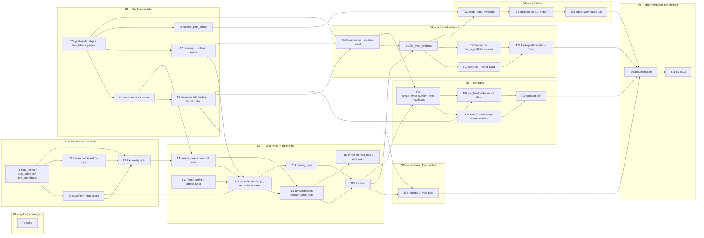

# RFC 0008 — Implementation plan

Companion to [RFC 0008 — Typst notes](0008-typst-notes.md) (PR #925). Each task below is meant to
be one issue and one pull request: small enough to review in one sitting, independent where the
dependency graph allows, and **done only when its probe passes**. The rules carried over from the
RFC 0002, 0004, 0005 and 0007 plans hold: a green suite is not a probe (a probe asserts the
specific new behaviour, and where it guards a regression the breaking mutation is shown to fail);
no-regression probes are differential against artefacts captured from `main`, never against a
hand-written expectation; and **every probe that writes compares bytes** — a refusal leaves the
vault byte-identical, a rename changes bytes only inside rewritten references
(`differs_only_by`), and a creation writes exactly the block plus the body it was given.

This plan is written so that a task can be handed to an agent that has not read the discussion.
Each task states what to build, where, what it must not change, how it is proven, and what it
waits on. An agent taking a task reads this page, the RFC sections the task cites, and the files
it names, in that order; a decision the RFC does not make is **raised on the task's issue, not
improvised** (see *Decisions this plan makes* for the ones already taken).

Conventions: `cdno` means the CLI built from the branch; `just ci` is the local gate (fmt +
clippy + test), narrower than CI, which also runs `cargo tarpaulin` and a fmt *check*; every new
Rust test file is registered in its crate's `tests/unit.rs` or it never runs; **every task adds
its line to `CHANGELOG.md` under `[Unreleased]`**; fixtures use the stock examples
(`surrogate-model`, `surrogate-error-budget`, `bias-variance-split`) and never a real vault's
names. The RFC's section numbers (§5.1, §6.2, …) refer to the amended RFC. Line numbers cited
as `file:line` are as of `333659c` (the 0.44.0 release) and are a place to start reading, not a
contract; `rg` in this repository needs `--no-ignore` under `crates/*/src/vault/`, because the
repo root is itself a dev vault and its ignore rules hide that folder from ripgrep.

## Complexity tiers

| Tier | Meaning | Match to |
|---|---|---|
| **M — mechanical** | The pattern exists next door and is copied; the probe is a compile plus an existing test shape; no new invariant. | A small, fast model. |
| **S — standard** | Several files or one judgement call; an existing invariant must be kept; the design is fully specified in the RFC and the task follows it. | A mid-tier model. |
| **R — reasoning** | A new invariant, a transaction with ordering or rollback hazards, a parser over a grammar, or a correctness argument that spans files. | A frontier reasoning model, with a second-model review of the diff. |

A task tiered M or S that turns out to need a decision the RFC does not make is stopped and the
decision raised on its issue.

Tally: 3 M (T5, T16, T25), 21 S, 8 R (T0, T2, T6, T7, T12, T17, T23, T27). The R tasks are the ones where a
wrong answer is silent: a `.typ` that falls out of the index without a word, a link the lexer
split that the scanner never saw, a rename that moved the note and left its figures behind, a
revision that rewrote the metadata block along with the body.

## Decisions this plan makes

The RFC leaves a few things to the code. Each is recorded here so the task that meets it does
not improvise; any can be overturned on the plan's issue.

- **P1 — lint re-runs the classifier; nothing caches its report.** The RFC says the two
  *classifier* lint rows are "raised from the classifier's report" (§5.10). `Vault::new` returns
  the reconcile report to its caller and keeps nothing (`vault/mod.rs:191`), and the MCP server
  is long-lived, so a report cached at open would be stale by the time lint runs.
  `lint_all_notes` calls the classifier itself on the store (a walk plus one byte search per
  unlabelled `.typ`, the cost §5.2 already accepts per command) and reports from that.
- **P2 — the permitted Typst folders travel as a value, `NoteScope`.** Core cannot know which
  types admit Typst (§5.9). The classifier takes a `NoteScope { ignore: IgnoreSet, typst_folders:
  Vec<String> }`; the domain builds it in `Vault::new` after `TypeRegistry::validate`, from the
  registry's `admits_typst` answers and each type's folder, and passes it where `IgnoreSet` is
  passed today (`vault/mod.rs:205`, `bootstrap.rs:43`, `bin/server.rs:522`, the CLI watcher).
  Until S3 the list is empty and the classifier never reads a `.typ`. T12 adds
  `typst_excluded_folders`, the folders of types the switch leaves out.
- **P3 — `typst-syntax = "=0.15.1"`.** The newest release when this plan was written; an exact
  pin per §6.1. The machine this is developed on has the `typst` binary 0.14.2, and the parser
  must postdate the syntax it reads, so the pin is newer than the binary, never older. Bumping
  the pin is its own one-line PR with the S2 suite as its probe.
- **P4 — new domain verbs for Typst, the Markdown verbs untouched.** Rather than threading a
  format through `file_evidence_with_vars` and `create_custom_note_with_vars` (both carry
  template variables that Typst refuses), the domain gains `file_typst_evidence`,
  `adopt_typst_evidence` and `create_typst_custom_note`, and the CLI and MCP dispatch on
  `format`. The Markdown paths stay byte-for-byte what they are, which is what makes the
  differential probes cheap.
- **P5 — `parse_note` has the shape of `Frontmatter::parse`.** `parse_note(path, raw) ->
  Result<(Frontmatter, &str), ParseError>`, so moving a call site is a rename and the body slice
  for Typst is the bytes after the label. A second entry, `parse_note_spanned`, also returns the
  metadata span, for the two writers that need it (revise, set_frontmatter).
- **P6 — stem exclusivity is its own error.** The RFC says "the same rejection the rename uses
  for a taken slug" (§5.7) and also lists a code `stem_taken_by_other_format` (§6.4). Both are
  met with a new `DomainError::StemTakenByOtherFormat { stem, holder: VaultPath }` whose
  message names the other file and the Obsidian cause, mapped to that code; `SlugTaken` keeps its
  meaning (a slug held by a note of the same format or by a folder).
- **P7 — the interface layer hands adoption a list of `(source, relative_name)` pairs.** The
  domain does no file I/O (§5.7), so the CLI and the server enumerate the assets folder beside
  the adopted file and pass `Vec<(PathBuf, String)>`; the domain maps each to
  `portfolios/<slug>/<stem>/<relative_name>` and refuses a `relative_name` that escapes
  (`..`, absolute).
- **P8 — "does not parse" means `typst_syntax::parse(source).diagnosis().errors`.** One definition
  for creation (refuse) and lint (Warning), with the first Error node's line in the message.

## Dependency graph



**What can start on day one, in parallel:** T0 (the spike, on its own branch), T1 (S1's root),
T5 (S2's root) and T11 (the config table, which touches nothing the others touch). S1 and S2 are
independent until T10 joins them. S4 and S5 are independent of each other once T18 is in. S4b
follows S4.

Nothing in this plan reads, measures or depends on any particular vault. Every fixture is built
from the stock examples, every differential probe runs on the dev vault that is this repository,
and the one measurement the RFC records (§2.1) stays what it is: aggregate counts, taken outside
the repository, with nothing else from the vault entering it.

---

## Stage S0 — the spike (not merged)

### T0 — The spike

**What.** A throwaway branch and a scratch vault (`cdno init` in a temp dir, `[note_types.concept]`
installed) that answers the questions §8 S0 lists before S2 is designed in detail. Build the
smallest thing that reads a `.typ` with `typst-syntax` (pin per P3), index three notes by hand —
an authored evidence note with a `[[concepts/bias-variance-split]]` in its body and a
`[[projects/surrogate-model]]` in its block, an adopted deck with a `figs/` folder and a `.bib`,
and a concept — and measure:

1. **Parse cost.** `typst_syntax::parse` on a 2 KB, a 20 KB and a 200 KB `.typ` (microseconds,
   `std::time::Instant`, median of 100), and the cost of the `<cdno>` byte search on the same
   files, so §5.2's "the residual cost is one read per unlabelled `.typ` per command" has a
   number. Report alongside the time `Vault::new` already takes on a vault with 58 unlabelled
   `.typ` attachments (copy that shape, not the files).
2. **Compile time and crate count.** `cargo build --timings` before and after adding
   `typst-syntax`; the added crates from `cargo tree -e normal -p cdno-core`.
3. **Tree shape.** Whether `#metadata((…)) <cdno>` parses as a `FuncCall` whose parent markup has
   the `Label` as the next non-trivia sibling, for the label on the same line and on the next
   line, and inside a content block (must be rejected as nested, §5.3).
4. **The escape round trip.** `[[concepts/bias-variance-split\#Statement]]` in a body: the
   scanner's address span excludes the backslash; renaming the concept rewrites the address and
   `differs_only_by` holds on the raw bytes; the file still compiles.
5. **The lexer's splitting.** Print the leaf kinds for `[[2026-11-08-error-budget--v2]]`,
   `[[it's-done]]` and `[[a/b.c]]`; confirm every leaf is Text, Shorthand, SmartQuote, Escape or
   a bracket, so the "one inline run" rule (§5.5) holds for the addresses `slugify` can produce.
6. **The compile diff.** With `typst` 0.12 and the installed binary: compile `report.typ` whose
   template sets `page` and `document(title: …)`, once as written and once with the block
   prepended; `diff` the PDFs after stripping their creation dates (`typst compile --format pdf`,
   then compare page text with `pdftotext` or byte-compare after zeroing `/CreationDate`). Repeat
   for the adopted deck with its paths rewritten to `<stem>/…`.
7. **Renaming the Typst note itself.** Move `x.typ` and `x/` by hand, run reconcile, confirm the
   index agrees with disk and the backlinks landed.

**Deliverable.** A comment on the RFC's PR with the seven findings, each a number or a yes/no with
the command that produced it, and a list of RFC amendments if any finding contradicts the text.
Nothing is merged.

**Depends on.** Nothing.

**Complexity.** R. Nothing here is hard to write, but every later design detail rests on reading
the findings right.

**Probes.** The deliverable *is* the probe: each of the seven has an answer, and the RFC is
amended where an answer disagrees with it (expected candidates: §5.2's cost sentence, §5.5's leaf
list, §5.7's minimum version).

**Correct means.** S2 can be written against facts about the parser, not beliefs about it.

---

## Stage S1 — helpers and classifier (no Typst behaviour)

### T1 — `NoteFormat`, `note_format`, `note_address`, `note_candidates`

**What.** In `crates/cdno-core/src/paths.rs`:

```rust
#[derive(Debug, Clone, Copy, PartialEq, Eq, Hash)]
pub enum NoteFormat { Markdown, Typst }
impl NoteFormat {
    pub const fn extension(self) -> &'static str;      // "md" | "typ"
    pub const ALL: [NoteFormat; 2];
}
/// The format a path would have as a note, from its extension alone,
/// ASCII case-insensitively. Says nothing about whether it is a note.
pub fn note_format(path: &VaultPath) -> Option<NoteFormat>;
/// The path without its note extension: `concepts/x.md` → `concepts/x`,
/// `portfolios/p/_index.md` → `portfolios/p/_index`. A path with no note
/// extension is returned unchanged.
pub fn note_address(path: &VaultPath) -> String;
/// The paths an address may name, in resolution order:
/// `<a>.md`, `<a>.typ`, `<a>/_index.md`. Pure; the caller filters against
/// the index (a `.typ` that is not indexed is not a note).
pub fn note_candidates(address: &str) -> Vec<VaultPath>;
```

Case-insensitivity is the one behaviour change S1 makes (§5.1): reconcile's `OsStr::new("md")`
test (`reconcile.rs:139`) is case-sensitive and the watcher's `eq_ignore_ascii_case`
(`watch.rs:112`) is not; both follow `note_format` after T4, so `NOTE.MD` is a note everywhere or
nowhere. It is a note.

**Deliverable.** The enum and three functions with doc comments, `tests/unit/paths_tests.rs`
additions.

**Depends on.** Nothing.

**Complexity.** S. Pure functions, but `note_address` is what every log line will carry, so its
edge cases (a dotted stem `run-v1.2.md`, `_index.md`, a path with no extension) are the point.

**Probes.**
- `cargo test -p cdno-core --test unit -- unit::paths_tests` passes with
  `note_format_reads_the_extension_case_insensitively` (`a.md`, `a.MD`, `a.typ`, `a.TYP`,
  `a.pdf` → None, `a` → None, `a.md/` → None), `note_address_strips_only_the_note_extension`
  (`run-v1.2.md` → `run-v1.2`, `x.typ` → `x`, `x.pdf` → `x.pdf`, `p/_index.md` → `p/_index`),
  `note_candidates_lists_both_formats_then_the_folder_index` (order and exact strings), and
  `note_address_then_candidates_round_trips` (property test with `proptest` over slug-shaped
  stems and the three extensions: the original path is among `note_candidates(note_address(p))`).
- Mutation: make `note_format` case-sensitive; the first test fails.

**Correct means.** One place says what a note extension is, and an address is a path minus
exactly that.

### T2 — The classifier and `NoteScope`

**What.** A new `crates/cdno-core/src/classify.rs`:

```rust
pub struct NoteScope { pub ignore: IgnoreSet, pub typst_folders: Vec<String> }  // P2
pub enum SkipReason { Attachment, Ignored, /* S3 adds: */ TypstUnlabelled, TypstLabelBroken { line: usize }, TypstOutsideScope }
pub struct Skipped { pub path: VaultPath, pub reason: SkipReason }
pub struct Classified {
    pub notes: BTreeSet<VaultPath>,     // what reconcile indexes
    pub files: BTreeSet<VaultPath>,     // every walked path outside .cuaderno/ (the rename snapshot needs it)
    pub skipped: Vec<Skipped>,          // attachments and ignored files are counted, not listed, until S3
    pub artefacts: usize, pub ignored: usize,
}
pub fn classify(store: &Arc<dyn VaultStore>, scope: &NoteScope) -> Result<Classified, StoreError>;
```

`classify` is the walk `reconcile` does today (`reconcile.rs:116–184`: walk, drop `.cuaderno/`,
keep note extensions, compute the ancestor set, resolve stubs with `attachment_stubs`, partition
out `owning_artefact_stub`, then the `ignore` globs) moved into one function and called by
`reconcile`, whose report keeps its `scanned`/`artefacts`/`ignored` counts from `Classified`.
`rename_snapshot` (`rename.rs:341–390`), which duplicates the walk today, calls it too (T4). In
S1 the `typst_folders` list is empty and the classifier keeps only `NoteFormat::Markdown` paths
(the `.typ` arm is T12). `reconcile(store, index, ignore)` becomes `reconcile(store, index,
scope)`; `Vault::new` builds a `NoteScope` with an empty folder list for now.

**Deliverable.** `classify.rs`, `reconcile` through it, the signature change at its four callers
(`vault/mod.rs:205`, `bootstrap.rs`, `bin/server.rs:534`, the CLI watcher's reconcile call),
tests.

**Depends on.** T1.

**Complexity.** R. The walk encodes the "ownership is positive" rule (`artefacts.rs` header) and
the independence of the stub and ignore exclusions (`reconcile.rs:158–160`); the risk is a
reordering that lets an ignored stub promote its artefacts into notes.

**Probes.**
- `cargo test -p cdno-core --test unit -- unit::reconcile_tests` passes unchanged (every
  existing reconcile test is a regression probe here), plus in a new `classify_tests.rs`:
  `an_ignored_stub_still_owns_its_folder` (a stub under an `ignore` glob with a `.md` inside its
  folder: the inner file is an artefact, not a note, and the stub is ignored),
  `a_note_sharing_a_name_with_a_sibling_folder_owns_nothing` (the `artefacts.rs` header case),
  `classify_lists_every_file_outside_cuaderno_dir` (`files` holds the `.pdf` too),
  `classify_counts_match_reconcile_report` (the three counts equal the report's on the same
  store).
- Differential: on the dev vault (this repository), `cdno reindex --json` on `main` and on the
  branch report equal `scanned`, `artefacts`, `ignored` and the same `notes` row count
  (`sqlite3 .cuaderno/index.db 'select count(*) from notes'`).
- Mutation: apply the ignore globs before the stub partition; the first probe fails.

**Correct means.** One function decides what is a note, and reconcile and the rename agree
because they ask it.

### T3 — The transaction derives added and removed notes from its ops

**What.** In `transaction.rs:272–300` and `:586`, replace the two `is_md` closures with the
op-keyed sets: a path is *added* when this commit's index ops `UpsertNote` it and the file ops
created it or moved to it; *removed* when the ops `RemoveNote` it, or a file op deleted it or
moved from it and no `UpsertNote` names it. The sets drive the link re-resolution (`:507`) as
today. Expose `pub(crate) fn note_delta(&self) -> (Vec<VaultPath>, HashSet<VaultPath>)` for the
test. This fixes the existing bug §5.1 names: a `FileOp::Import` of a `.md` into an artefact
folder counts as an added note today and triggers a re-resolution pass for a file that is not in
the index.

**Deliverable.** The two closures gone, `note_delta`, tests.

**Depends on.** T1 (for the vocabulary; no call into it is needed).

**Complexity.** S. The ordering (index ops run after all file writes succeed) is unchanged; the
care is that a `MoveBack` undo of a non-note file (the assets folder a rename will move in T17)
contributes nothing.

**Probes.**
- `cargo test -p cdno-core --test unit -- unit::transaction_tests`:
  `importing_a_markdown_attachment_adds_no_note` (an `import_external` of `doc.md` into
  `portfolios/p/stub/` with the stub's upsert only: `note_delta().0 == [stub]`),
  `moving_a_non_note_file_is_not_a_note_delta`,
  `a_removed_note_is_one_the_ops_removed` (`remove_note` without a `delete_file`, as a rename of
  a Markdown note does: `delete_file(old)` and `remove_note(old)` both present; the set holds it
  once), and the existing re-resolution tests (`#640`) unchanged.
- Mutation: key `added` on `Undo::DeleteCreated` alone; the first test fails.

**Correct means.** "This commit added a note" means the index was told so, not that a file with
some extension appeared.

### T4 — The twenty sites

**What.** Every `.md` literal of the three kinds in §3.1 goes through T1's helpers or T2's
classifier, and every site that is Markdown on purpose keeps its literal under a one-line
comment saying why. The list, as of `333659c` (`rg --no-ignore -n '\.md"|OsStr::new\("md"\)'`):

- **(a) classification** → `note_format` / `classify`: `reconcile.rs:139` (T2 did it),
  `transaction.rs:276, 586` (T3 did it), `cdno-cli/src/commands/watch.rs:111–112`,
  `rename.rs:341–390` (`rename_snapshot` → `classify`, keeping `VaultSnapshot`'s fields),
  `note_ref.rs:350` (`is_note_file`: `note_format(path).is_some()`; a `.typ` candidate counts
  only when `index.find_by_path` has a row, so an attachment never resolves as a note),
  `note_ref.rs:221` (a path-shaped reference: contains `/` or ends in a note extension).
- **(b) address → path** → `note_candidates`: `extractors.rs:559, 581, 597` (`resolve_one`
  rules 0a, 1 and 1b iterate the candidates against `vault_paths` in order, so the order of
  `note_candidates` is the resolution order), `note_ref.rs:330–333` and `:508`
  (`current_link_target`), `rename.rs:318, 1291–1292, 1328, 1332, 1613, 1638, 1721, 1738`,
  `artefacts.rs:148` (`sibling_stub_of_path` stays `.md` in S1 and widens in T14; comment it).
- **(c) path → address** → `note_address`: `revise.rs:176`, `log.rs:179, 189`,
  `set_frontmatter.rs:396`, `portfolios.rs:790` (`note_wikilink_target`),
  `notes_section.rs:146`, `monthly.rs:270`, `tracking.rs:511`, `rename.rs:816`.
- **Markdown on purpose, annotated:** the journal paths in `paths.rs:138–164`; the machine-written
  types' creation paths (`custom_notes.rs:310` becomes format-aware in T26 and is annotated until
  then; `actions.rs:237, 327`; `tracking.rs:195`; `questions.rs:256, 342`;
  `stewardships.rs:474–545`; the `_index.md` paths in `portfolios.rs` and `rename.rs:687`);
  `migrate.rs`; the stub-shape probe in `lint.rs:1223`; the message text in `lint.rs:1511`;
  `cdno-cli/src/bundled.rs:80–118` (template file names).

**Deliverable.** The replacements, the comments, tests where behaviour is observable.

**Depends on.** T1, T2, T3.

**Complexity.** S. Mechanical in each place; the judgement is the list, and the one behaviour
change (case) is stated.

**Probes.**
- `cargo test --workspace` passes unchanged: every existing test on these paths is a regression
  probe, and S1 adds no Typst behaviour to test.
- The RFC's §10 last bullet: `rg --no-ignore -n 'OsStr::new\("md"\)|"\.md"|\.md"' crates/*/src
  --glob '!**/tests/**'` lists only `paths.rs` (the helpers), `classify.rs`, and lines each
  carrying a `// Markdown on purpose:` comment; the PR description pastes the list.
- Differential: a `cdno lint --json` and a `cdno search --json surrogate` on the dev vault are
  identical on `main` and the branch; `cdno note rename` of a fixture concept on a copy of the
  dev vault produces the same `git diff` on both (the rename is the heaviest user of (b)).
- `cargo test -p cdno-cli --test watch`: `an_upper_case_md_file_triggers_a_pass` (new; the
  unification), and the existing watcher tests.
- Mutation: return `.md` only from `note_candidates`; nothing fails yet (expected: S1 is
  behaviour-neutral) — the mutation that *must* fail is in T12.

**Correct means.** After S1 the engine has no opinion about `.md` outside two functions and one
walk, and nothing a person sees has changed.

---

## typst-syntax 0.15.1 facts (from the spike)

Measured by T0 on the pinned crate; T5–T9 are written against these.

- **Entry.** `typst_syntax::parse(&str) -> SyntaxNode`, root kind `Markup`. `SyntaxNode` has
  `kind()`, `children()`, `leaf_text()`, `full_text()`, `len()`, `diagnosis()` (`.errors`) and
  `errors_and_warnings()`. There is no `text()`, `errors()` or `erroneous()`.
- **Offsets.** `LinkedNode::new(&root)`, then `children()`, `offset()`, `range()`, `get()`,
  `parent()`, `cast::<T>()`, `next_sibling()` and `prev_sibling()`, which skip trivia.
  `SyntaxKind::is_trivia` is Shebang, LineComment, BlockComment, Space and Parbreak; Shebang is not
  in §5.3's "whitespace and comments", so "first" needs its own check.
- **The block.** At top level the root `Markup` holds the siblings `Hash`, `FuncCall`, trivia,
  `Label`. Same line, next line, glued, a comment between and a blank line between all give
  `func.next_sibling()` the `Label`, and the compiler attaches it in each case. The leaf text keeps
  the angle brackets: `"<cdno>"`. The block's span runs from `prev_sibling()` (the `Hash`) to the
  label's end. A nested block sits in a `Markup` under a `ContentBlock`, so finding one for
  `Nested` takes a descent.
- **Values.** `ast::FuncCall::{callee, args}`; `Expr::Ident(i).as_str()`; `args.items()` gives
  `Arg::Pos(expr)`; `Expr::Dict(d).items()` gives `DictItem::{Named, Keyed, Spread}`;
  `Named::{name, expr}`, `Keyed::{key, expr}`. `Expr::Str(s).get()` decodes (`\#` stays a literal
  backslash and hash), `Expr::Bool(b).get()`, `Expr::Array(a).items()` gives `ArrayItem::{Pos,
  Spread}`. `("x",)` is `Array`, `("x")` is `Parenthesized` (`.expr()`).
- **Link runs.** Recurse over all nodes, stopping at `Raw` (it holds `Text` leaves) and `Equation`.
  At a `Markup`, gather consecutive Text, Escape, Shorthand, SmartQuote and Space children into a
  run, and on any other child flush and recurse. Match the brackets on Text leaves equal to `[` or
  `]`: `LeftBracket`/`RightBracket` occur only as `ContentBlock` delimiters. A content block's
  interior is its own `Markup`, so a figure caption needs no special case.
- **Leaves.** `[[2026-11-08-error-budget--v2]]` is Text, Text, Text, Shorthand `--`, Text, Text,
  Text; `'` is SmartQuote; `\#` is Escape. 200,000 generated slug paths held only Text and Space.
  Interior leaves that break a run: `#x` Hash+Ident, word-start `*`/`_` Strong/Emph, `//` a
  LineComment that swallows `]]`, `http://…` Link, `<b>` Label, `@b` Ref. `-1` at a word start is
  Shorthand `-`; in a word it stays Text, and so do `a_b` and `a*b`. A `Space` can carry `\n`.
- **Decoding.** `ast::Escape::get() -> char`. For Shorthand and SmartQuote use `leaf_text()`: their
  `get()` is the rendered form.
- **Headings.** `Heading` has `HeadingMarker`, `Space`, `Markup`. A trailing ` <sec>` is a sibling
  of the `Heading` in the parent, so the heading's `Markup` already excludes it.
- **`typst::with_tree` (T5, #965) is the only way to parse.** Deep trees overflow the stack in
  recursive walks and in `Drop`, so no other code calls `parse` directly.
- **Offsets are not source bytes on odd inputs.** Tree offsets can drift, so never slice with
  `source[range]`: use `source.get(range)` and treat `None` as a fault.
- **Lines.** From `line_of` (`Lines`), never by counting `\n`.
- **Errors.** `diagnosis().errors` is a `bool`. After a bare `parse()` the spans are detached, so
  `errors_and_warnings()` gives no position: walk `LinkedNode`s for `SyntaxKind::Error` and take
  `offset()`.
- **Never run the Markdown scanner on Typst.** On `[[x\#y]]` it yields the address `x\`.

---

## Stage S2 — the Typst reader (no caller yet)

### T5 — The dependency, `has_label`, `parses`

**What.** `typst-syntax = "=0.15.1"` in the workspace `Cargo.toml` and `crates/cdno-core/Cargo.toml`
(P3; no other crate names it, §6.1). A new `crates/cdno-core/src/typst.rs`, the only module
that uses `typst_syntax`, with:

```rust
pub const CDNO_LABEL: &str = "<cdno>";
/// The byte search of §5.2: cheap, run before any parse.
pub fn has_label(source: &str) -> bool;
/// P8: `Ok(())` when the tree holds no Error node; else the first one's line.
pub fn parses(source: &str) -> Result<(), SyntaxFault { line: usize, message: String }>;
```

and the S0 numbers (parse cost, compile time, crate count) recorded in the module doc.

**Deliverable.** The dependency, the two functions, `tests/unit/typst_tests.rs` registered in
`tests/unit.rs`.

**Depends on.** T0's findings (not a code dependency).

**Complexity.** M.

**Probes.**
- `cargo test -p cdno-core --test unit -- unit::typst_tests`:
  `has_label_is_a_byte_search` (`<cdno>` inside a comment is still `true` — the search is cheap
  on purpose and the parse decides), `parses_accepts_a_document_with_maths_and_a_show_rule`,
  `parses_reports_the_line_of_an_unclosed_emphasis` (`_oops` on line 7 → `line: 7`),
  `parses_reports_an_unclosed_raw_block`.
- `cargo tree -e normal -p cdno-core | rg -c .` grows by the number S0 measured, pasted in the PR.

**Correct means.** The parser is in the build, isolated, and "does not parse" has one meaning.

### T6 — The metadata block reader

**What.** In `typst.rs`:

```rust
pub struct MetadataBlock {
    /// From the `#` of `#metadata` to the `>` of `<cdno>`, inclusive.
    pub span: Range<usize>,
    /// The dictionary as JSON: strings, arrays of strings, booleans, numbers (§5.3).
    pub value: serde_json::Value,
    /// Each key's value span inside the source, for the edit module (T8).
    pub entries: Vec<EntrySpan { key: String, key_span: Range<usize>, value_span: Range<usize> }>,
    /// Where a new entry would be inserted (before the closing `))`).
    pub insert_at: usize,
    /// The `:` of an empty dictionary `(:)`, which a first entry replaces (T8).
    pub empty_colon: Option<Range<usize>>,
    /// Whether a comma follows the last entry (T8).
    pub trailing_comma: bool,
}
pub enum TypstError {
    NoBlock,                                   // no `#metadata((…)) <cdno>` at top level
    LabelBroken { line: usize },               // `#metadata` block with a `type` key present; label missing, mistyped, or not its sibling
    Nested { line: usize },                    // the block is inside a content block or function body
    NotFirst { line: usize },                  // something other than whitespace/comments precedes it
    Duplicate { line: usize },                 // a second `<cdno>` block
    NotLiteral { line: usize, what: String },  // identifier, call, arithmetic, nested dict, …
    NotADictionary { line: usize },
}
pub fn metadata_block(source: &str) -> Result<MetadataBlock, TypstError>;
```

Rules from §5.3: top level, first, exactly one; the argument a literal dictionary; values
`Str`, `Array` of `Str` (`("x",)` and `("x")` both read as one string — the latter is a
parenthesised string, accepted on read), `Bool`, and `Int` or `Float` with an optional leading
`-` (read into JSON numbers; a decimal integer beyond `i64` is lexed as a `Float`, `Int::get`
returns 0 for text it cannot parse, so the reader parses the text itself, and a non-finite float
is `NotLiteral`); keys identifiers or string keys; string escapes
decoded by the parser's own `Str::get`. Anything else is `NotLiteral` with `what` naming the node
kind. `LabelBroken` is the §5.2 Error: the text holds a `#metadata((` call with a `type` key but the
`<cdno>` label is absent, mistyped or not the call's next non-trivia sibling.

**Deliverable.** The reader, the error enum, tests: one accepting fixture and one per error
variant, in `typst_tests.rs`.

**Depends on.** T5.

**Complexity.** R. The tree-walk is small, but the "first and top level" and "sibling label"
rules depend on the tree shape S0 confirmed, and a wrong answer in the lenient direction indexes
a file as a note with no metadata.

**Probes.**
- `cargo test -p cdno-core --test unit -- unit::typst_tests`:
  `metadata_block_reads_strings_arrays_and_booleans` (the §5.3 example → the expected JSON,
  `tags` an array of two), `one_element_array_and_parenthesised_string_read_alike`,
  `string_escapes_are_decoded` (`"a \"b\" \\ c"` → `a "b" \ c`),
  `a_leading_comment_is_allowed_before_the_block`, `a_label_on_the_next_line_is_the_blocks`,
  one test per `TypstError` variant with the line asserted (`not_first` with a `= Heading` on
  line 1 and the block on line 3 → `NotFirst { line: 3 }`),
  `another_metadata_call_before_the_block_is_not_first` (a `#metadata((x: 1)) <other>` ahead of
  the `<cdno>` block is neither whitespace nor a comment, so §5.3 makes it `NotFirst`), and
  `other_metadata_labels_after_the_block_are_ignored`.
- `proptest` (lives in T8's `typst_edit_tests.rs`, where `write_block` exists): for a generated
  dictionary of ≤8 keys, including Typst keywords, with string, string-array, bool, integer and
  float values, `write_block` then `metadata_block` round-trips the JSON exactly.
- Mutation: accept a nested dictionary as a literal; `not_literal_nested_dictionary` fails.

**Correct means.** The block is read without evaluating anything, and every way to get it wrong
has a name and a line.

### T7 — Headings and wikilink spans over Typst markup

**What.** In `typst.rs`:

```rust
/// `(level, source_text)` per `=`-heading, §5.5's anchor form: bytes after the `=` run and one
/// space, a trailing `<label>` stripped, Escape leaves decoded, trimmed, whitespace collapsed.
pub fn headings(source: &str) -> Vec<(u8, String)>;
pub struct TypstLinks {
    pub spans: Vec<crate::extractors::WikilinkSpan>,   // raw byte ranges, as the Markdown scanner's
    pub addresses: Vec<String>,                          // decoded address per span, no anchor
    pub targets: Vec<String>,                            // decoded target per span, anchor included: what the resolver sees
    pub faults: Vec<LinkFault { open: usize, line: usize, leaf: String }>, // interior not one inline run
}
pub fn wikilink_spans(source: &str) -> TypstLinks;
```

Rules from §5.5: links are read in markup at any nesting, over contiguous runs of inline leaves
(Text, Escape, Shorthand, SmartQuote, Space; the `[` and `]` of a link are Text leaves of their
own, and `Raw` holds Text leaves too, so the `Raw` subtree is skipped), **and** in the string values of
the `<cdno>` block (span inside the quotes, address the decoded string's `[[…]]` contents); never
in raw, comments, code-mode expressions, labels, refs or maths. Lint's *finder* takes `[[` as two adjacent Text
leaves `[` in a `Markup` (so a run the lexer broke cannot hide a link, and the content-block bracket
of `#foo[[x]]` is not an opening), and every `[[` found whose interior does not lex as one inline
run is a `LinkFault`, as is one whose decoded target spans a line and one with no `]]` in its run
(a line comment swallowing the close, a plain unclosed `[[`). A `[[` glued after a `#…` expression
(`#emph[a][[x]]`) is a content-block argument and simply not a link: no span, no fault. `WikilinkSpan`'s ranges are
**raw bytes**: `target` includes the backslash of an escaped anchor, and `address` ends before it
(it holds a backslash only for an escape inside the address, `a\_b`); `addresses[i]` is the decoded
address and `targets[i]` the decoded target with its anchor, the form the resolver sees. The rewrite in T17 writes the new address escaped into the raw span, and
`differs_only_by` compares raw bytes, which is the round trip S0 confirmed.

**Deliverable.** The two functions, `TypstLinks`, tests.

**Depends on.** T5.

**Complexity.** R. This is the grammar-facing part; the leaf list and the "one run" rule come
from S0 and the probes below pin them.

**Probes.**
- `cargo test -p cdno-core --test unit -- unit::typst_tests`:
  `headings_use_source_text` (`= The *bias* term <sec>` → `(1, "The *bias* term")`,
  `== A -- B` → `(2, "A -- B")`, `= Caf\u{e9}` decoded),
  `links_in_a_plain_run` (`[[concepts/bias-variance-split]]` → one span, address equal),
  `links_split_by_the_lexer_are_whole` (`[[2026-11-08-error-budget--v2]]`, `[[it's-done]]`,
  `[[a/b.c|label]]` → one span each, address exact, label excluded),
  `an_escaped_hash_is_decoded_in_the_target_and_kept_out_of_the_address`
  (`[[concepts/x\#Statement]]` → `targets[0]` is `concepts/x#Statement`, `addresses[0]` is
  `concepts/x`; `source[span.target]` contains the backslash, `source[span.address]` is `concepts/x`),
  `an_unescaped_hash_is_a_fault_not_a_link` (`[[concepts/x#Statement]]` → zero spans, one fault
  naming the `Hash`/code leaf and its line),
  `links_inside_a_figure_caption_are_read` (markup nested in `#figure(caption: [see [[x]]])`),
  `links_in_raw_comments_code_strings_and_maths_are_not_read` (one of each, zero spans),
  `links_in_the_block_strings_are_read` (`origin: "[[projects/surrogate-model]]"` → one span
  inside the quotes; a `[[x]]` in a non-metadata string literal → none),
  `a_bracket_run_the_lexer_broke_is_still_found_by_lint` (a `[[a *b* c]]`: zero spans, one
  fault — the finder saw it),
  `a_content_block_bracket_is_not_a_link_opening` (`#foo[[x]]`: zero spans, zero faults),
  `a_link_glued_after_a_hash_expression_is_not_one` (`#emph[a][[x]]`: zero spans, zero faults),
  `a_link_spanning_a_line_is_a_fault` (`[[a` newline `b]]`: zero spans, one fault),
  `an_unclosed_opening_is_a_fault` (`[[x` with no close: zero spans, one fault).
- `proptest`: for slugs generated by the slug grammar (`[a-z0-9]+(-[a-z0-9]+)*`, up to 50 chars)
  and paths of ≤3 such segments, `[[<path>]]` in a body yields exactly one span with that address.
- Mutation: drop `Shorthand` from the leaf set; `links_split_by_the_lexer_are_whole` fails on the
  `--` case.

**Correct means.** Every `[[…]]` a writer can type with `slugify`'s alphabet is an edge, every one
they must escape is either escaped and an edge or unescaped and a named fault, and nothing in a
quoting construct is read.

### T8 — The metadata-syntax edit module and the literal writer

**What.** `typst.rs::metadata_edit` (or a sibling file `typst_edit.rs` re-exported from `typst.rs`,
still the only module naming the crate), mirroring `frontmatter_edit.rs:237–649`:

```rust
pub fn write_block(fields: &[(String, serde_json::Value)]) -> Result<String, TypstError>;  // the literal writer: escapes, `("x",)`, `true`/`false`, numbers, one key per line, `<cdno>` on the closing line; `Unwritable` for null, objects, non-string array items, a repeated key
pub fn scalar_span(block: &MetadataBlock, key: &str) -> Option<Range<usize>>;
pub fn rewrite_scalar(source: &str, key: &str, value: &serde_json::Value) -> Result<(String, Vec<AddressEdit>), TypstError>;  // byte-exact; inserts the key when absent, at `insert_at`
pub fn append_list_value(source: &str, key: &str, item: &str) -> Result<(String, Vec<AddressEdit>), TypstError>;  // `("a",)` → `("a", "b")`; absent key inserted
pub fn remove_list_value(source: &str, key: &str, item: &str) -> Result<(String, Vec<AddressEdit>), TypstError>;
// no `changed_only_at`: the edits are checked exactly by core's `differs_only_by(before, after, &edits)`
```

The writer emits Typst string escapes only (`"` and `\`), never the markup escape rule (§5.3);
keys that are not identifiers, and Typst keywords, are written as string keys; inserting a key into `(:)` replaces the `:`. Nothing re-serialises the dictionary:
a comment inside the block and the writer's key order survive every edit, except that
`append_list_value` and `remove_list_value` rewrite the whole array they edit in one-line form, so
a comment inside *that array* is lost. The edit functions return `AddressEdit`s (a range of the old
source and its replacement, as the YAML twin does) and an insertion uses the source's line ending
(`\r\n` when it holds one).

**Deliverable.** The module, tests, `proptest` round trips.

**Depends on.** T6.

**Complexity.** S. The YAML twin exists next door and every operation has a byte-exact probe.

**Probes.**
- `cargo test -p cdno-core --test unit -- unit::typst_edit_tests` (new file, registered):
  `write_block_round_trips_through_metadata_block` (proptest, shared with T6),
  `rewrite_scalar_changes_only_the_value_span` (`differs_only_by` holds on the returned edit, whose range is the old
  value span; a `// note` comment inside the block survives), `a_same_line_comment_survives_a_rewrite`,
  `a_crlf_source_gets_crlf_line_endings_on_insertion`, `write_block_refuses_a_repeated_key`, `rewrite_scalar_inserts_a_missing_key_before_the_close`,
  `append_to_a_one_element_array_keeps_it_an_array` (`("a",)` → `("a", "b")`; `("a")` →
  `("a", "b")` too), `remove_last_item_leaves_the_empty_array` (`()`),
  `a_quote_in_a_value_is_escaped_for_typst_not_markup` (`a "b" #c` → `"a \"b\" #c"`).
- Mutation: re-serialise the dictionary on `rewrite_scalar`; the comment-survives test fails.
  Mutation: let the replaced range swallow a same-line trailing comment;
  `a_same_line_comment_survives_a_rewrite` fails.

**Correct means.** The block can be edited the way YAML frontmatter is edited: at a span, with
proof that nothing else moved.

### T9 — `relative_path_literals`

**What.** In `typst.rs`:

```rust
pub struct PathLiteral { pub span: Range<usize> /* inside the quotes */, pub value: String, pub call: String, pub line: usize }
pub enum PathArg { Literal(PathLiteral), NotLiteral { call: String, line: usize } }
/// Every path argument of `image`, `read`, `json`, `csv`, `yaml`, `toml`, `xml`, `cbor`,
/// `bibliography`, `include` and a path `import` (§5.7). `@preview` package imports and includes are not
/// returned.
pub fn path_args(source: &str) -> Vec<PathArg>;
```

`bibliography` takes a string or an array of strings; both forms are returned one literal each.
A path argument that is not a string literal (a variable, a concatenation, an import from a name) is `NotLiteral` so
adoption can refuse it with a `remedy` (`asset_path_not_literal`).

**Deliverable.** The function, tests.

**Depends on.** T5.

**Complexity.** S.

**Probes.**
- `cargo test -p cdno-core --test unit -- unit::typst_tests`:
  `path_args_finds_every_listed_call` (one of each call in a fixture; the span is inside the
  quotes; `include "chapter.typ"` and `import "lib.typ": f` are found, `import
  "@preview/x:0.1.0"` is not), `bibliography_with_an_array_yields_one_literal_per_item`,
  `a_variable_path_is_reported_not_literal`, `an_image_inside_a_figure_is_found` (nesting). The list also covers `plugin`, `pdf.attach`, styles with an extension of `bibliography`/`cite`,
  `raw(theme:, syntaxes:)`, `image(icc:)`, and the callee forms `std.name`, `name.with(..)` and
  `(name)`; a string with `://` is a local path, and `@` is skipped only for `import`/`include`.
- Mutation: drop `include`; the first test fails.

**Correct means.** Adoption can see every file the document reaches for, or say which one it
cannot see.

---

## Stage S3 — Typst notes in the engine

### T10 — `parse_note` and the core call sites

**What.** In `frontmatter.rs`:

```rust
impl Frontmatter { pub fn from_typst(value: serde_json::Value) -> Self; }   // same type `parse` builds
/// P5. Dispatches on `note_format(path)`: Markdown → `Frontmatter::parse`; Typst → `typst::metadata_block`,
/// the body being the bytes after the label. A path with no note extension is a `ParseError`.
pub fn parse_note<'a>(path: &VaultPath, raw: &'a str) -> Result<(Frontmatter, &'a str), ParseError>;
pub struct Spanned<'a> { pub frontmatter: Frontmatter, pub body: &'a str, pub metadata_span: Range<usize> }
pub fn parse_note_spanned<'a>(path: &VaultPath, raw: &'a str) -> Result<Spanned<'a>, ParseError>;
```

`ParseError` gains `Typst(TypstError)`. The six core call sites of `Frontmatter::parse` that can
see a note path move to `parse_note`: `reconcile.rs` (2), `transaction.rs` (1), `artefacts.rs:58`
(a stub is Markdown by definition; it moves so a Typst note can be an owner in T14),
`markdown.rs` (3 — these parse a Markdown document on purpose; annotate rather than move),
`frontmatter_edit.rs` (2 — YAML on purpose; annotate). `heading_texts` and `headings`
(`markdown.rs:245, 261`) gain format-dispatching twins in a new `crates/cdno-core/src/note.rs`
(`note_headings(path, body)`), so `read_note` can ask once.

**Deliverable.** The functions, the error variant, the moved sites, the annotations, tests.

**Depends on.** T4 (the helpers), T6 (the reader).

**Complexity.** S.

**Probes.**
- `cargo test -p cdno-core --test unit -- unit::frontmatter_tests`:
  `parse_note_on_markdown_is_frontmatter_parse` (same `(fm, body)` on ten fixtures, including a
  malformed one erroring the same), `parse_note_on_typst_returns_the_block_and_the_rest`
  (body starts at the byte after `<cdno>`, so a comment on the next line is kept),
  `parse_note_on_a_typst_file_without_a_block_is_no_block`,
  `parse_note_on_a_pdf_path_is_an_error`.
- Differential: `cargo test --workspace` unchanged, and `cdno reindex` on the dev vault produces
  an identical `notes` table (dump with `sqlite3 … .dump notes`) before and after.

**Correct means.** Every reader has one door, and a Markdown note goes through it unchanged.

### T11 — The `[typst]` table and `admits_typst`

**What.** `config.rs`: `pub struct TypstConfig { pub note_types: Option<Vec<String>> }` under
`VaultConfig::typst` (`#[serde(default, deny_unknown_fields)]`, like `FocusConfig`). `None` is the
implicit default of §5.9; `Some(vec![])` turns the feature off. In `type_registry.rs`:

```rust
pub const TYPST_REFUSED_TYPES: &[&str] = &["daily","weekly","monthly","project","action","commitment","inbox","tracking","stewardship","portfolio","question"];
impl TypeRegistry<'_> {
    /// `evidence`, plus `concept` when declared, unless `[typst] note_types` says otherwise.
    pub fn typst_types(&self) -> Vec<&str>;
    pub fn admits_typst(&self, type_name: &str) -> bool;
    /// The folders those types live in: `portfolios` for evidence; a custom type's `folder`.
    pub fn typst_folders(&self) -> Vec<String>;
}
```

`TypeRegistry::validate` (`:213`) validates an **explicit** list only: every name known, none in
`TYPST_REFUSED_TYPES`; the implicit default is never validated (so a vault without `concept`
opens clean). `Vault::new` builds `NoteScope` from `typst_folders()` (P2). `NoteTypeInfo`
(`describe`, `:329`) gains `admits_typst: bool`, so `list_note_types` tells an agent which types
take `format: typst`.

**Deliverable.** The table, the registry methods, the validation, the DTO field, docs-site
`reference/configuration.md` entry, tests.

**Depends on.** Nothing (T2's `NoteScope` is where it is consumed; the two meet in T12).

**Complexity.** S.

**Probes.**
- `cargo test -p cdno-domain --test unit -- unit::type_registry_tests`:
  `typst_default_is_evidence_plus_concept_when_declared` (two configs),
  `a_vault_without_concept_opens_with_no_typst_table`,
  `an_empty_list_turns_typst_off`, `an_explicit_list_naming_a_refused_type_fails_validation`
  (one per refused name, table-driven; message names the type and says why),
  `an_explicit_list_naming_an_unknown_type_fails_validation`,
  `typst_folders_follow_the_types` (`portfolios`, `concepts`).
- `cargo test -p cdno-core --test unit -- unit::config_tests`: `typst_table_parses_and_rejects_unknown_keys`.
- `cargo test -p cdno-mcp --test handlers_context`: `list_note_types_reports_admits_typst`.
- Mutation: validate the implicit default; the second test fails.

**Correct means.** One switch, in one place, that the engine never reads directly.

### T12 — The classifier reads `.typ`; reconcile indexes Typst notes

**What.** `classify.rs` gains the `.typ` arm (§5.2): a `NoteFormat::Typst` path under one of
`scope.typst_folders` or the new `scope.typst_excluded_folders`. T12 adds that second field to
`NoteScope` and owns the registry helper, `TypeRegistry::typst_excluded_folders()`: `portfolios` if
evidence is not admitted, and the folder of each custom type not admitted. A `.typ` under neither
list is never touched. For the rest, in order:

1. Inside a folder owned by a stub or (T14) a Typst note → an attachment, never read.
2. The file is read and searched. Under an excluded folder: `has_label` true → `Skipped
   { TypstOutsideScope }` (the Warning); false → nothing, an attachment as today.
3. Under an admitted folder: `has_label` true → in `notes`.
4. Otherwise, the broken-label check: the bytes hold `#metadata(`, optional whitespace including
   newlines, `(`, and later `type` or `"type"` followed by optional whitespace and `:` →
   `Skipped { TypstLabelBroken { line } }`, `line` from the match's offset. `#metadata ((` is not
   a call and does not match. So `<cdn>` lands here, not in step 5. This is a byte search, never
   `metadata_block`.
5. Otherwise → `Skipped { TypstUnlabelled }`.

Only byte searches
run in the classifier; the parse runs in `reconcile_one`, which goes through `parse_note` and
reports `LabelBroken` (a `<cdno>` that is not the call's sibling)/`Nested`/`NotFirst`/`NotLiteral`/missing `type` as a per-file reconciliation issue
exactly as malformed YAML is reported today (the note is indexed with its error; never demoted).
In `reconcile_one`: `title` from the block's `title` (`:527` already reads the field), the FTS
title is the block's `title` for Typst (`:575` uses `first_h1` for Markdown), full text is the
body after the block (§5.4), facets through `extract_note_facets` with a format dispatch: body
links via `typst::wikilink_spans` (`targets`, decoded) and block links via the existing
`extract_frontmatter_wikilinks` over the JSON (they coincide with the block-string spans of T7;
the facet extractor needs only the targets). Inline tags are not read from Typst text (§5.4).
`typst::headings` is not stored (the index keeps no headings; `read_note` computes them, T16).

**Deliverable.** The classifier arm, the reconcile dispatch, the FTS title rule, tests on real
files (`tempfile`, the core profile).

**Depends on.** T2, T7, T10, T11.

**Complexity.** R. The "is a note" decision for `.typ` is by content, and each wrong direction
has a different cost (§5.2); the probes below check both directions.

**Probes.**
- `cargo test -p cdno-core --test unit -- unit::reconcile_tests`:
  `a_labelled_typ_under_portfolios_is_indexed_with_its_block` (type, title=None, `source`,
  `portfolio`, `created` in the row's frontmatter JSON; `content_hash` over the whole file),
  `a_labelled_typ_concept_has_the_blocks_title_as_row_and_fts_title`,
  `the_body_is_the_full_text_and_the_block_is_not` (an FTS search for a tag string inside the
  block finds nothing; a word in the body is found),
  `body_links_and_block_links_are_edges` (`[[concepts/bias-variance-split]]` in the body and
  `origin: "[[projects/surrogate-model]]"` → two `links` rows, resolved),
  `an_escaped_link_resolves_to_the_decoded_address`,
  `an_owned_typ_is_an_attachment_and_never_read` (a counting store wrapper sees zero reads of a
  `.typ` inside a stub's folder, labelled or not; assert the row count and `artefacts`),
  `a_loose_unlabelled_typ_is_skipped_unlabelled`, `a_labelled_typ_outside_scope_is_skipped`,
  `a_broken_label_is_skipped_with_its_line`,
  `a_mistyped_label_is_broken_not_unlabelled` (`<cdn>`, and the multi-line `#metadata(\n  (type:`
  form), `a_spaced_metadata_call_is_not_broken` (`#metadata ((type: "x"))` → `TypstUnlabelled`),
  `a_label_that_is_not_the_siblings_is_a_reconcile_issue`, `a_nested_block_is_reported_not_demoted` (a note
  whose metadata fails to parse follows the malformed-YAML path today: no row, one entry in
  `report.issues` naming the rule, retried every pass — and never counted in `artefacts`),
  `typst_off_parses_no_typ` (`typst_folders` empty: every labelled `.typ` is `TypstOutsideScope`,
  nothing is parsed, and the attachments are unchanged).
- Differential: the dev vault, which holds no labelled `.typ`, reindexes to an identical `notes`
  table; a copy with three fixture Typst notes dropped in gains exactly three rows.
- Mutation: index an unlabelled `.typ` in scope; `a_loose_unlabelled_typ_is_skipped_unlabelled`
  fails. Mutation: read the file before the ownership check;
  `an_owned_typ_is_an_attachment_and_never_read` fails. Mutation: read the
  FTS title from `first_h1`; the concept title test fails.

**Correct means.** A `.typ` is in the index exactly when §5.2's three conditions hold, and the
other cases are each counted, named, or reported — never silent.

### T13 — Every domain reader through `parse_note`

**What.** The domain's 51 `Frontmatter::parse` sites in 25 files (as of `333659c`) sort into
three groups. **Must move**, because the path can be evidence or concept: `portfolios.rs:184, 684,
700, 732, 768` (`get_portfolio_contents` fails the whole call on the first Typst note today,
§6.1), `search.rs:155`, `notes.rs` (`read_note`, via T16), `index_entry.rs:29`
(`build_index_entry_for`, used by every create and by `revise_note`), `revise.rs`,
`set_frontmatter.rs`, `rename.rs:1417, 1785, 1800`, `lint.rs`, `normalise.rs`,
`frontmatter_edit.rs`, `custom_notes.rs` (its own YAML helpers `parse_frontmatter_block`,
`reconcile_custom_frontmatter`, `:462–578`, are Markdown-template machinery: annotate, since a
Typst concept never passes through them — T26 creates it on another path), and the two
`find_by_path`-driven readers in `context.rs:571, 628` if the source can be a `## Notes` pointer
into a concept (check; annotate if it cannot). **Stay**, annotated as Markdown on purpose, because
the type is machine-written: `commitments.rs` (9), `context.rs` (the `list_by_type` loops over
projects, actions, daily, tracking), `tracking.rs`, `stewardships.rs`, `questions.rs`,
`projects/*`, `capture.rs`, `weekly_context.rs`, `daily.rs`, `actions.rs`, `migrate.rs`.
`EvidenceFrontmatter::try_from(Frontmatter)` (`note_type.rs`) is unchanged: the JSON shape is the
same from either format (§5.3).

**Deliverable.** The moves, the annotations, a test per moved reader with one Typst note in the
memory store.

**Depends on.** T10, T12.

**Complexity.** S. Many files, one pattern; the judgement is the sort, and the list above is it.

**Probes.**
- `cargo test -p cdno-domain --test unit -- unit::portfolios_tests`:
  `portfolio_contents_lists_a_typst_evidence_note_with_its_fields` (a seeded `.typ` beside two
  `.md`; three entries, sorted by `created` as today),
  `list_portfolios_counts_a_typst_evidence_note`.
- `unit::search_tests`: `search_finds_a_typst_body_and_shows_its_syntax_in_the_snippet`
  (the snippet contains `$` or `=`; the accepted v1 leak, §5.4).
- `unit::lint_tests`: `lint_reads_a_typst_note_without_a_frontmatter_error`.
- `unit::rename_tests`: `a_typst_referrer_is_read_by_the_snapshot` (renaming the Markdown concept
  a Typst note links to rewrites the Typst note's address; `differs_only_by` on its bytes) — this
  is the §10 fourth bullet's first half, and the rename of the project in `origin` is its second:
  `a_rename_of_the_project_in_a_typst_origin_rewrites_the_block_string`.
- `rg --no-ignore -n 'Frontmatter::parse' crates/cdno-domain/src` lists only lines carrying a
  `// Markdown on purpose:` comment; pasted in the PR.
- Mutation: leave `portfolios.rs:768` on `Frontmatter::parse`; the first test fails with a
  parse error on the whole call.

**Correct means.** No domain reader can fail on a Typst note it is allowed to see.

### T14 — `owning_note`

**What.** `artefacts.rs`: `owning_artefact_stub` → `owning_note(path, is_owner)`, where a
directory `portfolios/<p>/<stem>/` (or `<concept-folder>/<stem>/`, §5.7) is owned by
`<stem>.md` when that file is an attachment stub (as today) **or** by `<stem>.typ` when that file
is a Typst note (`has_label` and `note_format == Typst`). `attachment_stubs` → `folder_owners`,
still resolved once per walk and positively by reading the file. `MIN_OWNER_DEPTH` and the
`portfolios` prefix generalise to "a folder of a type in scope"; the classifier passes
`scope.typst_folders` so a `concepts/<stem>/` folder can be owned too. Owners resolve
**shallow-first**, and a candidate inside an already owned folder owns nothing, so a labelled file
inside an assets folder is not opened as a candidate owner. The lint orphan check
(`lint.rs:1162`, `orphan_artefact_issues`) uses the same helper, so a figures folder beside a
Typst note is not an orphan, and a PDF inside it is not warned about (§5.7).

**Deliverable.** The widened ownership, both callers, tests.

**Depends on.** T12.

**Complexity.** S. The rule is the same rule with a second owner shape.

**Probes.**
- `cargo test -p cdno-core --test unit -- unit::artefacts_tests`:
  `a_typst_note_owns_its_sibling_folder` (`x.typ` labelled, `x/figs/a.png`, `x/refs.bib`,
  `x/notes.md`: the `.md` inside is not a note, the folder has one owner),
  `an_unlabelled_typ_owns_nothing` (`x.typ` without a label beside `x/`: the folder's `.md` *is*
  a note — being wrong here drops notes silently, so this is the load-bearing test),
  `a_stub_and_a_typst_note_sharing_a_stem_both_claim_the_folder` (the §5.7 clash: both indexed,
  lint reports it in T15; ownership resolves to the stub, deterministically, and the test pins
  which).
- `cargo test -p cdno-domain --test unit -- unit::lint_tests`:
  `a_pdf_beside_a_typst_note_is_not_an_orphan`.
- Mutation: own by path shape (`x.typ` exists); `an_unlabelled_typ_owns_nothing` fails.

**Correct means.** A Typst note's figures are its own, and nothing else changes hands.

### T15 — The lint rows

**What.** `vault/lint.rs`: the rows of §5.10, each one `LintIssue` (`cdno-domain/src/lint.rs:63`)
with the severity the table gives and a message that names the rule and the remedy:

- From the per-note loop, for a Typst row: `metadata block missing a required key` (Error;
  `type` absent, or `title` absent on a type whose Markdown form carries a title heading — a
  custom type with a `title_field`, or `concept`), `metadata block not literal` (Error),
  `metadata block not first or not top-level` (Error) — these three come from `parse_note`'s
  `TypstError` on the raw bytes lint already reads; `link interior not one inline run` (Error,
  from `TypstLinks::faults`, one per fault with its line); `Typst note does not parse` (Warning,
  from `parses`, P8); `stem shared between .md and .typ` (Error; the message ends with "an
  editor that resolves `[[x]]` only to `x.md` may have created the empty file" — the Obsidian
  cause, §5.11, named without the product).
- From the classifier (P1): `Typst file is neither a note nor an attachment` (Warning,
  `TypstUnlabelled`), `labelled Typst file outside the configured types` (Warning,
  `TypstOutsideScope`), `metadata present but the <cdno> label is missing, mistyped or nested`
  (Error, `TypstLabelBroken`).
- From reconciliation: a labelled `.typ` whose block `type` is not a Typst-admitting type is kept
  out of the index and reported per file in the reconciliation issues, naming the path and the
  type (T13, `NoteScope.typst_types`); lint turns each into an Error row.
- The existing broken-wikilink check (`lint.rs:336–372`) uses the format-dispatched scanner, so a
  dangling link in a Typst body is reported as for Markdown.

`cdno lint` and the `lint` tool need no change: they render `LintIssue`s.

**Deliverable.** The rows, the classifier call, tests; `docs-site/src/reference/cli/lint.md`
rows.

**Depends on.** T13, T14 (and `parses` from T5, already in by then).

**Complexity.** S.

**Probes.**
- `cargo test -p cdno-domain --test unit -- unit::lint_tests`, one test per row with the exact
  message asserted and its severity:
  `typst_missing_type_is_an_error`, `typst_concept_without_title_is_an_error`,
  `typst_evidence_without_title_is_clean`, `typst_not_literal_is_an_error`,
  `typst_block_not_first_is_an_error`, `typst_unescaped_hash_in_a_link_is_an_error_with_its_line`,
  `typst_unclosed_emphasis_is_a_warning`, `shared_stem_is_an_error_naming_the_editor_cause`,
  `loose_typ_is_a_warning`, `labelled_typ_outside_scope_is_a_warning`,
  `broken_label_is_an_error`, `dangling_link_in_a_typst_body_is_reported_as_in_markdown`,
  `a_clean_typst_vault_lints_clean` (three fixtures, zero issues).
- `cargo test -p cdno-cli --test lint`: `lint_prints_typst_rows` (one fixture, the row appears
  with its level).
- Mutation: raise `does not parse` as Error; its test fails on severity.

**Correct means.** Every way a Typst note can be wrong that the RFC names is one visible line,
at the level the lint convention gives it.

### T16 — `format` on `read_note`; `cdno open` on a Typst note

**What.** `NoteView` (`notes.rs:20`) gains `format: NoteFormat`; `read_note` goes through
`parse_note` (body after the block), `headings` through `note_headings` (T10), `title` for Typst
is the block's `title` (never a `= ` heading, §5.3). `NoteDto` in `cdno-mcp/src/dto.rs` gains
`format: String` (`"markdown" | "typst"`), the `read_note` description (`context.rs:439`) gains
one sentence ("`format` is `typst` for a Typst note: `body` is the source after its metadata
block, `headings` are its `=` headings"). `cdno open` keeps its behaviour (it prints a path, or opens the
file in the editor) and resolves a Typst note to its `.typ`; there is no `cdno note show`.

**Deliverable.** The field on both layers, the description sentence, tests.

**Depends on.** T13.

**Complexity.** M.

**Probes.**
- `cargo test -p cdno-domain --test unit -- unit::notes_tests`:
  `read_note_on_a_typst_concept_reports_format_title_body_and_headings` (body starts after the
  label; `headings == ["Statement", "Why it matters"]` from `= ` headings; `title` from the
  block).
- `cargo test -p cdno-mcp --test handlers_context`: `read_note_carries_format` (Markdown →
  `"markdown"`; a fixture `.typ` → `"typst"`).
- `cargo test -p cdno-cli --test open`: `open_prints_a_typst_note` (`--print` or the existing
  non-editor path).

**Correct means.** An agent reading a note knows what syntax it is holding before it writes any
back.

---

## Stage S3b — renaming Typst notes

### T17 — A Typst note as the renamed note

**What.** `vault/rename.rs`: `plan_rename` and `rename_note` (`:459`, `:1146`) accept a Typst
note as the target. The plan moves `<old>.typ` → `<new>.typ` **and**, when it exists, the assets
folder `<old>/` → `<new>/` as one `move_file` per file inside it (the store moves files, not
directories; `remove_dir_if_empty` from RFC 0007 T9 tidies the old folder), rewrites every
referrer through the format-dispatched scanner (T13 already does this for Typst *referrers*),
rewrites the note's **own** relative path literals that point into its assets folder
(`<old>/figs/a.png` → `<new>/figs/a.png`, via T9's `path_args` and T8's literal writer — these
are not references in the RFC's sense but they break on the move, and the plan lists them), and
appends the old slug to the block's `aliases` with `append_list_value` (T8). `differs_only_by`
is asserted over the note's own bytes with the alias span and the path-literal spans as the
permitted edits. The `renamed [[<new>]] — <title>` line uses `note_address`. `is_renamable`
(`:312`) admits a Typst concept or other custom-type note; evidence stays unrenamable in both formats
(RFC 0007 §5.2).

**Deliverable.** The planner and writer changes, the asset moves, tests on the memory store and
one on real files (the move of a folder).

**Depends on.** T8, T15.

**Complexity.** R. A rename is the one write that touches many files; the new hazard is a
half-moved assets folder and a rolled-back note, which the transaction's reverse-order undo must
cover; the probe checks the rollback.

**Probes.**
- `cargo test -p cdno-domain --test unit -- unit::rename_tests`:
  `renaming_a_typst_note_moves_its_assets_folder` (plan lists `n+1` moves; after the write,
  every file is at `<new>/…`, `<old>/` is gone),
  `renaming_a_typst_note_rewrites_its_own_asset_paths_and_nothing_else`
  (`differs_only_by(before, after, alias_edit ∪ path_edits)`),
  `renaming_a_typst_note_appends_the_alias_to_the_block` (`aliases: ("old",)` appears; a
  second rename extends it),
  `a_markdown_and_a_typst_referrer_are_both_rewritten`,
  `a_failed_asset_move_rolls_the_note_back` (a store that fails the third move: the note is at
  `<old>.typ` with its original bytes, the two moved assets are back, the index unchanged),
  `a_renamed_typst_note_reindexes_from_scratch_to_the_same_rows` (reconcile on a fresh index
  equals the index after the rename — §10's "the index rebuilt from scratch agrees").
- `cargo test -p cdno-cli --test note`: `note_rename_moves_a_typst_note_and_its_folder` (real
  files; `ls` the folder).
- Mutation: skip the own-path rewrite; the second test fails (and the compile diff of S0 would
  show a missing image).

**Correct means.** A Typst note renames as a Markdown one does, and its figures and bibliography
come with it.

---

## Stage S4 — authored evidence

### T18 — The block writer, field transport, and the creation-time check

**What.** In `cdno-domain/src/vault/typst_note.rs` (a new file with its own `impl Vault` block,
per the operations-per-file rule, plus free functions):

```rust
/// §5.7: the engine's fields first, in this order, then the type's declared fields in the
/// registry's order; each value written as given: a string, a JSON array the caller supplies, or a number
/// or bool the caller has coerced to a declared `int`/`float`/`bool` field's type (T26).
/// `FieldSpec.list` is reserved (`list = true` is a load error today), so no declared field is a list.
/// `TypstError::Unwritable` from `write_block` maps explicitly (no `From` impl) to the existing
/// `DomainError::InvalidFieldValue { note_type, field: "(metadata block)", reason: what }`.
pub(in crate::vault) fn render_metadata_block(note_type: &str, ordered: &[(String, serde_json::Value)]) -> Result<String, DomainError>;  // through T8's write_block
pub(in crate::vault) enum BodyRejection { CarriesBlock, DoesNotParse { line, message }, LinkNeedsEscape { line, leaf }, /* plus any §5.10 row the body alone can trip */ }
/// One pure check shared with lint: the body must not carry `<cdno>`, must parse, and must have no link fault.
pub(in crate::vault) fn check_typst_body(body: &str) -> Result<(), BodyRejection>;
pub(in crate::vault) fn assemble_typst_note(block: &str, body: &str) -> String;  // block, blank line, body as given (trailing newline ensured)
```

`DomainError` gains `BodyCarriesMetadataBlock`, `BodyDoesNotParse { line, message }`,
`LinkNeedsEscape { line, leaf }` (each with a `remedy` string the MCP and CLI render, in the
`FocusOpen` pattern), `FormatUnsupportedForType { note_type }`, `VarsUnsupportedForTypst`,
`StemTakenByOtherFormat { stem, holder }` (P6), `SectionRevisionUnavailableForTypst`,
`AssetPathOutsideFolder { path, line }`, `AssetPathNotLiteral { call, line }` — all the variants
§6.4 lists, added here once so T21, T24 and T26 only map them.

**Deliverable.** The module, the error variants with remedies, tests.

**Depends on.** T5, T7, T8.

**Complexity.** S.

**Probes.**
- `cargo test -p cdno-domain --test unit -- unit::typst_note_tests` (new, registered):
  `render_metadata_block_orders_engine_fields_first` (the §1.1 block byte-for-byte),
  `a_supplied_array_becomes_an_array_and_a_scalar_a_string`, `an_unwritable_value_maps_to_invalid_field_value`,
  `check_refuses_a_body_carrying_the_label`, `check_refuses_a_body_that_does_not_parse_with_its_line`,
  `check_refuses_an_unescaped_link_with_its_leaf`, `check_accepts_the_rfc_example_body`,
  `every_typst_rejection_carries_a_remedy` (table over the new variants: `remedy()` is `Some`
  and non-empty).
- Mutation: drop the parse check; the `does_not_parse` test fails.

**Correct means.** One authority writes the block, and a body an agent got wrong is refused at
the door with the fix in the message.

### T19 — `file_typst_evidence` and stem exclusivity

**What.** `Vault::file_typst_evidence(at, portfolio, source, origin, body) -> Result<VaultPath,
DomainError>` in `typst_note.rs`, mirroring `file_evidence_with_vars` (`portfolios.rs:502`):
the same `source`/`origin` validation and portfolio existence check; the slug as today
(`<date>-<slugify(source)>`), extension `.typ`; **stem exclusivity**: refuse if
`portfolios/<p>/<stem>.md` exists (`StemTakenByOtherFormat`), and make `file_evidence_with_vars`
and `file_attachment` refuse if `<stem>.typ` exists (the one change to the Markdown paths, two
lines each); `check_typst_body`; `admits_typst("evidence")` else `FormatUnsupportedForType`; the
block from `render_metadata_block` with `type`, `created`, `source`, `portfolio`, `origin`
(wrapped `[[…]]` as the Markdown template wraps it); `build_index_entry_for` through `parse_note`
(T13); write, upsert, the `evidence created [[<address>]] — <source>` log line through
`build_created_line` (`log.rs`), commit. Vault byte-identical on every refusal (the refusals run
before anything is staged).

**Deliverable.** The verb, the two exclusivity checks on the Markdown verbs, tests.

**Depends on.** T15, T18.

**Complexity.** S.

**Probes.**
- `cargo test -p cdno-domain --test unit -- unit::typst_note_tests`:
  `file_typst_evidence_writes_block_then_body_and_logs` (the file equals
  `assemble_typst_note(expected_block, body)`; the daily log has the created line with no
  `.typ`; the index row is evidence with the fields),
  `the_new_note_is_in_portfolio_contents_and_search_at_once`,
  `a_body_with_an_unescaped_hash_is_refused_and_nothing_is_written` (store snapshot before ==
  after, no log line),
  `a_typ_whose_stem_matches_an_md_is_refused` and `an_md_whose_stem_matches_a_typ_is_refused`
  (both directions; the message names the holder),
  `typst_off_refuses_with_format_unsupported`.
- Mutation: stage the write before `check_typst_body`; the byte-identical test fails.

**Correct means.** Filing a Typst evidence note is the same act as filing a Markdown one, and
every refusal leaves no trace.

### T20 — `cdno file --format typst`

**What.** `cdno-cli/src/commands/file.rs:24`: `--format <markdown|typst>` (clap `ValueEnum`,
`Option`, default `markdown`, never prompted — §6.3), `--body-file <PATH>` (the body; with
`--format typst` one of `--body-file` or `--content` is required, and `--var` is refused with
`vars_unsupported_for_typst`'s text). Dispatch: `typst` without `--attach` →
`file_typst_evidence`; `typst` with `--attach` → T24 (until then, a clear "adoption lands in a
later release" error, exit 2); `markdown` → unchanged. The rejection renderer
(`commands/rejection.rs`) maps the new variants to the same `{code, message, remedy}` JSON the
MCP emits, for `--json`. `docs-site/src/reference/cli/file.md` gains the flag and the §1.1
transcript.

**Deliverable.** The flags, the dispatch, the rejection mapping, the docs section, tests.

**Depends on.** T19.

**Complexity.** S. Flags-and-prompts is non-negotiable (`docs/cli-ergonomics.md`); `--format` is
the documented exception's shape: an `Option` with a default, not prompted.

**Probes.**
- `cargo test -p cdno-cli --test portfolio`: `file_format_typst_writes_a_typ_note`
  (`--body-file derivation.typ`; the file exists, `cdno open --print` shows it, `cdno lint` is
  clean), `file_format_typst_refuses_var` (exit 2, the code in `--json`),
  `file_format_typst_refuses_an_unescaped_link_with_remedy` (`--json` carries `remedy`),
  `file_without_format_is_unchanged` (differential against `main`'s output for the same
  arguments).
- `cdno file --help` lists `--format` and `--body-file`; pasted in the PR.

**Correct means.** The terminal half of filing a Typst note exists and refuses the way the server
does.

### T21 — `format` on `file_to_portfolio` and the rejection codes

**What.** `FileToPortfolioInput` (`input.rs:87`) gains `format: Option<String>` with a doc
comment giving the two values and the §6.4 rules (default `markdown`; with `typst`, `content` is
the complete Typst body, preamble included, no `<cdno>` block; `vars` refused). The handler
(`operations.rs:203`) dispatches: `typst` + no `attach` → `file_typst_evidence`; `typst` +
`attach` → T24 (until then `INVALID_PARAMS` naming the field). `RejectionCode` (`rejection.rs:96`)
gains `FormatUnsupportedForType`, `BodyCarriesMetadataBlock`, `BodyDoesNotParse`,
`LinkNeedsEscape`, `VarsUnsupportedForTypst`, `StemTakenByOtherFormat`,
`SectionRevisionUnavailableForTypst`, `AssetPathOutsideFolder`, `AssetPathNotLiteral`, each
mapped from its `DomainError` with `details` (`line`, `leaf`, `holder`, `call`) and the `remedy`
in the payload, the `focus_open` pattern. The tool description gains two sentences (when to pass
`typst`; the body is complete Typst and the engine writes the block).

**Deliverable.** The field, the dispatch, nine codes, the description, tests.

**Depends on.** T19.

**Complexity.** S.

**Probes.**
- `cargo test -p cdno-mcp --test handlers_operations`:
  `file_to_portfolio_with_format_typst_writes_a_typ_note`,
  `file_to_portfolio_typst_refuses_vars_with_a_code`,
  `file_to_portfolio_typst_refuses_an_unescaped_link_with_line_and_remedy`,
  `file_to_portfolio_typst_refuses_a_shared_stem_naming_the_holder`,
  `file_to_portfolio_without_format_is_markdown` (the Markdown handler tests unchanged).
- `cargo test -p cdno-mcp --test e2e_stdio`: one round trip filing a Typst note and reading it
  back with `read_note` (`format == "typst"`).
- The rejection module's exhaustiveness test (`rejection.rs`'s "every variant has a code") passes
  with the nine new variants.

**Correct means.** An agent can file a Typst note and, when it gets the body wrong, is told what
to change.

### T22 — The `file-to-portfolio` skill and the filing docs

**What.** In `cuaderno-flow/file-to-portfolio/SKILL.md`: the filing test's new question — "is
this the thing you delivered?" (then it is not evidence and is not filed, §9 D1); when to choose
`format: typst` (the person asks, or the material is already Typst); the body is complete Typst
including the preamble, copied from the newest Typst sibling in the portfolio via `read_note`
when the person has none; the escape rule inside `[[…]]`; never `attach` a `.typ` that should be
a note. `docs-site/src/tutorials/research-and-evidence.md` gains a "Filing a Typst note"
section; `docs-site/src/reference/mcp/writes.md` gains the field. The stock example throughout.

**Deliverable.** The skill text, the two docs pages, `mdbook build` clean.

**Depends on.** T20, T21.

**Complexity.** S.

**Probes.**
- `mdbook build docs-site` with no warnings.
- Every flag and field the pages name exists (`cdno file --help`, the DTO schema from
  `cargo test -p cdno-mcp --test server -- schema` or the existing schema dump), checked in the
  PR description.
- The skill's `check-tool-names.py` (`examples/skills/check-tool-names.py`) passes on the skill.

**Correct means.** The agent that files evidence knows the one new question and the one new
rule.

---

## Stage S4b — adoption

### T23 — `adopt_typst_evidence`

**What.** `Vault::adopt_typst_evidence(at, portfolio, source, origin, file: &Path, assets:
Vec<(PathBuf, String)>) -> Result<Adopted { path, rewrites: Vec<(String, String)> }, DomainError>`
in `typst_note.rs` (P7). Steps, in order, nothing staged before the last refusal: the common
validation of T19; read the file (the domain takes the **contents** as `&str` from the interface
layer too, to keep "no file I/O" literal — so the signature takes `file_contents: &str` and
`file_name: &str`); refuse `has_label` (`BodyCarriesMetadataBlock`); refuse `parses` failure
(`BodyDoesNotParse`); `path_args` (T9): every `NotLiteral` → `AssetPathNotLiteral` (the remedy says the path must be a plain string
literal; it does not say "variable", since `image(read(...))` and `image(bytes(...))` are also
`NotLiteral`); every
literal resolved against the source directory (`Path::new(dir).join(value)` normalised) must
land inside the assets folder being copied, else `AssetPathOutsideFolder` (a `/`-rooted path is
outside by definition; `..` that climbs out is outside); the `assets` list must contain every
referenced file, else `AssetPathOutsideFolder` names the first missing one; each literal is
rewritten to `<stem>/<relative>` with T8's literal writer at its span (the rewrites returned);
stem exclusivity; the block prepended; one `import_external` per asset to
`portfolios/<p>/<stem>/<relative>` with an `AlreadyExists` check per destination as
`file_attachment` does (`portfolios.rs:575`); the note write, upsert, log line, commit. A PDF in
the assets folder is copied and never warned about (§5.7). The original file is never touched.

**Deliverable.** The verb, `Adopted`, tests including a rollback.

**Depends on.** T9, T19.

**Complexity.** R. Path containment is a security-shaped check (a literal `../../.ssh/x` must be
refused, not copied), the rewrite must hit exactly the literal spans, and the import-then-write
ordering has the rollback hazard `file_attachment` already handles for one file and this handles
for many.

**Probes.**
- `cargo test -p cdno-domain --test unit -- unit::typst_note_tests`:
  `adopt_copies_assets_rewrites_paths_and_lists_them` (`image("figs/a.png")` →
  `image("<stem>/figs/a.png")`, `bibliography("refs.bib")` → `"<stem>/refs.bib"`; the result
  lists both; the note's other bytes are unchanged — `differs_only_by` with the literal spans),
  `adopt_refuses_a_path_outside_the_folder` (`../other/a.png`; nothing written),
  `adopt_refuses_an_absolute_and_a_rooted_path`, `adopt_refuses_a_non_literal_path_with_its_call`,
  `adopt_refuses_a_file_already_carrying_the_label`, `adopt_refuses_a_file_that_does_not_parse`,
  `adopt_refuses_when_a_referenced_asset_is_not_in_the_list`,
  `adopt_leaves_a_pdf_in_the_assets_folder_and_lint_is_clean`,
  `a_failed_import_rolls_back_every_import_and_writes_nothing` (store fails the second import),
  `adopt_never_modifies_the_source_file` (the interface passes contents, so this is structural;
  the CLI test below checks the disk).
- `cargo test -p cdno-core --test unit -- unit::transaction_tests`: the existing `Import`
  rollback test extended to three imports.
- Mutation: resolve paths against the vault root instead of the source directory; the first test
  fails on the rewrite.

**Correct means.** An existing deck becomes a note with everything it reaches for, or the engine
says exactly which path it cannot bring.

### T24 — Adoption on the CLI and the server

**What.** `cdno file --format typst --attach <file>.typ`: the CLI reads the file, enumerates the
folder beside it (every regular file under `<dir>/`, excluding only the `.typ` itself;
subfolders included, relative names preserved; a sibling `.typ` is an asset like any other, so a
chapter reached by `include` is copied and its own relative paths stay valid, since the folder
moves whole) into the `(PathBuf, String)` list, calls `adopt_typst_evidence`, prints the path and
the rewrites (one line each, or `rewrites` in `--json`). `--move` relocates the source as it does
for an attachment today. The server does the same from `FileToPortfolioInput { format: "typst",
attach }`, under the existing "the file must be on the server" limit (§6.4); the tool's result
gains `rewrites`.

**Deliverable.** Both surfaces, tests.

**Depends on.** T23.

**Complexity.** S.

**Probes.**
- `cargo test -p cdno-cli --test portfolio`: `file_attach_typst_adopts_with_its_folder` (a temp
  folder with `deck.typ`, `figs/a.png`, `refs.bib`, `out.pdf`: all three copied under the stem
  folder, the source dir untouched, `cdno lint` clean, the output lists two rewrites),
  `file_attach_typst_refuses_an_escaping_path_and_copies_nothing`.
- `cargo test -p cdno-mcp --test handlers_operations`:
  `file_to_portfolio_typst_attach_adopts_and_lists_rewrites`.
- `cargo test -p cdno-mcp --test e2e_stdio`: one adoption round trip.

**Correct means.** The weekly act of §2.1 is one command, on both surfaces.

### T25 — The adopt-over-retype rule in the skill

**What.** `file-to-portfolio/SKILL.md`: when the material is already a `.typ` with figures,
adopt it (`attach` + `format: typst`) rather than pasting its text as `content`; the "is this the
thing you delivered?" question first; what to do with the rewrites list (nothing; it is a
record). `docs-site` filing section gains the adoption transcript from §1.1.

**Deliverable.** The text.

**Depends on.** T24.

**Complexity.** M.

**Probes.** `mdbook build` clean; the skill names only fields that exist.

**Correct means.** The agent reaches for adoption when adoption is right.

---

## Stage S5 — concepts

### T26 — `create_typst_custom_note` and its surfaces

**What.** `Vault::create_typst_custom_note(at, type_name, title, fields, body, origin, slug)` in
`typst_note.rs`, mirroring `create_custom_note_with_vars` (`custom_notes.rs:208`) without the
template and variable machinery: the type must be custom and `admits_typst`; `title` required;
every supplied field declared; required fields present (engine-supplied `title`, `slug`,
`created`, `date` as today); the slug explicit-or-derived; the path `<folder>/<slug>.typ`; stem
exclusivity both ways (`custom_notes.rs:310` learns the `.typ` check); `check_typst_body`; the
block from `type`, `title`, `created`, `origin` and the declared fields in the registry's order
(§5.7: no title heading, no scaffold); write, upsert, `concept created [[<address>]] — <title>`,
commit. `cdno note create --format typst --body-file` and `CreateCustomNoteInput.format` dispatch
to it; `--var`/`vars` with `typst` refused.

**Deliverable.** The verb, both surfaces, tests.

**Depends on.** T15, T18.

**Complexity.** S.

**Probes.**
- `cargo test -p cdno-domain --test unit -- unit::typst_note_tests`:
  `create_typst_concept_writes_block_body_and_logs` (no `= <title>` heading written; no
  scaffold; the block carries `title` and `origin`),
  `create_typst_concept_refuses_a_type_that_does_not_admit_typst`,
  `create_typst_concept_refuses_vars`, `concept_stem_exclusivity_both_ways`.
- `cargo test -p cdno-cli --test note`: `note_create_format_typst`.
- `cargo test -p cdno-mcp --test handlers_operations`: `create_custom_note_format_typst`.

**Correct means.** A maths-heavy concept can be created where the Markdown one is, with the same
fields.

### T27 — `revise_note` whole-body on Typst; section refused

**What.** `revise.rs:132`: after the hash compare, `parse_note_spanned` (T10) replaces
`Frontmatter::parse`; for `Revision::Body` on a Typst note the new content is
`raw[..metadata_span.end]` + a newline rule (keep the bytes between the label and the old body's
first non-blank line, so a blank line after the block survives) + the new body, refused when the
new body `has_label` (`BodyCarriesMetadataBlock`) or fails `check_typst_body`; for
`Revision::Section` on a Typst note → `SectionRevisionUnavailableForTypst` with the remedy "read
the note, edit the body, pass it whole with `expected_hash`" (§5.8). `ensure_revisable` is
unchanged (evidence refused in both formats). The log line's address through `note_address`
(T4 did it). The MCP `revise_note` description gains one sentence.

**Deliverable.** The dispatch, the refusal, tests.

**Depends on.** T26.

**Complexity.** R. The one write that replaces a body must not touch the block, and the
boundary between them is a byte offset; the probe is byte-exact.

**Probes.**
- `cargo test -p cdno-domain --test unit -- unit::revise_tests`:
  `whole_body_revision_of_a_typst_concept_keeps_the_block_byte_for_byte`
  (`after[..span.end] == before[..span.end]`; `after[span.end..]` is the new body plus the kept
  separator), `whole_body_revision_logs_revised_with_the_address_and_no_extension`,
  `a_new_body_carrying_the_label_is_refused`, `a_new_body_that_does_not_parse_is_refused_and_nothing_changes`,
  `section_revision_on_typst_is_refused_with_the_remedy`,
  `a_typst_evidence_note_is_refused_as_append_only` (same error as Markdown),
  `stale_hash_is_refused_before_any_typst_check` (a wrong hash with a broken body yields
  `StaleRevision`, not a parse error — the order `revise.rs:160–172` keeps).
- Mutation: slice the body at the block's `)) ` instead of after the label; the first test fails.

**Correct means.** Refining a Typst concept rewrites exactly the body, and the one thing the
Markdown machinery cannot do is refused with the way round it.

### T28 — `set_frontmatter` on the block

**What.** `set_frontmatter.rs:69`: `parse_note` for the read; the write through
`typst::rewrite_scalar` (T8) for a Typst note and `rewrite_frontmatter_scalar`
for Markdown, chosen by `note_format`; `differs_only_by` on the returned edits asserted in debug
builds as the YAML path does with `frontmatter_changed_only_at`. `TypstError::Unwritable` maps to
`DomainError::InvalidFieldValue { note_type, field: <key>, reason }`. The value coercion and the schema checks (`:85–130`)
are format-neutral and unchanged; `set_frontmatter` writes scalars (string, int, float, bool, date),
since `FieldSpec.list` is reserved and the setter has no array path. The log line is unchanged.

**Deliverable.** The dispatch, tests.

**Depends on.** T8, T26.

**Complexity.** S.

**Probes.**
- `cargo test -p cdno-domain --test unit -- unit::set_frontmatter_tests`:
  `set_frontmatter_rewrites_a_block_scalar_at_its_span` (`differs_only_by` holds; the block's
  comment and order survive), `set_frontmatter_inserts_a_missing_declared_key_in_the_block`,
  `set_frontmatter_writes_int_float_and_bool_literals_on_a_typst_note`,
  `set_frontmatter_refuses_i64_min_on_an_int_field_as_invalid_field_value` (`Unwritable` →
  `InvalidFieldValue`), `reserved_keys_are_refused_on_typst_too`.
- `cargo test -p cdno-cli --test frontmatter`: one Typst round trip.

**Correct means.** A settable field is set the same way whatever the note's syntax.

### T29 — The `concept` skill

**What.** `cuaderno-flow/concept/SKILL.md`: `format: typst` for a concept that is mostly
equations; the whole-body revision procedure for a Typst concept (read → edit → pass whole with
`expected_hash`, then confirm only the intended region changed, since every equation is
re-emitted); promotion from `## Notes` translates Markdown or LaTeX maths into Typst; the escape
rule inside `[[…]]`; no scaffold is appended. `docs-site/src/tutorials/concept-library.md` and
`concepts/concept-library.md` gain a Typst paragraph each.

**Deliverable.** The text.

**Depends on.** T27, T28.

**Complexity.** S.

**Probes.** `mdbook build` clean; names only fields that exist; `check-tool-names.py` passes.

**Correct means.** The agent refining a Typst concept does not reach for a section it cannot
have.

---

## Stage S6 — documentation and method

### T30 — Documentation

**What.** `docs/design.md`: §3 note types gain the format sentence; §5.5 evidence note and the
concept section gain the metadata block and the two-type scope; a new subsection "Note formats"
with adoption, the losses of §5.11, and the deliverable rule (§9 D1). `CLAUDE.md`: "Markdown is
the source of truth" → "plain text on disk is the source of truth"; the classifier named as the
one place that decides what is a note; the `rg --no-ignore` note. `docs-site`: a new
`reference/typst-notes.md` listed in `SUMMARY.md` (what a Typst note is, the block, the escape
rule, adoption, what is lost — in the words §5.11 uses, the editor-link loss stated plainly);
`reference/cli/file.md`, `cli/note.md`, `cli/lint.md`, `configuration.md`, `mcp/writes.md`,
`mcp/reads.md`, `concepts/note-types.md` (which types admit Typst), `troubleshooting.md` ("my
`.typ` is not in the index": the three conditions and the lint rows). `examples/skills/references/
LINKING-RULES.md`: the one-line escape rule and the no-inline-tags rule for Typst. The server
instructions (`server.rs:237`): the §6.4 paragraph, inside the 2048-character cut the module
notes, with a test pinning it there as the focus paragraph has. `STATUS.md`'s RFC 0008 row;
`CHANGELOG.md` collects the stage.

**Deliverable.** The pages.

**Depends on.** T17, T22, T25, T29.

**Complexity.** S.

**Probes.**
- `mdbook build docs-site` with no warnings; the new page is in `SUMMARY.md`.
- `cargo test -p cdno-mcp --test server`: `instructions_carry_the_typst_paragraph_inside_the_cut`.
- Every flag, field and code the pages name exists, checked by hand in the PR description.
- `rg -n "typst" docs-site/src | wc -l` is at least eight pages.

**Correct means.** A reader of the user guide can file, adopt, revise and rename a Typst note,
and knows what their editor will not do.

### T31 — RLM 1.3

**What.** Per §9 D13 (decided 2026-11-08): `METHOD_VERSION` → `1.3`
(`cdno-domain/src/method_version.rs:18`, the module doc extended), `FILE_MIGRATIONS` unchanged
(`migrate.rs:118`; a minor needs no step), the method page
(`docs-site/src/concepts/rlm.md:189`) gains the 1.3 line in the changelog of practices: notes
are plain text, Markdown by default, Typst admitted for evidence and concepts; a project's
deliverable lives where the project's work lives and is not filed to a portfolio. Additive: every
1.2 logbook is a valid 1.3 logbook; on adopting 1.3 a paper user does one thing, a dated line.
`cdno init` stamps 1.3; `cdno migrate` on a 1.2 vault writes only the stamp. The skew tests are
updated as T28 of RFC 0007 updated them.

**Deliverable.** The constant, the page, the tests.

**Depends on.** T30 (the version is stamped last among the code changes, since a binary never
stamps a version whose practices it lacks).

**Complexity.** S.

**Probes.**
- `cargo test -p cdno-domain --test unit -- unit::migrate_tests`:
  `migrating_to_1_3_stamps_and_reads_nothing_through`; the skew tests updated (an unstamped
  vault still reads as 1.0; a 1.2 vault is an older minor, no step).
- `cargo test -p cdno-cli --test migrate`: `a_1_2_vault_migrates_to_1_3_with_only_the_stamp`.
- `rg -n "1.3" docs-site/src/concepts/rlm.md` hits the changelog.

**Correct means.** The method says what the tool does, in one sentence, and a 1.2 logbook is a
valid 1.3 logbook.

---

## Out of scope, by the RFC

- **Rendering** (`cdno render`, the compiler on `$PATH`, "does not compile" and "package
  missing" lint rows, the `imports` column, the preamble verb, `read_note` pointing at a PDF,
  serving PDFs over MCP) — the later RFC (§8, §9 D12, D15, D16).
- **Section revision for Typst** (§9 D7's second stage).
- **A text-only projection** on `read_note` (§9 O1, deferred until an agent is seen to stumble
  after S4).
- **A fixed revision heading** on appended evidence revisions (§9 O2; free-form in both formats).
- **`cdno lint --fix` Typst repairs** (§9 O3; none in v1).
- **Typst for any machine-written type** (§9 D1).
- **Evidence snapshots** in either format (§3.3; its own RFC).

## Suggested order of work

Four tracks from day one: **A** T0 alone, a week at most, its findings folded into the RFC
before S2's R tasks start; **B** T1 → T2 (R) → T3 → T4, which ships S1 as its own release with no
visible change; **C** T5 → T6 (R) → T7 (R) → T8, T9, the reader with no caller, mergeable
behind S1 or before it; **D** T11, small and independent. The tracks meet at
T10 → T12 (R), the centre of the work, where a hand-placed Typst note is first indexed; T13, T14,
T15 and T16 follow it and are independent of each other once T13 is in. S3b (T17, R) can run
beside S4. S4 (T18 → T19 → T20 ∥ T21 → T22) and S5 (T26 → T27 (R) ∥ T28 → T29) are independent
after T18 and can run in parallel; S4b (T23 (R) → T24 → T25) follows S4. T30 closes
the stage, T31 lands last among the code changes.

Each stage is a PR on its own, green and reviewed before the next (§8); within a stage the tasks
are separate PRs where the graph allows, and the review for an R task is by a model above the
one that wrote it.
